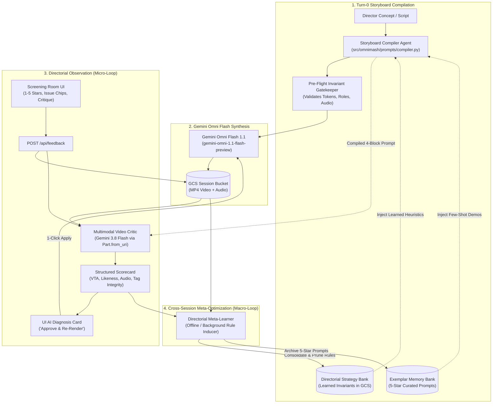
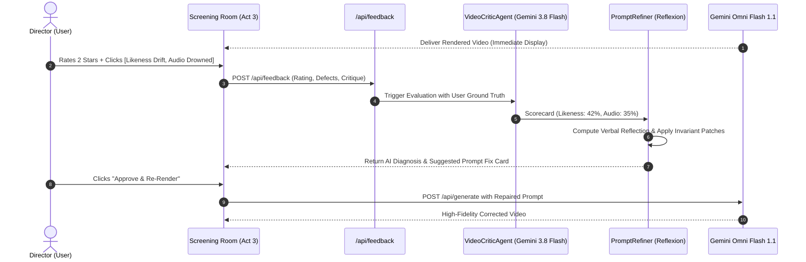

# Directorial Observability & Meta-Optimization Architecture (DOMA)
### Closed-Loop Multimodal Prompt Optimization & Directorial Memory Agent for OmniMash

---

## 1. Executive Summary & Problem Formulation

OmniMash is an AI-native video generation studio and engine designed to direct cinematic scenes, multi-turn conversational edits, and multi-scene narrative productions using **Gemini Omni Flash 1.1** (`gemini-omni-1.1-flash-preview` / `gemini-omni-flash-preview`). It orchestrates 4-block meta-prompts (`### INPUT ROLES & REFERENCES`, `### CHARACTER PROFILES`, `### SCENE INSTRUCTIONS`, `### TIMELINE`), coordinates character reference sheets, dual keyframes, and audio stems, and records session telemetry in Google Cloud Storage.

### 1.1. The Root Problem: The Open-Loop Feed-Forward Flaw
Despite sophisticated prompt compilers and guardrails, studio operations have repeatedly run into frustrating generation defects:
1. **Prompt Tag Collisions**: Duplicate or conflicting tags injected into character identifiers (e.g., `- Role A <IMAGE_REF_0> <IMAGE_REF_1>: Severus Snape (@Image1) (@Image2)`), confusing the Gemini Omni Flash multimodal role tokenizer.
2. **Phantom Keyframe Seeds & Index Shifts**: Misalignment between image byte lists and prompt ordinal tags, where character references are incorrectly tagged as `@Image1` while `@Image1` in Gemini's payload is occupied by a keyframe image, or where dead tokens like `<FIRST_FRAME>@KeyframeSeed` cause role misattribution.
3. **Character Likeness Drift & Latent Space Averaging**: Loss of facial identity across multi-character shots and conversational turns, exacerbated by redundant wardrobe descriptions contradicting attached reference sheets (*violating Zero Wardrobe Redundancy*).
4. **Audio Ducking & Vocal Intelligibility Defects**: Background beat tracks drowning out theatrical spoken dialogue due to unformatted audio stems lacking the `instrumental` declaration or using ineffective phrasing.

OmniMash currently operates as a **purely open-loop, feed-forward pipeline**:
$$\text{User Concept} \longrightarrow \text{Deconstruct} \longrightarrow \text{Compile 4-Block} \longrightarrow \text{Omni Flash Video Render} \longrightarrow \text{Output}$$

There is **zero observation of the rendered video artifact**, **zero persistence of directorial user feedback**, and **zero feedback loop** informing how the prompt compiler constructs initial prompts.

### 1.2. The Solution: DOMA Dual-Loop Architecture
To solve this permanently, we specify the **Directorial Observability & Meta-Optimization Architecture (DOMA)**. Grounded in Google internal evaluation frameworks (*Disney Gemini Video AutoRater*, *GenMedia AutoRater Core*, *SoundCloud Review Engine*) and state-of-the-art multimodal agent literature (*Reflexion*, *TextGrad*, *VBench*, *DSPy/MIPROv2*), DOMA introduces a dual-loop closed system:
- **Loop 1: Tactical In-Session Self-Refinement (Micro-Loop)**: A multimodal critic (`gemini-3.8-flash`) inspects the rendered video artifact from GCS against reference images and user feedback, offering 1-click surgical prompt patches before finalizing clips.
- **Loop 2: Strategic Cross-Session Meta-Optimization (Macro-Loop)**: An asynchronous rule inducer observes triplets of $(\text{Prompt}, \text{Video}, \text{User Feedback})$ across historical sessions, extracts invariant prompt construction heuristics into a **Directorial Strategy Bank**, and curates 5-star prompts into an **Exemplar Memory Bank**. When crafting *original* Turn-0 prompts for future sessions, the compiler queries these banks to prevent errors before a single video frame is rendered.

---

## 2. Research Grounding & Best Practices

DOMA synthesizes battle-tested patterns from Google internal production systems and top generative AI literature:

### 2.1. Internal Google Production Systems
1. **Disney Gemini Video AutoRater (`cloud-gtm/disney-gemini-autorater`, `cloud-ai-fde/disney-disney-gemini-autorater`)**:
   - Production evaluation system built for Disney on Google Cloud Run and Vertex AI.
   - Deconstructs video generation evaluation into a 4-stage pipeline:
     1. *Rubric Generation*: Deconstructs text prompts into 30–45 atomic verification criteria using `gemini-4-argon` / `gemini-3.8-flash`.
     2. *Parallel VQA Verification*: Evaluates the video against the rubric across 3 parallel calls for majority consensus.
     3. *Hierarchical Scoring*: Quantifies Video-Text Adherence (VTA), Image-to-Video (I2V) conditioning, and temporal artifacts.
     4. *Diagnostic Synthesis & Prompt Revision*: Synthesizes a structured JSON diagnostic report with actionable prompt rewrites.
2. **GenMedia AutoRater Core (`cloud-ai-fde/genmedia-autorater-core`)**:
   - Google enterprise evaluation framework for generative media.
   - Features pre-hooks, frame decomposition, multi-judge evaluation (Gemini temporal critic + aesthetic preference models), and automated decision engine with explicit verdicts: `PASS`, `WARN`, or `REWRITE_PROMPT`.
3. **SoundCloud / Cymbal Music Review Engine (`cloud-ai-fde/soundcloud-review-engine`)**:
   - Multimodal review engine that inspects media and continuously improves through **Human-in-the-Loop Learning Pipelines**.
   - Captures human reviewer feedback, aggregates it into distilled behavioral patterns, and dynamically enriches future agent prompts.
4. **Google Video Overviews Autorater Architecture (`video_overviews/autoraters`)**:
   - Google's standardized rater pattern utilizing `AutoraterInput` (text, images, video bytes/URIs) and `AutoraterResponse` (overall rating, category breakdown, critic feedback).

### 2.2. External Literature & Industry Benchmarks
1. **VBench (Zheng et al., CVPR 2024)**:
   - Deconstructs video quality into disentangled, orthogonal dimensions: Subject Consistency, Background Consistency, Temporal Flickering, Motion Smoothness, Dynamic Degree, Text-Video Alignment, and Aesthetic Quality.
   - Highlights that Video-LLMs suffer from temporal blind spots unless prompted with chronological chunking (`[0-3s]`, `[3-6s]`, `[6-10s]`).
2. **Reflexion: Language Agents with Verbal Reinforcement Learning (Shinn et al., NeurIPS 2023)**:
   - Demonstrates that verbal self-reflection stored in episodic memory outperforms reinforcement learning (RL) on generative tasks. When a trial fails, the agent writes a natural-language diagnostic critique that guides future attempts.
3. **TextGrad: Automatic Differentiation via Text (Yuksekgonul et al., Stanford 2024)**:
   - Treats prompt strings as trainable variables in a computation graph. Multimodal evaluators compute natural-language "gradients" (rich critiques) that are backpropagated to mutate and optimize prompt strings.
4. **DSPy & MIPROv2 (Khattab et al., Stanford 2024)**:
   - Multi-stage prompt optimization treating prompt instructions and few-shot exemplars as hyperparameters optimized against evaluation metrics.
5. **Retrieval-Augmented Prompt Optimization (RAPO, 2024)**:
   - Employs dual-branch optimization: one branch retrieves successful domain-specific modifiers from a curated exemplar bank, while the other applies learned stylistic transformations.

---

## 3. Architecture & Topology: The Dual-Loop Closed System



---

## 4. The Triplet Data Model

To observe the relationship between the prompt, the rendered video, and directorial feedback over multiple iterations, we introduce unified schemas in `src/omnimash/evaluation/models.py`:

```python
from __future__ import annotations

from datetime import datetime, timezone
from enum import Enum
from pydantic import BaseModel, Field


class DefectCategory(str, Enum):
    TAG_COLLISION = "TAG_COLLISION"
    PHANTOM_KEYFRAME = "PHANTOM_KEYFRAME"
    LIKENESS_DRIFT = "LIKENESS_DRIFT"
    WARDROBE_CONTRADICTION = "WARDROBE_CONTRADICTION"
    AUDIO_DROWNED = "AUDIO_DROWNED"
    AUDIO_VOCAL_HALLUCINATION = "AUDIO_VOCAL_HALLUCINATION"
    TEMPORAL_BEAT_MISSED = "TEMPORAL_BEAT_MISSED"
    OFFSCREEN_LIPSYNC_ERROR = "OFFSCREEN_LIPSYNC_ERROR"


class UserFeedbackRecord(BaseModel):
    feedback_id: str
    session_id: str
    turn_id: str
    rating: int = Field(ge=1, le=5, description="1 (Unusable) to 5 (Masterpiece)")
    defects: list[DefectCategory] = Field(default_factory=list)
    critique_text: str = ""
    timestamp: str = Field(default_factory=lambda: datetime.now(timezone.utc).isoformat())


class DimensionScore(BaseModel):
    score: float = Field(ge=0.0, le=100.0)
    passed: bool
    evidence: str
    timestamp_range: str | None = None


class VideoEvaluationScorecard(BaseModel):
    evaluation_id: str
    session_id: str
    turn_id: str
    overall_rating: float = Field(ge=0.0, le=100.0)
    video_text_adherence: DimensionScore
    character_likeness: DimensionScore
    audio_visual_harmony: DimensionScore
    tag_and_index_integrity: DimensionScore
    detected_defects: list[DefectCategory] = Field(default_factory=list)
    verbal_critique: str
    suggested_prompt_patch: str | None = None
    pass_verdict: bool


class DirectorialInvariantRule(BaseModel):
    rule_id: str
    category: DefectCategory
    trigger_pattern: str  # e.g., "two_or_more_characters_with_reference_sheets"
    invariant_directive: str  # The directive injected into Storyboard Compiler
    rationale: str
    confidence_score: float = Field(ge=0.0, le=1.0)
    times_applied: int = 0
    defect_reduction_rate: float = 0.0


class StrategyBank(BaseModel):
    version: str = "1.0.0"
    updated_at: str
    rules: list[DirectorialInvariantRule] = Field(default_factory=list)


class ExemplarPromptRecord(BaseModel):
    exemplar_id: str
    session_id: str
    concept: str
    style_preset: str
    compiled_4block_prompt: str
    scorecard: VideoEvaluationScorecard
    user_rating: int
    created_at: str
```

---

## 5. Component Deep Dive

### 5.1. Component 1: Multimodal Video Critic (`VideoCriticAgent`)
- **Model**: `gemini-3.8-flash` via the `google-genai` SDK (`location="global"`).
- **Execution**: Asynchronous background inspection initiated as soon as a video render completes and its GCS URI is registered.
- **Multimodal Ingestion**:
  ```python
  from google.genai import types

  video_part = types.Part.from_uri(
      file_uri=f"gs://{bucket_name}/sessions/{session_id}/renders/{clip_filename}",
      mime_type="video/mp4",
  )
  ```
- **Evaluation Rubric & Execution**:
  The Critic evaluates the video against the original 4-Block prompt and reference images across 4 orthogonal axes:
  1. **Video-Text Adherence (VTA)**: Validates each temporal block (`[0-3s]`, `[3-6s]`, `[6-10s]`). Did the character actions occur in sequence?
  2. **Character Likeness & Zero Wardrobe Redundancy**: Compares video frames at $t=2\text{s}, 5\text{s}, 8\text{s}$ against attached character reference sheets (`@Image1`, `@Image2`). Did faces morph? Did clothing deviate from the reference sheet?
  3. **Audio-Visual Balance**: Inspects the native audio stream. Does the background beat duck under spoken lines? Did the model hallucinate singing vocals when an instrumental was requested?
  4. **Tag & Index Symmetry**: Verifies that character references are ordinally aligned with multimodal payload slots.
- **Output**: Generates a complete `VideoEvaluationScorecard` with timestamped defect callouts.

---

### 5.2. Component 2: Director Review & Telemetry API
- **Endpoint**: `POST /api/feedback`
- **Request Body**:
  ```json
  {
    "session_id": "parody_session_1",
    "turn_id": "turn_001",
    "rating": 2,
    "defects": ["LIKENESS_DRIFT", "AUDIO_DROWNED"],
    "critique_text": "Dumbledore's face morphed into Voldemort at second 4, and the 808 bass drowned out his punchline."
  }
  ```
- **Persistence**: Saved directly to GCS at:
  `gs://omnimash-media-{project}/sessions/{session_id}/turns/{turn_id}/feedback.json`
- **UI Integration (Act 3: The Screening Room)**:
  - Adds a Directorial Review Bar below the video player.
  - Interactive 1–5 Star widget.
  - Quick-select defect chips (`[Likeness Drift]`, `[Phantom Seed]`, `[Tag Collision]`, `[Audio Drowned]`, `[Beat Missed]`).
  - Optional critique box with 1-click "Submit & Diagnose".

---

### 5.3. Component 3: Tactical In-Session Refiner (Micro-Loop)


- When a video receives a low rating ($\le 3$) or a critical defect is flagged:
- The **Prompt Refiner** consumes the triplet:
  $$\text{Input Triplet} = \left[ \text{Compiled 4-Block Prompt}, \text{Video Evaluation Scorecard}, \text{User Critique} \right]$$
- Utilizing the **Reflexion** framework, it writes an internal self-reflection:
  - *Reflection*: *"The likeness drifted because the prompt included extensive prose describing a wool robe which contradicted the attached reference sheet @Image1. The audio drowned because '140 BPM Trap' lacked the 'instrumental' keyword."*
  - *Correction*: Applies a surgical prompt patch:
    1. Removes conflicting wardrobe prose from `### CHARACTER PROFILES` (*Zero Wardrobe Redundancy*).
    2. Prepends `'instrumental'` to the audio stem and injects an explicit ducking directive.
    3. Locks face and background via `[PRESERVATION LOCK]`.
- **UI Action**: Displays an **"AI Directorial Diagnosis & Patch"** card in the Screening Room UI with an **"Approve & Re-Render"** button, giving the user complete transparency and control.

---

### 5.4. Component 4: Strategic Meta-Optimizer & Memory Bank (Macro-Loop)
This is the core engine that enables the agent to **get better at crafting the original video generation prompt**:

```text
Historical Triplet Archive (GCS)
       │
       ▼
Rule Induction Engine (Gemini 4 Argon / 3.8 Flash)
       │
       ├─► Directorial Strategy Bank (distilled invariant prompt rules)
       └─► Exemplar Memory Bank (curated 5-star few-shot exemplars)
       │
       ▼
Turn-0 Storyboard Compiler (src/omnimash/prompts/compiler.py)
       │
       ▼
Optimized Original Generation Prompt (Zero Errors on Turn 0)
```

1. **Directorial Strategy Bank (`meta/strategy_bank.json`)**:
   - Persisted centrally in GCS across all studio sessions.
   - Stores distilled invariant rules with confidence scores and defect reduction rates.
   - **Representative Distilled Invariants**:
     - *Rule #11 (Audio Ducking)*: "When user specifies an audio genre (e.g. trap, boom bap, rock), ALWAYS prefix with 'instrumental' and append 'subtly ducked in the background beneath spoken dialogue' in Block 3."
     - *Rule #17 (Zero Wardrobe Redundancy)*: "When a character has an attached `<IMAGE_REF_N>` reference sheet, omit all clothing/wardrobe prose from `### CHARACTER PROFILES`. Describe only non-visual personality and vocal delivery to prevent prompt-conditioning tension."
     - *Rule #24 (Dynamic Keyframe Offset)*: "When `<FIRST_FRAME>` keyframe seed is provided, character reference image indices MUST be offset to start at `@Image2` (or `@Image3` if dual-keyframe is active)."
     - *Rule #32 (Spatial Staging)*: "For multi-character interaction scenes with reference images, explicitly declare screen positions ('Role A on screen-left, Role B on screen-right') in `### SCENE INSTRUCTIONS` to prevent facial latent averaging."
2. **Exemplar Memory Bank (`meta/exemplar_bank.json`)**:
   - Automatically ingests prompts that achieve $\ge 4.5/5$ stars and a passed evaluation scorecard.
   - Indexed by genre, style tone, and character count.
   - When compiling a new concept, `StoryboardCompilerAgent` retrieves the 2 most relevant 5-star exemplars and injects them as few-shot demonstrations.
3. **Automated Rule Pruning & Conflict Resolution**:
   - To prevent prompt bloat and context explosion, the Meta-Learner performs **Pareto rule pruning**:
     - Deduplicates overlapping rules using semantic similarity embeddings.
     - Prunes rules that have not reduced defects over the last 20 sessions or whose confidence drops below $0.70$.
     - Caps active injected heuristics to the top-5 most relevant rules per scene.

---

### 5.5. Component 5: Pre-Flight Invariant Gatekeeper (`preflight_linter.py`)
To prevent invalid prompts from ever reaching Gemini Omni Flash:
- Runs deterministically in-memory before every API call to `/api/generate` or `/api/generate-shot`.
- Performs validation checks:
  1. *Token Check*: Verifies no duplicate or stacked tokens (e.g., `<IMAGE_REF_0> <IMAGE_REF_1>`).
  2. *Ordinal Alignment Check*: Verifies character references start at $1 + \text{len(keyframes)}$.
  3. *Zero Wardrobe Redundancy Check*: Verifies characters with attached image sheets have no conflicting clothing descriptions.
  4. *Audio Ducking Check*: Verifies beat stems contain `instrumental` and a ducking clause when dialogue is present.
- If a violation is found, the Gatekeeper repairs it automatically and logs a telemetry warning.

---

## 6. How DOMA Eliminates Historical Generation Defects

| Defect Class | Root Cause Mechanism | How DOMA Eliminates It Permanently |
| :--- | :--- | :--- |
| **Phantom Keyframe Seeds & Index Shifts** | Hardcoded starting index (`start_ref_idx = 1`) and dummy token leakage (`"KeyframeSeed"`). | Gatekeeper dynamically sets index to $1 + \text{len(keyframes)}$. Rule #24 ensures prompt tokens match multimodal payload slots 1:1. |
| **Prompt Tag Collisions** | Single-word token splitting (`source_name.split()`) colliding common words like "Potter". | `image_tags.py` restricts candidate keys to canonical full names. Gatekeeper asserts that each character identifier contains at most one tag. |
| **Character Likeness Drift & Latent Averaging** | Text wardrobe descriptions clashing with reference sheet image conditioning; lack of spatial staging. | Strategy Bank Rule #17 enforces Zero Wardrobe Redundancy. Rule #32 injects explicit left/right screen-staging directives. |
| **Audio Drowned Spoken Dialogue** | Audio beats lacking `instrumental` keyword, causing hallucinated vocal rapping over spoken lines. | Strategy Bank Rule #11 automatically prepends `instrumental` and appends `subtly ducked in the background beneath spoken dialogue`. |

---

## 7. Implementation Roadmap & Project Layout

### 7.1. New Directory & Module Structure
```text
src/omnimash/
├── evaluation/                      # [NEW EVALUATION & OPTIMIZATION MODULE]
│   ├── __init__.py
│   ├── models.py                   # Pydantic models (Feedback, Scorecard, InvariantRule)
│   ├── video_critic.py             # Multimodal Video Evaluator (gemini-3.8-flash)
│   ├── prompt_refiner.py           # Reflexion-based surgical prompt repair
│   ├── strategy_bank.py            # GCS-persisted Strategy & Exemplar Memory Manager
│   └── rule_inducer.py             # Macro-loop offline rule induction background worker
├── prompts/
│   ├── compiler.py                 # Injects Strategy Bank invariants & dynamic image indexing
│   ├── image_tags.py               # Hardens candidate key extraction to eliminate collisions
│   └── preflight_linter.py         # [NEW] Deterministic pre-flight invariant gatekeeper
├── agent/
│   ├── adk_pipeline.py             # Adds VideoCriticAgent to Google ADK production workflow
│   └── orchestrator.py             # Integrates feedback recording & auto-evaluation triggers
├── api/
│   ├── routers/
│   │   ├── feedback.py             # [NEW ROUTER] POST /api/feedback, GET /api/eval/scorecard
│   │   └── generation.py           # Triggers async VideoCritic on render completion
│   └── templates/index.html        # Adds Screening Room Directorial Review & AI Patch Card
└── storage/
    └── gcs.py                      # GCS persistence methods for scorecards, feedback & memory
```

### 7.2. Phased Rollout
1. **Phase 1: Telemetry, Models & Review UI**
   - Create `src/omnimash/evaluation/models.py`.
   - Implement `POST /api/feedback` and GCS feedback logging.
   - Add the Directorial Review Bar (1–5 stars + defect chips) in Act 3 of `index.html`.
2. **Phase 2: Multimodal Video Critic (`VideoCriticAgent`)**
   - Implement `src/omnimash/evaluation/video_critic.py` using `gemini-3.8-flash`.
   - Expose `GET /api/eval/scorecard/{turn_id}`.
   - Display the "AI Diagnosis & Suggested Prompt Fix" card in the Screening Room UI with 1-click "Approve & Re-Render".
3. **Phase 3: Strategy Bank & Pre-Flight Gatekeeper**
   - Create `src/omnimash/evaluation/strategy_bank.py` seeded with foundational invariants.
   - Implement `src/omnimash/prompts/preflight_linter.py` and hook it into `compiler.py` and `adk_pipeline.py`.
4. **Phase 4: Macro-Loop Rule Induction Engine**
   - Implement `src/omnimash/evaluation/rule_inducer.py` as an offline / scheduled background worker that analyzes feedback triplets across sessions and updates the Strategy Bank.

---

## 8. Confirmed Architectural Decisions

> [!IMPORTANT]
> **Decision 1: Hybrid Strategy Bank Scope & Agent Platform Memory Bank (CONFIRMED)**
> - **Platform Memory Bank Integration**: DOMA integrates directly with **Vertex AI Agent Platform Memory Bank** (`google-cloud-aiplatform` / ADK `PreloadMemoryTool`). Memory namespaces and sessions are automatically synchronized with Agent Engine memory services.
> - **Hybrid Scoping Architecture**:
>   - **Global Baseline**: Structural engineering invariants (token collision prevention, dynamic keyframe offset, instrumental audio prefix) are stored under the global agent namespace (`meta/strategy_bank.json`).
>   - **Project-Level Overrides**: Directorial stylistic preferences, character-specific pacing, and aesthetic nuances are partitioned per project (`user_id="project_{project_id}"` / `projects/{project_id}/strategy_bank.json`).
>   - **Dual-Layer Persistence**: The `StrategyBankManager` writes to both Vertex AI Agent Platform Memory Bank (for reasoning engine queries) and GCS JSON (for Cloud Run and local auditability).

> [!NOTE]
> **Decision 2: Execution Mode — On-Demand Studio + Always-On Test Suites (CONFIRMED)**
> - **Studio Web UI**: Delivers rendered video immediately (zero user wait time). `VideoCriticAgent` runs **on-demand** only when the user rates a clip $\le 3$ stars or clicks the **"🎯 Diagnose Shot"** button, preventing wasted API quota.
> - **Automated Test Suites & CI/CD**: Runs `VideoCriticAgent` **always-on** against test generations, asserting that prompt mutations maintain $>85\%$ Video-Text Adherence and zero tag/likeness defects.
