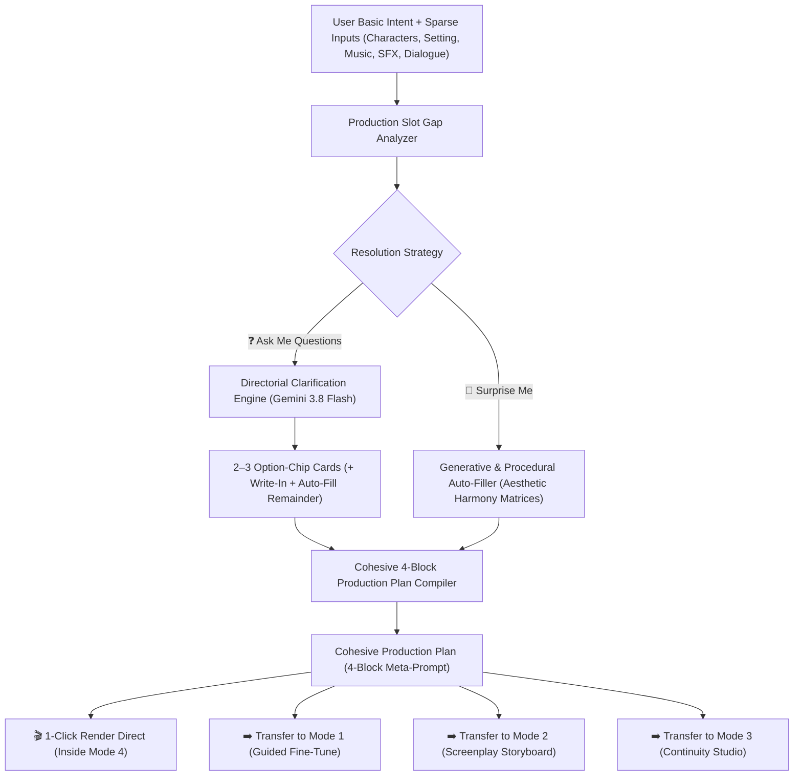

# Mode 4: Director's Co-Pilot (Intent Auto-Orchestrator) & Ubiquitous Cross-Mode Gap-Filling

This document details the architecture, 7-slot production model, directorial question clarification engine, aesthetic auto-filler, and ubiquitous cross-mode integration for **Mode 4: Director's Co-Pilot** in **omnimash**.

---

## 1. Architectural Motivation & Product Role

While existing creation modes in OmniMash cater to specialized workflows:
- **Mode 1 (Guided Fine-Tune):** Single-video target with aesthetic sliders and camera controls.
- **Mode 2 (Screenplay Storyboard):** Multi-scene theatrical script and storyboard sequence.
- **Mode 3 (Continuity Studio):** Multi-shot character consistency anchors and conversational diff branching.

**Mode 4: Director's Co-Pilot** is designed as the **simplest mode of all**. It requires zero technical, cinematic, or prompt engineering knowledge. A user enters a basic intent (e.g., *"Two chefs having an aggressive culinary rap battle"*), optionally provides any known specifics (characters, setting, music, sound effects, or dialogue), and OmniMash autonomously resolves the remaining production details into a cohesive 4-block Gemini Omni Flash prompt.

---

## 2. The 7-Slot Production Model

To generate high-cohesion video with `gemini-omni-1.1-flash`, the system resolves 7 distinct production dimensions:

| Slot | Dimension | Role & Description | Auto-Fill Strategy |
| :--- | :--- | :--- | :--- |
| **1** | **Core Intent & Conflict** | Overarching narrative premise and conflict. | Expanded from user's basic intent. |
| **2** | **Characters & Wardrobe** | Identified roles, visual descriptions, wardrobe tags, and vocal deliveries. | Vault character hydration or generated high-contrast pairs. |
| **3** | **Setting & Lighting** | Physical location and cinematic lighting ambiance. | Inferred from theme (e.g. *"Warm halogen spotlights with neon rim light"*). |
| **4** | **Camera Motion** | Continuous tracking instructions and optics. | Auto-configured continuous tracking shot (`"In a single continuous shot. No scene cuts. 35mm anamorphic tracking dolly"`). |
| **5** | **Background Music & BPM** | Musical genre and tempo. | Tempo-matched preset (e.g. *"140 BPM Heavy 808 Trap Beat"*). |
| **6** | **Sound Effects & Foley** | Diegetic audio cues. | Decoupled parenthetical cues (e.g. *"Sizzling laser stoves, knife chops, steam releases"*). |
| **7** | **Timeline & Dialogue** | Micro-action chronology (`[0-3s]`, `[3-6s]`, `[6-10s]`) with spoken dialogue. | Structured with speaker tags and vocal delivery directives. |

User-provided inputs are locked as **Immutable Anchors**; missing inputs become **Candidate Gaps**.

---

## 3. Dual Resolution Paths

### Branch A: Directorial Clarification Loop ("Ask Me Questions")
- Generates **2 to 3 high-impact multiple choice question cards** targeting the most important unfilled slots (e.g., visual tone, musical backdrop, character dynamic).
- Each question provides 3–4 vivid option chips plus a custom write-in field.
- **Zero-Friction Escape Hatch:** Every question includes a **"🎲 Auto-Fill Remainder & Generate Plan"** action, allowing the user to answer a single question and let AI finish the rest.

### Branch B: Procedural & Generative Auto-Filling ("Surprise Me")
- Instantly fills all remaining gaps using **Aesthetic Harmony Matrices** (e.g., Cyberpunk -> 140 BPM Dark Synth -> Anamorphic tracking shot -> Neon rim light).
- Automatically binds saved characters from the session vault.
- Compiles the canonical 4-block Gemini Omni Flash prompt.

---

## 4. Ubiquitous Cross-Mode Availability

The Director's Co-Pilot intelligence is available across all User Journey modes:

1. **Dedicated Mode 4 Studio Tab:**
   Accessed via the top mode switcher (`Mode 4: Director's Co-Pilot`). Styled in crisp **Cyan tokens** (`cyan-500`, `cyan-400`, `cyan-950/80`, `border-cyan-800/60`).
2. **Contextual Inbound Assistant in Modes 1, 2, and 3:**
   - **Mode 1 (Visual Concept):** Button `✨ Co-Pilot Gap Filler` opens the assist modal, inspects the concept, and auto-fills missing sliders/audio/wardrobe.
   - **Mode 2 (Screenplay):** Button `✨ Co-Pilot Script & Shot Generator` in Act 1/2 generates 3-scene screenplay scripts and shot cards.
   - **Mode 3 (Continuity Studio):** Button `✨ Co-Pilot Master Setup` synthesizes Master Description, Characters, and Style Preset.
3. **Outbound State Promotion Bar:**
   From Mode 4, users can render directly with 1 click, or click **"Open in Mode 1 / 2 / 3"** to promote the compiled plan into that mode's workflow for deeper manual fine-tuning.

---

## 5. REST APIs and Data Models

- **`POST /api/intent/analyze-gaps`**: Accepts `AnalyzeIntentGapsRequest`, determines missing slots, and returns 2–3 structured `ClarificationQuestion` items.
- **`POST /api/intent/auto-fill`**: Accepts `AutoFillIntentPlanRequest`, synthesizes missing slots, and returns `CohesiveProductionPlan`.
- **`POST /api/intent/render-direct`**: Directly translates the production plan into an Omni Flash generation turn and returns the rendered video.
- **Google ADK Agent:** `create_intent_clarifier_agent()` in `src/omnimash/agent/adk_pipeline.py`.
