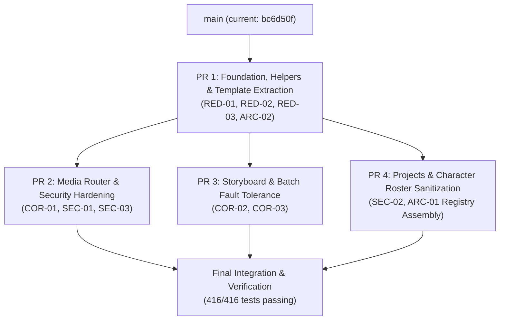

# API Architecture & Code Quality Remediation Plan

> **For Claude:** REQUIRED SUB-SKILL: Use superpowers:executing-plans to implement this plan task-by-task.

**Goal:** Remediate all 3 Critical and 7 Required findings from [`code_review.md`](../../code_review.md) across `src/omnimash/api`, modernizing the module into a modular, secure, high-performance, and maintainable architecture.

**Architecture:** Decompose the 11,060-line monolithic `app.py` into a lightweight core application (`main.py` / `app.py`) that serves an extracted template (`templates/index.html`), consumes shared helpers (`helpers.py`) and FastAPI dependencies (`deps.py`), and registers 4 domain-partitioned `APIRouter` modules (`routers/media.py`, `routers/storyboard.py`, `routers/projects.py`, `routers/characters.py`).

**Tech Stack:** Python 3.12, FastAPI 0.141.1, Starlette 1.7.0, Pydantic 2.14.1, Uvicorn 0.54.0, Google Cloud Storage Client.

---

## Executive Dependency Graph & Parallel PR Strategy

To minimize total execution wall-clock time, the remediation is structured into a foundation PR followed by three disjoint feature PRs that can be developed and verified concurrently in isolated git worktrees without merge conflicts:



### PR Work Breakdown & Parallel Execution Matrix

| PR | Target Branch | Scope & Remediation IDs | Files Owned (Zero Overlap) | Est. Dev Time |
| :--- | :--- | :--- | :--- | :--- |
| **PR 1 (Foundation)** | `refactor/api-foundation-helpers` | `RED-01`, `RED-02`, `RED-03`, `ARC-02` | `src/omnimash/api/templates/index.html`<br>`src/omnimash/api/deps.py`<br>`src/omnimash/api/helpers.py`<br>`src/omnimash/api/app.py` (template load) | ~15 mins |
| **PR 2 (Parallel)** | `fix/api-media-security-hardening` | `COR-01`, `SEC-01`, `SEC-03` | `src/omnimash/api/routers/media.py`<br>`tests/api/test_media_api.py` | ~20 mins |
| **PR 3 (Parallel)** | `fix/api-storyboard-batch-resilience` | `COR-02`, `COR-03` | `src/omnimash/api/routers/storyboard.py`<br>`tests/api/test_storyboard_api.py` | ~20 mins |
| **PR 4 (Parallel)** | `feat/api-projects-character-isolation` | `SEC-02`, `ARC-01` | `src/omnimash/api/routers/projects.py`<br>`src/omnimash/api/routers/characters.py`<br>`src/omnimash/api/app.py` (router inclusion) | ~20 mins |

---

## Detailed Issue Breakdown & Remedies

### 1. `COR-01`: Blocking Synchronous I/O in `async def upload_media_file`
- **File:** `src/omnimash/api/app.py:9618-9648` (migrating to `src/omnimash/api/routers/media.py`)
- **How We Fix It:**
  Change endpoint to standard synchronous `def upload_media_file` or wrap blocking disk writes (`with open(...)`) and GCS uploads (`agent.storage.upload_bytes`) with `await anyio.to_thread.run_sync(...)`. Reading the upload stream chunking will use `await file.read(...)` followed by offloaded disk/cloud writes:
  ```python
  @router.post("/api/upload")
  async def upload_media_file(
      file: Annotated[UploadFile, File()],
      agent: Annotated[OmniMashAgent, Depends(get_agent)],
  ):
      content = await file.read(max_upload_bytes + 1)
      # Offload blocking write to threadpool
      await anyio.to_thread.run_sync(
          _write_upload_bytes, agent, content, file.filename, file.content_type
      )
```
- **Expected Impact:** Eliminates main asyncio event loop freezes during multi-megabyte media uploads, preventing API starvation for concurrent users and SSE connections.

---

### 2. `COR-02`: Unhandled Exceptions in `generate_draft_batch` Abort the Entire Batch
- **File:** `src/omnimash/api/app.py:10603-10642` (migrating to `src/omnimash/api/routers/storyboard.py`)
- **How We Fix It:**
  Wrap worker execution in `_run_draft` in a comprehensive `try...except Exception as exc:` block:
  ```python
  def _run_draft(item: tuple[DraftBatchShotItem, int]) -> DraftBatchItem:
      shot, var_idx = item
      try:
          turn = agent.process_user_turn(...)
          return DraftBatchItem(
              shot_index=shot.shot_index,
              variation_index=var_idx,
              action=shot.action,
              resolution=req.resolution or "360p",
              status="COMPLETED" if turn.success else "FAILED",
              video_url=turn.video_url,
              gcs_uri=getattr(turn, "gcs_uri", None),
              turn_id=turn.turn_id,
              keyframe_image_url=shot.keyframe_image_url,
          )
      except Exception as exc:
          logger.error("Draft generation failed for shot %d: %s", shot.shot_index, exc)
          return DraftBatchItem(
              shot_index=shot.shot_index,
              variation_index=var_idx,
              action=shot.action,
              resolution=req.resolution or "360p",
              status="FAILED",
              video_url=None,
              gcs_uri=None,
              turn_id=None,
              keyframe_image_url=shot.keyframe_image_url,
          )
```
- **Expected Impact:** Individual generation failures (e.g. transient API timeout or content policy flag) no longer abort the entire batch of 6–12 variations; successful drafts are preserved and returned to the UI.

---

### 3. `COR-03`: Temporary File Descriptor & Disk Leak on Stitching Upload Failure
- **File:** `src/omnimash/api/app.py:10103-10116` and `10577-10590` (migrating to `src/omnimash/api/helpers.py`)
- **How We Fix It:**
  Consolidate into `helpers.stitch_and_upload_master(...)` and wrap GCS upload in a strict `try...finally` block:
  ```python
  def stitch_and_upload_master(
      agent: OmniMashAgent,
      shot_clips: list[str],
      title_cards: list[dict[str, Any]] | None = None,
      ...
  ) -> tuple[str, str]:
    master_path = agent.stitcher.stitch_storyboard_master(...)
    local_master_path = master_path
    try:
      if os.path.exists(master_path):
        gcs_uri = agent.storage.upload_file(master_path, gcs_dest)
        ...
        return master_path, master_url
    finally:
      if local_master_path.startswith("/tmp/") and os.path.exists(
          local_master_path
      ):
        try:
          os.remove(local_master_path)
        except OSError:
          pass
```
- **Expected Impact:** Guarantees zero residual `/tmp/` video file leaks upon network interruption, GCS quota errors, or stitch failures.

---

### 4. `SEC-01`: Memory Exhaustion (DoS Risk) via Full Blob Buffering in `media_proxy`
- **File:** `src/omnimash/api/app.py:10924-10950` (migrating to `src/omnimash/api/routers/media.py`)
- **How We Fix It:**
  Instead of downloading the entire blob via `download_blob_bytes(uri)` into a Python `bytes` buffer on every HTTP 206 range request:
  1. Inspect blob metadata (`blob.reload()`) to obtain `total_len` and `content_type` without fetching bytes.
  2. For ranged requests, download only the requested byte slice using `blob.download_as_bytes(start=start, end=end)` or stream via Starlette `StreamingResponse`.
  3. For mock/local files, seek and slice file streams without loading whole files into memory.
- **Expected Impact:** Reduces peak proxy RAM consumption from ~50MB per seek down to ~64KB per range chunk, completely eliminating out-of-memory DoS risk during concurrent multi-user video scrubbing.

---

### 5. `SEC-02`: Unsanitized Project & Session Names in GCS Storage Paths
- **File:** `src/omnimash/api/app.py:10723-L10750` (migrating to `src/omnimash/api/routers/projects.py`)
- **How We Fix It:**
  Add a strict Pydantic regex validator on `CreateProjectRequest.project_name` and `CreateSessionRequest.session_name`:
  ```python
  class CreateProjectRequest(BaseModel):
      project_name: str = Field(
          ...,
          pattern=r"^[a-zA-Z0-9_\-]+$",
          description="Alphanumeric, underscore, or hyphen only",
      )
```
  Add path parameter validation:
  ```python
  SafeIdentifier = Annotated[
      str,
      Path(pattern=r"^[a-zA-Z0-9_\-]+$", min_length=1, max_length=128),
  ]
```
- **Expected Impact:** Prevents path traversal vulnerabilities (`../`), newline injection, and cloud bucket namespace pollution.

---

### 6. `SEC-03`: Unvalidated File Extension & Content-Type in `/api/upload`
- **File:** `src/omnimash/api/app.py:9627-9635` (migrating to `src/omnimash/api/routers/media.py`)
- **How We Fix It:**
  Enforce explicit extension and MIME allowlists:
  ```python
  ALLOWED_MEDIA_EXTENSIONS = {
      ".mp4",
      ".mov",
      ".mp3",
      ".wav",
      ".jpg",
      ".jpeg",
      ".png",
      ".webp",
  }
  ALLOWED_MIME_PREFIXES = ("video/", "audio/", "image/")

  ext = os.path.splitext(file.filename or "")[1].lower()
  if ext not in ALLOWED_MEDIA_EXTENSIONS or not any(
      (file.content_type or "").startswith(p) for p in ALLOWED_MIME_PREFIXES
  ):
      raise HTTPException(status_code=400, detail=f"Unsupported file type: {ext}")
```
- **Expected Impact:** Rejects arbitrary executable payloads, HTML/SVG script injections, and unapproved binary files.

---

### 7. `ARC-01` & `ARC-02`: Modular `APIRouter` Architecture & Dependency Injection (`Depends`)
- **File:** `src/omnimash/api/app.py:9320-11050`
- **How We Fix It:**
  1. Create `src/omnimash/api/deps.py`:
     ```python
     from typing import Annotated
     from fastapi import Depends, Request
     from omnimash.agent.orchestrator import OmniMashAgent


     def get_agent(request: Request) -> OmniMashAgent:
         return request.app.state.agent


     AgentDep = Annotated[OmniMashAgent, Depends(get_agent)]
```
  2. Decompose routes into focused domain routers in `src/omnimash/api/routers/`:
     - `media.py`: `/api/upload`, `/api/motion-reference/upload`, `/api/media-proxy`
     - `storyboard.py`: `/api/storyboard/...`, `/api/generate-shot`, `/api/stitch-clips`
     - `projects.py`: `/api/projects/...`, `/api/sessions/...`
     - `characters.py`: `/api/characters/...`
     - `generation.py`: `/api/generate`, `/api/diff`, `/api/journey3/...`
  3. In `create_app`, include routers cleanly:
     ```python
     app.include_router(media.router)
     app.include_router(storyboard.router)
     app.include_router(projects.router)
     app.include_router(characters.router)
     app.include_router(generation.router)
```
- **Expected Impact:** Breaks down the 1,735-line closure into maintainable sub-300-line modules; enables unit testing of individual routers; permits clean dependency overriding in tests.

---

### 8. `RED-01`: 8,810-Line Embedded React SPA String Inside `app.py`
- **File:** `src/omnimash/api/app.py:507-9317`
- **How We Fix It:**
  1. Extract the raw HTML content into `src/omnimash/api/templates/index.html`.
  2. Implement cached template loader in `src/omnimash/api/app.py`:
     ```python
     _TEMPLATE_PATH = os.path.join(os.path.dirname(__file__), "templates", "index.html")
     _CACHED_UI_HTML: str | None = None


     def get_ui_html() -> str:
         global _CACHED_UI_HTML
         if _CACHED_UI_HTML is None:
             with open(_TEMPLATE_PATH, "r", encoding="utf-8") as f:
                 _CACHED_UI_HTML = f.read()
         return _CACHED_UI_HTML
```
  3. Export `UI_HTML = get_ui_html()` for full backward compatibility with existing tests (`from omnimash.api.app import UI_HTML`).
- **Expected Impact:** Shrinks `app.py` by 80% (from 11,060 lines down to ~2,250 lines initially, and <300 lines after router extraction), restoring IDE responsiveness, lint speed, and clean Git diffs.

---

### 9. `RED-02`: Verbatim 35-Line Character Normalization Loop Duplicated Across 5 Routes
- **File:** `src/omnimash/api/app.py:9420-9455`, `9700-9740`, `9896-9940`, `10308-10326`, `10425-10460`
- **How We Fix It:**
  Create a single canonical converter in `src/omnimash/api/helpers.py`:
  ```python
  def normalize_character_roles(
      characters: list[CharacterRoleModel | dict[str, Any]] | None,
      sanitize: bool = True,
  ) -> list[CharacterRole]:
      """Canonical normalization of mixed character inputs into CharacterRole objects."""
      if not characters:
          return []
      char_objs: list[CharacterRole] = []
      for c in characters:
          ...
      return char_objs
```
- **Expected Impact:** Deletes ~175 lines of duplicated parsing logic and ensures consistent sanitization and fallback behavior across all generation endpoints.

---

### 10. `RED-03`: Duplicate Storyboard Master Stitching Handlers
- **File:** `src/omnimash/api/app.py:10092-10125` and `10568-10601`
- **How We Fix It:**
  Unify in `src/omnimash/api/helpers.py`:
  ```python
  def stitch_and_upload_master(
      agent: OmniMashAgent,
      shot_clips: list[str],
      title_cards: list[dict[str, Any]] | None = None,
      narrator_audio_paths: list[str] | None = None,
      background_music_path: str | None = None,
      session_id: str | None = None,
      aspect_ratio: str = "16:9",
  ) -> tuple[str, str]:
      """Stitches master video, uploads to session GCS bucket, and ensures /tmp/ cleanup."""
```
- **Expected Impact:** Replaces 66 lines of copy-pasted upload and cleanup code with a clean 2-line call in both endpoints.

---

## Phased Implementation Plan

### Phase 1 (PR 1): Foundation, Helpers & Template Extraction
**Branch:** `refactor/api-foundation-helpers`
- **Tasks:**
  1. Extract `UI_HTML` to `src/omnimash/api/templates/index.html` and export backward-compatible `UI_HTML` accessor (`RED-01`).
  2. Create `src/omnimash/api/deps.py` with `get_agent` and `AgentDep` (`ARC-02`).
  3. Create `src/omnimash/api/helpers.py` with canonical `normalize_character_roles` (`RED-02`) and `stitch_and_upload_master` with `try...finally` disk cleanup (`RED-03`, `COR-03`).
- **Verification:**
  - `uv run pytest tests/api/test_app.py -v`
  - `uv run ruff check .`
  - `uv run ty check`

---

### Phase 2 (PR 2): Media Router & Security Hardening (Parallelizable)
**Branch:** `fix/api-media-security-hardening` (branched from PR 1)
- **Tasks:**
  1. Create `src/omnimash/api/routers/media.py` housing `/api/upload`, `/api/motion-reference/upload`, and `/api/media-proxy`.
  2. Implement `anyio.to_thread.run_sync` for upload writes (`COR-01`).
  3. Implement allowed extensions and MIME prefix validation (`SEC-03`).
  4. Implement GCS byte-range and stream chunking in `media_proxy` to eliminate DoS memory exhaustion (`SEC-01`).
- **Verification:**
  - `uv run pytest tests/api/test_phase3_media_security.py tests/api/test_app.py -k "test_api_media_proxy or test_api_upload" -v`

---

### Phase 3 (PR 3): Storyboard & Batch Fault Tolerance (Parallelizable)
**Branch:** `fix/api-storyboard-batch-resilience` (branched from PR 1)
- **Tasks:**
  1. Create `src/omnimash/api/routers/storyboard.py` housing `/api/storyboard/...`, `/api/generate-shot`, and `/api/stitch-clips`.
  2. Wrap `_run_draft` in `generate_draft_batch` with `try...except` to isolate variation failures (`COR-02`).
  3. Adopt `helpers.stitch_and_upload_master` with `try...finally` in storyboard stitching (`COR-03`, `RED-03`).
- **Verification:**
  - `uv run pytest tests/api/test_storyboard_library_api.py tests/api/test_phase1_shot_and_draft_bugs.py -v`

---

### Phase 4 (PR 4): Projects & Character Roster Sanitization (Parallelizable)
**Branch:** `feat/api-projects-character-isolation` (branched from PR 1)
- **Tasks:**
  1. Create `src/omnimash/api/routers/projects.py` and `src/omnimash/api/routers/characters.py`.
  2. Add regex validation pattern `^[a-zA-Z0-9_\-]+$` for project and session identifiers (`SEC-02`).
  3. Integrate `helpers.normalize_character_roles` (`RED-02`).
  4. Register all routers in `create_app` in `src/omnimash/api/app.py` (`ARC-01`).
- **Verification:**
  - `uv run pytest tests/api/test_character_api.py tests/api/test_concept_api.py -v`
  - `uv run pytest` (full 416-test suite)

---

## Verification Plan & Commands

For every PR and before any merge, execute the mandatory verification suite:

```bash
# 1. Static Type Checking
uv run ty check

# 2. Code Linting & Style
uv run ruff check .
uv run ruff format --check .

# 3. Targeted API & UI Tests
uv run pytest tests/api/test_app.py -k "test_ui_html_syntax_and_tag_balance or test_ui_html_renders_in_browser_without_syntax_error" -v
uv run pytest tests/api/test_app.py -v

# 4. Full Project Test Suite (All 416 Tests)
uv run pytest
```
