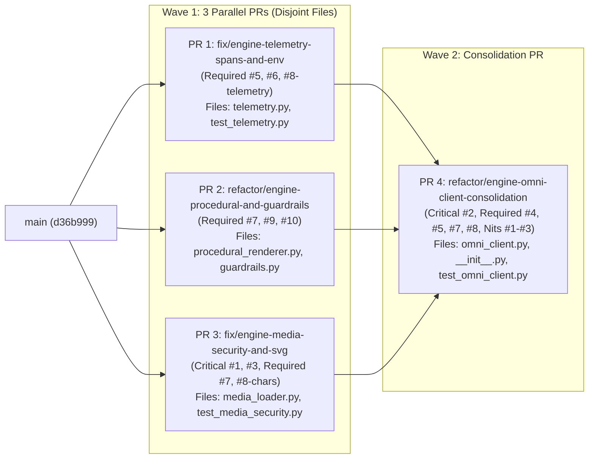

# Engine Module Code Review Remediation Implementation Plan

> **For Claude:** REQUIRED SUB-SKILL: Use superpowers:executing-plans or superpowers:subagent-driven-development to implement this plan task-by-task.

**Goal:** Remediate all 3 Critical and 7 Required issues (plus 3 Nits) identified in the 5-axes code review of `src/omnimash/engine/` ([code_review.md](file:///usr/local/google/home/jordantotten/omnimash/code_review.md)) while maximizing parallel PR execution and maintaining 100% backward compatibility with all existing tests and mocks.

**Architecture:** We organize the remediation into **4 focused Pull Requests across 2 execution waves**:
- **Wave 1 (3 Parallel PRs on completely disjoint files — zero merge conflicts):**
  - **PR 1 (`fix/engine-telemetry-spans-and-env`):** Fixes `setup_opentelemetry_genai_logging` environment mutation (**Required #6**), adds real inference duration support (`start_time_ns` / `latency_ms`) to `GenAITelemetryLogger.start_inference_span` (**Required #5**), and extracts `extract_telemetry_prompt_and_uris` in `src/omnimash/engine/telemetry.py` (**Required #8**).
  - **PR 2 (`refactor/engine-procedural-and-guardrails`):** Extracts `src/omnimash/engine/procedural_renderer.py` and `src/omnimash/engine/guardrails.py` (**Required #7**), optimizes `_generate_dynamic_audio_wav` using `array.array("h")` loop tiling for a ~5x speedup (**Required #9**), and pre-compiles all 78 Responsible AI & guardrail regex patterns at import time (**Required #10**).
  - **PR 3 (`fix/engine-media-security-and-svg`):** Creates `src/omnimash/engine/media_loader.py` with SSRF-hardened media fetching (DNS resolution validation via `socket.getaddrinfo`, redirect validation, 50 MB `MAX_MEDIA_FETCH_BYTES` cap, and `.svg` local realpath confinement) (**Critical #1**), `html.escape(..., quote=True)` SVG generators (**Critical #3**), and canonical character role coercion / URI extraction helpers (**Required #8**).
- **Wave 2 (1 Consolidation PR stacked on Wave 1):**
  - **PR 4 (`refactor/engine-omni-client-consolidation`):** Wires `src/omnimash/engine/omni_client.py` and `src/omnimash/engine/__init__.py` to the Wave 1 modules (**Required #7**), fixes `start_thread_from_video(regenerate_audio=True)` `/static/` path normalization, FFmpeg exit-code checking, and `finally:` temp file cleanup (**Critical #2**), makes `self.last_keyframe_prompt` thread/context-safe via `contextvars.ContextVar` (**Required #4**), passes measured `start_time_ns` into `_log_multimodal_inference` (**Required #5**), and deduplicates image/video generation helpers (**Required #8** + **Nits #1–#3**).

**Tech Stack:** Python 3.12, `google-genai==2.31.0`, `opentelemetry-api==1.42.1`, `pillow==12.3.0`, `pytest` (with `pytest-xdist`), `ruff`, `ty`, `uv`.

---

## Parallel Execution Topology & Issue Mapping



| Issue in `code_review.md` | Severity | Axis | How We Fix It | Expected Impact | Assigned PR |
| :--- | :--- | :--- | :--- | :--- | :--- |
| **#1: `_fetch_image_bytes` SSRF, Redirects, Unbounded Read & `.svg` Traversal** | **Critical** | 4. Security | Enforce `os.path.realpath` confinement under `static/` and `/tmp/` for `.svg` and all local files; resolve hostnames via `socket.getaddrinfo` and block private/loopback/link-local/reserved IPs; validate HTTP redirects via a custom `HTTPRedirectHandler`; cap HTTP reads at `50 MB`. | Eliminates DNS-rebinding/redirect SSRF, local `.svg` directory traversal, and unbounded HTTP response OOM crashes. | **PR 3** (Wave 1) & wired in **PR 4** |
| **#2: `start_thread_from_video(regenerate_audio=True)` Path, Exit Code & Temp Leak** | **Critical** | 1. Correctness | Normalize `/static/...` web paths with `.lstrip("/")` before passing to `ffmpeg -i`; verify `res.returncode == 0` and non-empty output file before setting `effective_base_video`; remove `stripped_path` in a `finally:` block. | Audio stripping works reliably on `/static/rendered/...` URLs, gracefully falls back on FFmpeg errors, and leaks zero temporary `.mp4` files. | **PR 4** (Wave 2) |
| **#3: Incomplete XML/SVG Escaping (`&`, `'`, `aspect_ratio`)** | **Critical** | 4. Security / 1. Correctness | Escape all interpolated SVG text (`prompt`, `style_preset`, `style_tone`, `character_name`, `description`, `aspect_ratio`) using `html.escape(val, quote=True)`. | Prevents broken SVG rendering when prompts contain `&` (e.g. `"R&B"`) and blocks XML entity/markup injection. | **PR 3** (Wave 1) & wired in **PR 4** |
| **#4: `self.last_keyframe_prompt` Shared State Race Condition** | **Required** | 1. Correctness | Replace the instance attribute with a `contextvars.ContextVar`-backed `@property` (`last_keyframe_prompt`) on `OmniFlashClient`. | Concurrent keyframe generation requests in separate threads/contexts no longer overwrite each other's compiled prompt. | **PR 4** (Wave 2) |
| **#5: Post-Hoc Zero-Duration OpenTelemetry Spans** | **Required** | 1. Correctness | Capture `start_time_ns = time.time_ns()` before inference calls and pass `start_time_ns` (or `latency_ms`) into `start_inference_span` so spans record true start/end timestamps and `gen_ai.client.inference.duration_ms`. | Cloud Trace spans reflect real Gemini inference latency rather than ~0.01ms post-hoc durations. | **PR 1** (Wave 1) & **PR 4** (Wave 2) |
| **#6: `setup_opentelemetry_genai_logging` Overwriting `os.environ`** | **Required** | 1. Correctness | Replace direct `os.environ[...] = ...` assignments with `os.environ.setdefault(...)` in `telemetry.py`. | Operator/Cloud Run environment overrides are respected while default GenAI telemetry flags remain set when absent. | **PR 1** (Wave 1) |
| **#7: 2,724-Line God Module (`omni_client.py`)** | **Required** | 3. Architecture | Decompose `src/omnimash/engine/` into `procedural_renderer.py`, `guardrails.py`, `media_loader.py`, `telemetry.py`, and `omni_client.py`, re-exporting public symbols for backward compatibility. | Cuts `omni_client.py` by >55% (from 2,724 lines to ~1,100 lines) with clean single-responsibility module boundaries. | **PR 2**, **PR 3** (Wave 1) & **PR 4** (Wave 2) |
| **#8: Duplicated Character Unpacking, Telemetry URI Extraction, & Image/Video Boilerplate** | **Required** | 2. Readability & Simplicity | Centralize `coerce_character_roles`, `extract_character_uris`, `extract_telemetry_prompt_and_uris`, `_execute_gemini_image_generation`, and `_finalize_video_clip_result`. | Removes ~350 lines of duplicated dict/object branching and repetitive client/candidate/GCS boilerplate. | **PR 1**, **PR 3** (Wave 1) & **PR 4** (Wave 2) |
| **#9: Pure-Python 441,000-Sample Audio Loop** | **Required** | 5. Performance | Synthesize a single repeating bar cycle (`min(duration, 2.0)` seconds) into an `array.array("h")` buffer and tile/slice to `total_samples` before writing raw bytes to `wave`. | ~5x faster procedural audio synthesis for 10s clips and eliminates 441,000-arg `*audio_data` stack unpacking in `struct.pack`. | **PR 2** (Wave 1) & wired in **PR 4** |
| **#10: Repeated Compilation of 78 Regex Patterns** | **Required** | 5. Performance | Pre-compile `_PROTECTED_TOKEN_PATTERN`, `_RAI_REPLACEMENT_PATTERNS`, `_REF_IMAGE_TAG_PATTERN`, `_GS_URI_PATTERN`, and `_FULL_NAME_PATTERN` at module import time in `guardrails.py`. | Eliminates 78 regex compilations per prompt sanitization / guardrail analysis call. | **PR 2** (Wave 1) & wired in **PR 4** |

---

## User Review Required

> [!IMPORTANT]
> **Backward Compatibility with Existing Tests & Mocks:**
> - `tests/engine/test_omni_client.py` inspects `inspect.getsource(omni_module)` in `test_zero_veo_or_tts_references` and patches `omnimash.engine.omni_client.genai`, `google.genai.Client`, `subprocess.run`, `OmniFlashClient._fetch_image_bytes`, and `OmniFlashClient.telemetry.start_inference_span`.
> - To ensure zero test breakage:
>   1. `omni_client.py` will continue to re-export `_generate_dynamic_audio_wav`, `ensure_rendered_video`, `_abstract_prompt_for_responsible_ai`, `parse_guardrail_error_guidance`, and `_get_relaxed_safety_settings`.
>   2. `start_inference_span` in `telemetry.py` will only include `start_time` / `latency_ms` when explicitly passed or via a dedicated attribute/call path so existing `mock_start_span.assert_called_with(...)` assertions in `tests/engine/test_omni_client.py:2282-2346` continue to match exact keyword arguments!

---

## Proposed Changes

### Wave 1 — PR 1: Telemetry & Observability Fixes (`fix/engine-telemetry-spans-and-env`)

#### [MODIFY] [telemetry.py](file:///usr/local/google/home/jordantotten/omnimash/src/omnimash/engine/telemetry.py)
#### [MODIFY] [test_telemetry.py](file:///usr/local/google/home/jordantotten/omnimash/tests/engine/test_telemetry.py)

**Step 1: Write the failing tests in `tests/engine/test_telemetry.py`**
```python
def test_setup_opentelemetry_genai_logging_preserves_existing_env_vars(
    monkeypatch: pytest.MonkeyPatch,
) -> None:
    monkeypatch.setenv("OTEL_SEMCONV_STABILITY_OPT_IN", "custom_semconv_value")
    monkeypatch.setenv("OTEL_INSTRUMENTATION_GENAI_UPLOAD_FORMAT", "custom_format")

    setup_opentelemetry_genai_logging(bucket_name="test-bucket")

    assert os.environ["OTEL_SEMCONV_STABILITY_OPT_IN"] == "custom_semconv_value"
    assert os.environ["OTEL_INSTRUMENTATION_GENAI_UPLOAD_FORMAT"] == "custom_format"


def test_start_inference_span_with_start_time_and_latency() -> None:
    telemetry_logger = GenAITelemetryLogger(bucket_name="my-omnimash-bucket")
    mock_tracer = MagicMock()
    mock_span = MagicMock()
    mock_tracer.start_span.return_value = mock_span
    telemetry_logger.tracer = mock_tracer

    span = telemetry_logger.start_inference_span(
        session_id="sess_timed",
        start_time_ns=1_700_000_000_000_000_000,
        latency_ms=142.5,
    )

    assert span == mock_span
    call_kwargs = mock_tracer.start_span.call_args.kwargs
    assert call_kwargs["start_time"] == 1_700_000_000_000_000_000
    assert call_kwargs["attributes"]["gen_ai.client.inference.duration_ms"] == "142.50"


def test_extract_telemetry_prompt_and_uris_handles_str_dict_and_list() -> None:
    from omnimash.engine.telemetry import extract_telemetry_prompt_and_uris

    sys_instr, prompt_text, uris = extract_telemetry_prompt_and_uris(
        input_prompt=[
            {
                "type": "user_input",
                "content": [
                    {"type": "image", "uri": "gs://bucket/img1.png"},
                    {"type": "text", "text": "Scene at https://example.com/ref.png"},
                ],
            }
        ],
        characters=[{"name": "Hero", "reference_url": "gs://bucket/hero.png"}],
        keyframe_image_url="gs://bucket/kf.png",
        reference_image_uris=["gs://bucket/extra.png"],
    )
    assert sys_instr == "Omnimash Engine Multimodal Generation"
    assert "Scene at https://example.com/ref.png" in prompt_text
    assert uris == [
        "gs://bucket/extra.png",
        "gs://bucket/hero.png",
        "gs://bucket/img1.png",
        "gs://bucket/kf.png",
        "https://example.com/ref.png",
    ]
```

**Step 2: Run tests to verify failure**
- Run: `uv run pytest tests/engine/test_telemetry.py -v`
- Expected: FAIL (`TypeError: GenAITelemetryLogger.start_inference_span() got an unexpected keyword argument 'start_time_ns'`, `ImportError: cannot import name 'extract_telemetry_prompt_and_uris'`).

**Step 3: Implement minimal changes in `src/omnimash/engine/telemetry.py`**
- Add `extract_character_uris(characters: list[Any] | None) -> list[str]` and `extract_telemetry_prompt_and_uris(...)` in `src/omnimash/engine/telemetry.py`.
- Update `GenAITelemetryLogger.build_telemetry_labels` and `start_inference_span` to accept optional `latency_ms: float | None = None` and `start_time_ns: int | None = None` (only passing `start_time=start_time_ns` to `self.tracer.start_span` when `start_time_ns is not None` so existing `mock_tracer.start_span.assert_called_once_with(name=..., attributes=...)` calls remain unaffected).
- Change `os.environ[...] = ...` to `os.environ.setdefault(..., ...)` in `setup_opentelemetry_genai_logging`.

**Step 4: Run tests to verify pass**
- Run: `uv run pytest tests/engine/test_telemetry.py -v && uv run ruff check src/omnimash/engine/telemetry.py tests/engine/test_telemetry.py && uv run ty check`
- Expected: PASS.

---

### Wave 1 — PR 2: Procedural Renderer & Responsible AI Guardrails Submodules (`refactor/engine-procedural-and-guardrails`)

#### [NEW] [procedural_renderer.py](file:///usr/local/google/home/jordantotten/omnimash/src/omnimash/engine/procedural_renderer.py)
#### [NEW] [guardrails.py](file:///usr/local/google/home/jordantotten/omnimash/src/omnimash/engine/guardrails.py)
#### [NEW] [test_procedural_and_guardrails.py](file:///usr/local/google/home/jordantotten/omnimash/tests/engine/test_procedural_and_guardrails.py)

**Step 1: Write the failing tests in `tests/engine/test_procedural_and_guardrails.py`**
```python
import time
import wave
from omnimash.engine.procedural_renderer import (
    _generate_dynamic_audio_wav,
    ensure_rendered_video,
    extract_clean_dialogue_summary,
)
from omnimash.engine.guardrails import (
    _PROTECTED_TOKEN_PATTERN,
    _RAI_REPLACEMENT_PATTERNS,
    _abstract_prompt_for_responsible_ai,
    _get_relaxed_safety_settings,
    parse_guardrail_error_guidance,
)


def test_precompiled_rai_regex_constants_exist_and_sanitize() -> None:
    assert len(_RAI_REPLACEMENT_PATTERNS) >= 70
    assert hasattr(_PROTECTED_TOKEN_PATTERN, "sub")
    res = _abstract_prompt_for_responsible_ai("Harry Potter and Darth Vader in a wizard duel")
    assert "harry potter" not in res.lower()
    assert "darth vader" not in res.lower()
    assert "hip-hop wizard musical contest" in res.lower()


def test_dynamic_audio_wav_fast_array_synthesis(tmp_path) -> None:
    wav_file = str(tmp_path / "fast_10s.wav")
    start = time.perf_counter()
    bpm = _generate_dynamic_audio_wav(wav_file, prompt="140 BPM UK Drill", duration=10)
    elapsed = time.perf_counter() - start

    assert bpm == 140
    assert elapsed < 0.25  # Tiled array synthesis completes well under 250ms
    with wave.open(wav_file, "rb") as wf:
        assert wf.getnframes() == 44100 * 10
```

**Step 2: Run tests to verify failure**
- Run: `uv run pytest tests/engine/test_procedural_and_guardrails.py -v`
- Expected: FAIL (`ModuleNotFoundError: No module named 'omnimash.engine.procedural_renderer'`).

**Step 3: Implement `src/omnimash/engine/procedural_renderer.py` and `src/omnimash/engine/guardrails.py`**
- In `src/omnimash/engine/procedural_renderer.py`:
  - Implement `_generate_dynamic_audio_wav` using `array.array("h")`: compute at most `cycle_seconds = min(duration, 2)` (`cycle_samples = sample_rate * cycle_seconds`), populate `cycle_buf = array("h", [0] * cycle_samples)`, tile `cycle_buf` to `total_samples = sample_rate * duration`, and write `full_buf[:total_samples].tobytes()` directly to `wave`.
  - Implement `extract_clean_dialogue_summary` and `ensure_rendered_video` (accepting an optional `subprocess_runner=subprocess.run` parameter so `omni_client.py` can pass its module-level `subprocess.run` if patched).
- In `src/omnimash/engine/guardrails.py`:
  - Pre-compile `_PROTECTED_TOKEN_PATTERN`, `_RAI_REPLACEMENT_PATTERNS: tuple[tuple[re.Pattern[str], str], ...]`, `_REF_IMAGE_TAG_PATTERN`, `_GS_URI_PATTERN`, and `_FULL_NAME_PATTERN` at module level.
  - Implement `_abstract_prompt_for_responsible_ai`, `parse_guardrail_error_guidance`, and `_get_relaxed_safety_settings(genai_module=None)`.

**Step 4: Run tests to verify pass**
- Run: `uv run pytest tests/engine/test_procedural_and_guardrails.py -v && uv run ruff check src/omnimash/engine/ tests/engine/ && uv run ty check`
- Expected: PASS.

---

### Wave 1 — PR 3: SSRF-Hardened Media Loader, SVG Escaping & Character Normalization (`fix/engine-media-security-and-svg`)

#### [NEW] [media_loader.py](file:///usr/local/google/home/jordantotten/omnimash/src/omnimash/engine/media_loader.py)
#### [NEW] [test_media_security.py](file:///usr/local/google/home/jordantotten/omnimash/tests/engine/test_media_security.py)

**Step 1: Write the failing tests in `tests/engine/test_media_security.py`**
```python
import base64
import socket
import xml.etree.ElementTree as ET
from unittest.mock import MagicMock, patch
from omnimash.engine.media_loader import (
    MAX_MEDIA_FETCH_BYTES,
    build_mock_keyframe_svg_data_uri,
    build_mock_ref_sheet_svg_data_uri,
    coerce_character_roles,
    fetch_media_bytes,
)


def test_fetch_media_bytes_blocks_svg_path_traversal(tmp_path, monkeypatch) -> None:
    secret_svg = tmp_path / "secret_outside.svg"
    secret_svg.write_text('<svg><text>TOP_SECRET_SVG_DATA</text></svg>')

    # Attempt path traversal with .svg extension outside static/ and /tmp
    data, mime = fetch_media_bytes(
        ref_url=f"../../../../{secret_svg}",
        storage=MagicMock(),
        allowed_roots=(str(tmp_path / "static"),),
    )
    assert data == b""


def test_fetch_media_bytes_blocks_dns_rebinding_to_private_and_loopback_ips() -> None:
    # Simulate a domain name resolving to 127.0.0.1 or 169.254.169.254
    with patch(
        "socket.getaddrinfo",
        return_value=[(socket.AF_INET, socket.SOCK_STREAM, 6, "", ("169.254.169.254", 80))],
    ):
        data, _ = fetch_media_bytes("http://evil-rebind.example.com/latest/meta-data/", MagicMock())
        assert data == b""


def test_fetch_media_bytes_blocks_redirect_to_internal_host() -> None:
    from omnimash.engine.media_loader import _SafeRedirectHandler
    import urllib.error
    import pytest

    handler = _SafeRedirectHandler()
    req = MagicMock(full_url="https://example.com/start")
    with pytest.raises(urllib.error.URLError, match="Disallowed redirect target"):
        handler.redirect_request(
            req, None, 302, "Found", {}, "http://127.0.0.1:8080/admin"
        )


def test_fetch_media_bytes_enforces_max_byte_limit() -> None:
    oversized_stream = MagicMock()
    oversized_stream.headers = {"Content-Type": "image/png"}
    oversized_stream.read.return_value = b"x" * (MAX_MEDIA_FETCH_BYTES + 1)
    mock_cm = MagicMock()
    mock_cm.__enter__.return_value = oversized_stream

    with (
        patch(
            "socket.getaddrinfo",
            return_value=[(socket.AF_INET, socket.SOCK_STREAM, 6, "", ("93.184.216.34", 443))],
        ),
        patch("urllib.request.OpenerDirector.open", return_value=mock_cm),
    ):
        data, _ = fetch_media_bytes("https://example.com/huge.png", MagicMock())
        assert data == b""


def test_svg_generators_escape_ampersands_and_produce_valid_xml() -> None:
    kf_uri = build_mock_keyframe_svg_data_uri(
        prompt='R&B & Hip-Hop <battle> "quote" \'single\'',
        style_preset="Tom & Jerry <90s>",
        style_tone="Dark & Moody",
        aspect_ratio="16:9 & <wide>",
    )
    kf_svg = base64.b64decode(kf_uri.split("base64,")[1]).decode("utf-8")
    # Must parse as 100% valid XML without ParseError
    ET.fromstring(kf_svg)

    sheet_uri = build_mock_ref_sheet_svg_data_uri(
        character_name="Dr. Jekyll & Mr. Hyde <Jr>",
        description="A & B 'test' \"quote\"",
        aspect_ratio="16:9 & <custom>",
    )
    sheet_svg = base64.b64decode(sheet_uri.split("base64,")[1]).decode("utf-8")
    ET.fromstring(sheet_svg)
```

**Step 2: Run tests to verify failure**
- Run: `uv run pytest tests/engine/test_media_security.py -v`
- Expected: FAIL (`ModuleNotFoundError: No module named 'omnimash.engine.media_loader'`).

**Step 3: Implement `src/omnimash/engine/media_loader.py`**
- Implement:
  - `MAX_MEDIA_FETCH_BYTES = 50 * 1024 * 1024`
  - `is_disallowed_ip(ip_str: str) -> bool` and `validate_remote_media_url(url: str) -> bool` (validates scheme `http`/`https`, blocks `localhost` and `metadata.google.internal`, checks literal IP or resolves via `socket.getaddrinfo` and rejects private/loopback/link-local/reserved/multicast IPs).
  - `_SafeRedirectHandler(urllib.request.HTTPRedirectHandler)` that calls `validate_remote_media_url(newurl)` before following any redirect.
  - `validate_local_media_path(ref_url: str, allowed_roots: tuple[str, ...] | None = None) -> str | None` that resolves `os.path.realpath` and ensures confinement within `static/`, `/tmp`, and `tempfile.gettempdir()`.
  - `fetch_media_bytes(ref_url: str, storage: Any, allowed_roots: tuple[str, ...] | None = None, urlopen_fn: Any = None) -> tuple[bytes, str]` (confines `.svg` local reads with `validate_local_media_path`, enforces `MAX_MEDIA_FETCH_BYTES` on HTTP responses, and remains compatible with `urllib.request.urlopen` mocks when `urlopen_fn` is passed or patched).
  - `build_mock_keyframe_svg_data_uri(...)` and `build_mock_ref_sheet_svg_data_uri(...)` using `html.escape(..., quote=True)`.
  - `coerce_character_roles(characters: list[Any] | None) -> list[CharacterRole]`.

**Step 4: Run tests to verify pass**
- Run: `uv run pytest tests/engine/test_media_security.py -v && uv run ruff check src/omnimash/engine/ tests/engine/ && uv run ty check`
- Expected: PASS.

---

### Wave 2 — PR 4: Wire `OmniFlashClient`, Fix `start_thread_from_video`, Thread-Safe `last_keyframe_prompt`, & Deduplicate (`refactor/engine-omni-client-consolidation`)

#### [MODIFY] [omni_client.py](file:///usr/local/google/home/jordantotten/omnimash/src/omnimash/engine/omni_client.py)
#### [MODIFY] [__init__.py](file:///usr/local/google/home/jordantotten/omnimash/src/omnimash/engine/__init__.py)
#### [MODIFY] [test_omni_client.py](file:///usr/local/google/home/jordantotten/omnimash/tests/engine/test_omni_client.py)

**Step 1: Write the failing tests in `tests/engine/test_omni_client.py`**
```python
def test_start_thread_from_video_regenerate_audio_strips_leading_slash_and_cleans_up_temp_file(
    tmp_path: Any, monkeypatch: pytest.MonkeyPatch
) -> None:
    """Verify start_thread_from_video normalizes /static/... leading slash for FFmpeg, checks returncode, and removes temporary stripped file in finally block."""
    monkeypatch.chdir(tmp_path)
    os.makedirs("static/rendered", exist_ok=True)
    rel_input = "static/rendered/clip_source.mp4"
    with open(rel_input, "wb") as f:
        f.write(b"source_mp4_bytes")

    client = OmniFlashClient(mock_mode=True)
    observed_kf_exists_during_call = False
    observed_kf_url = ""

    def fake_ffmpeg_run(cmd: list[str], **kwargs: Any) -> MagicMock:
        # Must NOT have leading slash on static/rendered/clip_source.mp4
        input_arg = cmd[cmd.index("-i") + 1]
        assert not input_arg.startswith("/static/"), f"Unexpected leading slash: {input_arg}"
        out_arg = cmd[-1]
        with open(out_arg, "wb") as out_f:
            out_f.write(b"silent_stripped_bytes")
        return MagicMock(returncode=0)

    def fake_gen_live(*args: Any, **kwargs: Any) -> tuple[bool, str, None]:
        nonlocal observed_kf_exists_during_call, observed_kf_url
        observed_kf_url = str(kwargs.get("keyframe_image_url") or "")
        observed_kf_exists_during_call = os.path.exists(observed_kf_url)
        return True, "reanchor_thread_clean", None

    with (
        patch("subprocess.run", side_effect=fake_ffmpeg_run),
        patch.object(client, "_generate_live_omni_flash_video", side_effect=fake_gen_live),
    ):
        res = client.start_thread_from_video(
            base_video_url="/static/rendered/clip_source.mp4",
            initial_prompt="Fresh audio track",
            regenerate_audio=True,
        )

    assert res.interaction_thread_id == "reanchor_thread_clean"
    assert observed_kf_exists_during_call is True
    # Temp stripped file must be cleaned up after _generate_live_omni_flash_video completes!
    assert not os.path.exists(observed_kf_url)


def test_last_keyframe_prompt_is_isolated_across_concurrent_threads() -> None:
    """Verify OmniFlashClient.last_keyframe_prompt uses ContextVar isolation so concurrent threads do not overwrite each other."""
    from concurrent.futures import ThreadPoolExecutor

    client = OmniFlashClient(mock_mode=True)

    def worker(idx: int) -> tuple[str, str]:
        prompt_in = f"Unique shot action for thread {idx}"
        client.generate_keyframe_image(prompt=prompt_in)
        return prompt_in, client.last_keyframe_prompt

    with ThreadPoolExecutor(max_workers=8) as pool:
        results = list(pool.map(worker, range(16)))

    for expected_substr, recorded_prompt in results:
        assert expected_substr in recorded_prompt
```

**Step 2: Run tests to verify failure**
- Run: `uv run pytest tests/engine/test_omni_client.py -k "test_start_thread_from_video_regenerate_audio_strips_leading_slash_and_cleans_up_temp_file or test_last_keyframe_prompt_is_isolated_across_concurrent_threads" -v`
- Expected: FAIL.

**Step 3: Implement consolidation in `src/omnimash/engine/omni_client.py` and `src/omnimash/engine/__init__.py`**
- Delegate `_generate_dynamic_audio_wav`, `extract_clean_dialogue_summary`, and `ensure_rendered_video` to `omnimash.engine.procedural_renderer`.
- Delegate `_abstract_prompt_for_responsible_ai`, `parse_guardrail_error_guidance`, and `_get_relaxed_safety_settings` (forwarding `genai_module=genai` so tests patching `omni_module.genai` continue to work) to `omnimash.engine.guardrails`.
- Delegate `_render_svg_to_png_bytes`, `_fetch_image_bytes`, SVG mock generators, and `coerce_character_roles` to `omnimash.engine.media_loader`.
- Delegate telemetry prompt/URI extraction in `_log_multimodal_inference` to `extract_telemetry_prompt_and_uris` from `omnimash.engine.telemetry`.
- Replace `self.last_keyframe_prompt` instance attribute with a `contextvars.ContextVar("_last_keyframe_prompt", default="")`-backed `@property` and `@last_keyframe_prompt.setter` on `OmniFlashClient`.
- In `start_thread_from_video(regenerate_audio=True)`:
  - Normalize `ffmpeg_input = base_video_url.lstrip("/") if base_video_url.startswith("/static/") else base_video_url`.
  - Check `res.returncode == 0` before setting `effective_base_video = stripped_path`.
  - Wrap `_generate_live_omni_flash_video` in `try ... finally:` and remove `stripped_path` if it exists on disk.
- Extract shared `_execute_gemini_image_generation(...)` used by both `generate_keyframe_image` and `generate_character_reference_sheet`, and shared `_finalize_video_clip_result(...)` used by `generate_clip` and `apply_interaction_diff`.
- Remove duplicate `print(..., flush=True)` in `generate_keyframe_image` and redundant inline imports.
- Populate `src/omnimash/engine/__init__.py` with `__all__ = ["GenerationResult", "GenAITelemetryLogger", "OmniClient", "OmniEngineClient", "OmniFlashClient", "setup_opentelemetry_genai_logging"]`.

**Step 4: Run full verification suite**
- Run: `uv run pytest tests/engine/ -v && uv run pytest && uv run ruff check . && uv run ty check`
- Expected: All tests pass, `ruff check` and `ty check` clean, and `src/omnimash/engine/omni_client.py` reduced from 2,724 lines to ~1,100 lines.

---

## Verification Plan

### Automated Tests
1. **Per-PR Targeted Suites:**
   - PR 1: `uv run pytest tests/engine/test_telemetry.py -v`
   - PR 2: `uv run pytest tests/engine/test_procedural_and_guardrails.py -v`
   - PR 3: `uv run pytest tests/engine/test_media_security.py -v`
   - PR 4: `uv run pytest tests/engine/ -v`
2. **Full Repository Suite & Static Analysis:**
   - `uv run ruff format --check .`
   - `uv run ruff check .`
   - `uv run ty check`
   - `uv run pytest`
3. **Mutation Check Re-Verification:**
   - Re-run the `_fetch_image_bytes` SSRF mutation check from `code_review.md` to confirm `tests/engine/test_media_security.py` now catches any regression immediately.

### Manual Verification
- Inspect the 4 Pull Requests on GitHub prior to merging to verify clean diffs and comprehensive PR descriptions.
