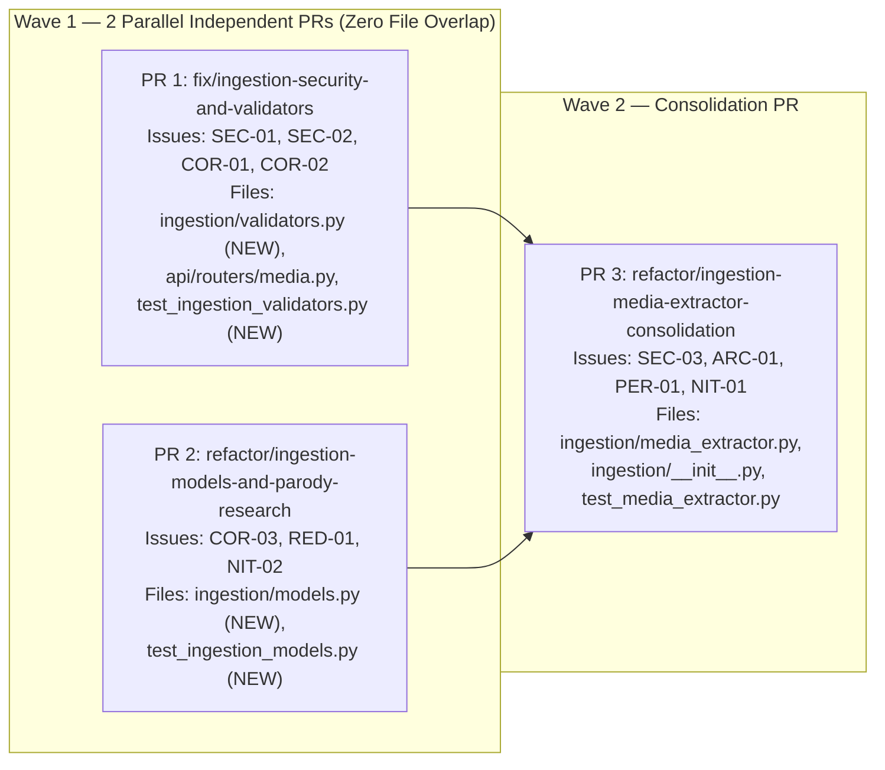

# `src/omnimash/ingestion` Code Review Remediation Implementation Plan

> **For Claude:** REQUIRED SUB-SKILL: Use superpowers:executing-plans to implement this plan task-by-task.

**Goal:** Remediate all **3 Critical** and **6 Required** issues (plus **2 Nits**) identified in the 5-axes code review of `src/omnimash/ingestion/` ([code_review.md](file:///usr/local/google/home/jordantotten/omnimash/code_review.md)), organized into **3 logical Pull Requests across 2 execution waves** so Wave 1 PRs execute 100% in parallel with zero merge conflicts.

**Architecture:** Extract pure validation/security logic (`src/omnimash/ingestion/validators.py`) and domain models/parody synthesis (`src/omnimash/ingestion/models.py`) in two parallel Wave 1 PRs that touch completely disjoint files. Then consolidate `src/omnimash/ingestion/media_extractor.py` and `src/omnimash/ingestion/__init__.py` in Wave 2 to wire the new validators, remove dead `/tmp/mock_frame_*.jpg` writes, collapse the 3x keyframe boilerplate into a declarative spec loop with parallel live GCS uploads, and expose a clean package export surface.

**Tech Stack:** Python 3.12 (`concurrent.futures`, `dataclasses`, `math`, `os`, `re`, `subprocess`, `urllib.parse`), `Pillow` (`12.3.0`), `yt-dlp` (`2026.08.19`), `FFmpeg` (`8.1.2`), `pytest` (`9.1.1`), `ruff`, `ty`.

---

## Issue-by-Issue Fix & Expected Impact Matrix

| Issue ID | Severity | Axis | How We Will Fix It | Expected Impact |
| :--- | :---: | :---: | :--- | :--- |
| **`SEC-01`** | **Critical** | Security | Create `validate_youtube_reference_url(url)` in `validators.py` enforcing `http`/`https`, checking an explicit YouTube hostname allowlist (`youtube.com`, `www.youtube.com`, `m.youtube.com`, `youtu.be`, `music.youtube.com`, `youtube-nocookie.com`), and calling `validate_remote_media_url(url)` for DNS-rebinding/private-IP protection; also set `allowed_extractors: ["youtube", "youtube:tab"]` in `ydl_opts`. | Eliminates SSRF and arbitrary `yt-dlp` extractor execution on `POST /api/extract-reference` while keeping legitimate YouTube URLs working seamlessly. |
| **`SEC-02`** | **Critical** | Security | Add `sanitize_ingestion_session_id(session_id)` in `validators.py` enforcing `^[a-zA-Z0-9_\-]+$` (rejecting `..`, `/`, `\`, and null bytes with `ValueError`), verify `os.path.realpath(local_dir)` stays inside `os.path.realpath("static/sessions")`, and validate `req.session_name` in `POST /api/extract-reference` (`media.py`). | Blocks directory traversal (`../../../`) when writing extracted keyframe JPEGs to `static/sessions/<sid>/references`. |
| **`COR-01`** | **Critical** | Correctness | Add `normalize_and_validate_clip_paths(source_video_path, output_clip_path)` in `validators.py` to strip leading `/` from `/static/...` web URLs returned by `/api/upload`, reject `-` flag-injection prefixes, and verify path confinement under `static/` or `/tmp/`. | Fixes `PermissionError: [Errno 13] Permission denied: '/static'` when cropping uploaded videos via `/api/motion-reference/upload`. |
| **`SEC-03`** | **Required** | Security / Dead Code | Delete the unused `/tmp/mock_frame_1.jpg`..`/tmp/mock_frame_3.jpg` copy loop in `analyze_youtube_reference`. | Eliminates CWE-377 predictable `/tmp` symlink/TOCTOU risk and cross-worker race conditions under `pytest-xdist`. |
| **`COR-02`** | **Required** | Correctness | Add `sanitize_clip_timing(start_time_seconds, duration_seconds)` in `validators.py` using `math.isfinite()` to reject/clamp `NaN`, `inf`, negative start times, and non-positive durations (`0.1 <= duration <= 60.0`, default `3.0`). | Prevents invalid `-ss nan` / `-t -5` arguments from breaking `ffmpeg` invocations. |
| **`COR-03`** | **Required** | Correctness | Implement `build_parody_research_result(subject, aesthetic)` in `models.py` that dynamically incorporates non-default `subject` and `aesthetic` inputs into `synopsis`, `suggested_props`, `suggested_vibe`, `suggested_audio`, and `suggested_dialogue` while preserving the classic Hogwarts/Atlanta Trap defaults when inputs match or are empty. | Ensures `POST /api/research` and `research_parody_clash()` return tailored parody research matching the user's requested subject and aesthetic. |
| **`RED-01`** | **Required** | Readability | Define `KeyframeSpec` and `DEFAULT_KEYFRAME_SPECS` in `models.py` and replace the 3x copy-pasted keyframe generation, upload, and `KeyframeAnnotation` blocks in `analyze_youtube_reference` with a single loop. | Cuts ~55 lines of repetitive boilerplate in `analyze_youtube_reference` and makes keyframe definitions declarative. |
| **`ARC-01`** | **Required** | Architecture | Re-export `MediaExtractor`, `ExtractedReference`, `KeyframeAnnotation`, `ParodyResearchResult`, and `ReferenceAnalysisReport` in `src/omnimash/ingestion/__init__.py` with `__all__`. | Establishes a clean public package boundary (`from omnimash.ingestion import MediaExtractor, ...`) consistent with `omnimash.engine`. |
| **`PER-01`** | **Required** | Performance | Remove the 3 redundant `/tmp/mock_frame_*.jpg` disk copies and upload the 3 generated keyframe JPEGs concurrently via `ThreadPoolExecutor(max_workers=3)` when `not self.storage.mock_mode`. | Reduces live GCS upload wall-clock latency by ~3x and removes 3 unnecessary disk writes per call. |
| **`NIT-01` & `NIT-02`** | **Nit** | Readability | Move `from omnimash.config import settings` to module top-level in `media_extractor.py` and extract `KEYFRAME_WIDTH = 1280`, `KEYFRAME_HEIGHT = 720`, `JPEG_QUALITY = 90` constants in `models.py`. | Improves module consistency and self-documenting image constants. |

---

## Parallel Execution Topology (Minimal Total Execution Time)



> [!IMPORTANT]
> **Why This Topology Minimizes Execution Time:**
> - **Wave 1 (PRs 1 & 2)** branches directly off `main` and touches **100% disjoint files**. Both PRs can be implemented, tested, linted, and reviewed simultaneously without any merge conflict.
> - **Wave 2 (PR 3)** merges Wave 1 and updates `src/omnimash/ingestion/media_extractor.py`, `src/omnimash/ingestion/__init__.py`, and `tests/ingestion/test_media_extractor.py`.

---

## Proposed Changes & Bite-Sized Tasks

### Task 1 (Wave 1 — PR 1): Ingestion Security & Input Validators (`fix/ingestion-security-and-validators`)

**Resolves:** `SEC-01` (Critical), `SEC-02` (Critical), `COR-01` (Critical), `COR-02` (Required)

**Files:**
- Create: [validators.py](file:///usr/local/google/home/jordantotten/omnimash/src/omnimash/ingestion/validators.py)
- Modify: [media.py](file:///usr/local/google/home/jordantotten/omnimash/src/omnimash/api/routers/media.py#L253-L257)
- Test: [test_ingestion_validators.py](file:///usr/local/google/home/jordantotten/omnimash/tests/ingestion/test_ingestion_validators.py)

**Step 1: Write the failing tests in `tests/ingestion/test_ingestion_validators.py`**

```python
import pytest

from omnimash.ingestion.validators import (
    normalize_and_validate_clip_paths,
    sanitize_clip_timing,
    sanitize_ingestion_session_id,
    validate_youtube_reference_url,
)


def test_validate_youtube_reference_url_allows_youtube_and_blocks_ssrf(monkeypatch):
    import socket

    def fake_getaddrinfo(host, port, *args, **kwargs):
        return [(socket.AF_INET, socket.SOCK_STREAM, 6, "", ("142.250.190.46", 443))]

    monkeypatch.setattr(socket, "getaddrinfo", fake_getaddrinfo)

    assert (
        validate_youtube_reference_url("https://www.youtube.com/watch?v=dQw4w9WgXcQ")
        == "https://www.youtube.com/watch?v=dQw4w9WgXcQ"
    )
    assert validate_youtube_reference_url("https://youtu.be/dQw4w9WgXcQ") == "https://youtu.be/dQw4w9WgXcQ"

    for bad_url in [
        "file:///etc/passwd",
        "http://169.254.169.254/latest/meta-data/",
        "https://evil.example.com/watch?v=123",
        "ytsearch:secret",
    ]:
        with pytest.raises(ValueError):
            validate_youtube_reference_url(bad_url)


def test_sanitize_ingestion_session_id_blocks_path_traversal():
    assert sanitize_ingestion_session_id(None) == "default"
    assert sanitize_ingestion_session_id("") == "default"
    assert sanitize_ingestion_session_id("sess_123-abc") == "sess_123-abc"

    for malicious in ["../etc", "../../tmp/pwn", "sess/../../root", "bad\x00id"]:
        with pytest.raises(ValueError, match="Invalid session_id"):
            sanitize_ingestion_session_id(malicious)


def test_normalize_and_validate_clip_paths_strips_leading_static_slash(tmp_path):
    src, out = normalize_and_validate_clip_paths("/static/uploads/dance.mp4")
    assert src == "static/uploads/dance.mp4"
    assert out == "static/uploads/dance_motion_3s.mp4"

    with pytest.raises(ValueError):
        normalize_and_validate_clip_paths("-i /etc/passwd")

    with pytest.raises(ValueError):
        normalize_and_validate_clip_paths("/etc/passwd")


def test_sanitize_clip_timing_handles_nan_inf_and_negative_values():
    start, dur = sanitize_clip_timing(-4.5, -10.0)
    assert start == 0.0
    assert dur == 3.0

    start_nan, dur_inf = sanitize_clip_timing(float("nan"), float("inf"))
    assert start_nan == 0.0
    assert dur_inf == 3.0

    start_ok, dur_ok = sanitize_clip_timing(2.5, 4.0)
    assert start_ok == 2.5
    assert dur_ok == 4.0
```

**Step 2: Run test to verify it fails**

Run: `uv run pytest tests/ingestion/test_ingestion_validators.py -v`
Expected: FAIL with `ModuleNotFoundError: No module named 'omnimash.ingestion.validators'`

**Step 3: Implement `src/omnimash/ingestion/validators.py` and update `POST /api/extract-reference` in `src/omnimash/api/routers/media.py`**

```python
# src/omnimash/ingestion/validators.py
from __future__ import annotations

import math
import os
import re
import tempfile
import urllib.parse

from omnimash.engine.media_loader import validate_remote_media_url

_SAFE_SESSION_ID_RE = re.compile(r"^[a-zA-Z0-9_\-]+$")
_ALLOWED_YOUTUBE_HOSTS = frozenset(
    {
        "youtube.com",
        "www.youtube.com",
        "m.youtube.com",
        "music.youtube.com",
        "youtu.be",
        "www.youtu.be",
        "youtube-nocookie.com",
        "www.youtube-nocookie.com",
    }
)


def validate_youtube_reference_url(url: str) -> str:
    """Validates that a reference URL is a safe HTTP(S) YouTube URL and resolves to a public IP."""
    cleaned = (url or "").strip()
    if not cleaned:
        raise ValueError("Missing YouTube reference URL")
    parsed = urllib.parse.urlparse(cleaned)
    if parsed.scheme not in ("http", "https"):
        raise ValueError(f"Unsupported URL scheme '{parsed.scheme}': only http and https are allowed")
    hostname = (parsed.hostname or "").strip().lower()
    if hostname not in _ALLOWED_YOUTUBE_HOSTS:
        raise ValueError(f"Disallowed reference host '{hostname}': only YouTube domains are permitted")
    validate_remote_media_url(cleaned)
    return cleaned


def sanitize_ingestion_session_id(session_id: str | None) -> str:
    """Validates session_id to prevent path traversal outside static/sessions/."""
    cleaned = (session_id or "").strip() or "default"
    if "\x00" in cleaned or ".." in cleaned or not _SAFE_SESSION_ID_RE.match(cleaned):
        raise ValueError(
            f"Invalid session_id '{session_id}': only alphanumeric, underscore, and hyphen characters are permitted"
        )
    base_root = os.path.realpath("static/sessions")
    target_dir = os.path.realpath(os.path.join("static", "sessions", cleaned, "references"))
    if not (target_dir == base_root or target_dir.startswith(base_root + os.sep)):
        raise ValueError(f"Invalid session_id '{session_id}': path escapes static/sessions/")
    return cleaned


def normalize_and_validate_clip_paths(
    source_video_path: str,
    output_clip_path: str | None = None,
) -> tuple[str, str]:
    """Normalizes leading /static/ paths and enforces confinement within static/ or /tmp/."""
    raw_src = (source_video_path or "").strip()
    if not raw_src or raw_src.startswith("-"):
        raise ValueError(f"Invalid source_video_path: {source_video_path!r}")

    normalized_src = raw_src.lstrip("/") if raw_src.startswith("/static/") else raw_src
    if output_clip_path is None:
        base_name, _ext = os.path.splitext(normalized_src)
        normalized_out = f"{base_name}_motion_3s.mp4"
    else:
        raw_out = output_clip_path.strip()
        if not raw_out or raw_out.startswith("-"):
            raise ValueError(f"Invalid output_clip_path: {output_clip_path!r}")
        normalized_out = raw_out.lstrip("/") if raw_out.startswith("/static/") else raw_out

    allowed_roots = (
        os.path.realpath("static"),
        os.path.realpath("/tmp"),
        os.path.realpath(tempfile.gettempdir()),
    )
    for candidate in (normalized_src, normalized_out):
        real_candidate = os.path.realpath(candidate)
        if not any(
            real_candidate == root or real_candidate.startswith(root + os.sep)
            for root in allowed_roots
        ):
            raise ValueError(
                f"Path '{candidate}' must reside within static/ or /tmp/ directories"
            )

    return normalized_src, normalized_out


def sanitize_clip_timing(
    start_time_seconds: float = 0.0,
    duration_seconds: float = 3.0,
) -> tuple[float, float]:
    """Clamps start_time_seconds and duration_seconds to finite, safe ranges for FFmpeg."""
    try:
        start_val = float(start_time_seconds)
    except (TypeError, ValueError):
        start_val = 0.0
    if not math.isfinite(start_val) or start_val < 0.0:
        start_val = 0.0

    try:
        dur_val = float(duration_seconds)
    except (TypeError, ValueError):
        dur_val = 3.0
    if not math.isfinite(dur_val) or dur_val <= 0.0:
        dur_val = 3.0
    else:
        dur_val = min(max(dur_val, 0.1), 60.0)

    return start_val, dur_val
```

And in `src/omnimash/api/routers/media.py:253-257`, validate `req.session_name` with `validate_safe_identifier` before calling `analyze_youtube_reference`.

**Step 4: Run tests, linter, and type checker**

Run: `uv run pytest tests/ingestion/test_ingestion_validators.py tests/api/test_media_api.py -v && uv run ruff check src/omnimash/ingestion/validators.py src/omnimash/api/routers/media.py tests/ingestion/test_ingestion_validators.py && uv run ty check`
Expected: PASS

**Step 5: Commit and open PR 1 (`fix/ingestion-security-and-validators`)**

```bash
git add src/omnimash/ingestion/validators.py src/omnimash/api/routers/media.py tests/ingestion/test_ingestion_validators.py
git commit -m "fix(ingestion): add URL SSRF validation, session_id path confinement, and clip path/timing sanitizers"
```

---

### Task 2 (Wave 1 — PR 2): Ingestion Domain Models & Dynamic Parody Research (`refactor/ingestion-models-and-parody-research`)

**Resolves:** `COR-03` (Required), `RED-01` (Required — declarative `DEFAULT_KEYFRAME_SPECS`), `NIT-02` (Nit)

**Files:**
- Create: [models.py](file:///usr/local/google/home/jordantotten/omnimash/src/omnimash/ingestion/models.py)
- Test: [test_ingestion_models.py](file:///usr/local/google/home/jordantotten/omnimash/tests/ingestion/test_ingestion_models.py)

**Step 1: Write the failing tests in `tests/ingestion/test_ingestion_models.py`**

```python
from omnimash.ingestion.models import (
    DEFAULT_KEYFRAME_SPECS,
    JPEG_QUALITY,
    KEYFRAME_HEIGHT,
    KEYFRAME_WIDTH,
    ParodyResearchResult,
    build_parody_research_result,
)


def test_build_parody_research_result_incorporates_custom_subject_and_aesthetic():
    res = build_parody_research_result(
        subject="Darth Vader and Luke Skywalker",
        aesthetic="80s Miami Synthwave",
    )
    assert isinstance(res, ParodyResearchResult)
    assert "Darth Vader" in res.synopsis
    assert "80s Miami Synthwave" in res.synopsis or "Synthwave" in res.suggested_vibe
    assert len(res.suggested_props) >= 3
    assert res.vibe_intensity > 0


def test_build_parody_research_result_preserves_default_hogwarts_trap_clash():
    res = build_parody_research_result(
        subject="Harry Potter and Draco Malfoy",
        aesthetic="Atlanta Trap Disstrack",
    )
    assert "Dripwarts" in res.synopsis
    assert "Diamond Lightning Bolt Chain" in res.suggested_props
    assert "Trap" in res.suggested_audio


def test_default_keyframe_specs_and_constants():
    assert KEYFRAME_WIDTH == 1280
    assert KEYFRAME_HEIGHT == 720
    assert JPEG_QUALITY == 90
    assert len(DEFAULT_KEYFRAME_SPECS) == 3
    assert DEFAULT_KEYFRAME_SPECS[0].filename == "frame_1.jpg"
```

**Step 2: Run test to verify it fails**

Run: `uv run pytest tests/ingestion/test_ingestion_models.py -v`
Expected: FAIL with `ModuleNotFoundError: No module named 'omnimash.ingestion.models'`

**Step 3: Implement `src/omnimash/ingestion/models.py`**

```python
# src/omnimash/ingestion/models.py
from __future__ import annotations

from dataclasses import dataclass, field

KEYFRAME_WIDTH: int = 1280
KEYFRAME_HEIGHT: int = 720
JPEG_QUALITY: int = 90


@dataclass
class ExtractedReference:
    is_valid: bool
    source_url: str | None = None
    keyframes: list[str] = field(default_factory=list)
    audio_track_path: str | None = None
    description: str | None = None
    gcs_uri: str | None = None


@dataclass
class KeyframeAnnotation:
    timestamp: str
    image_url: str
    usage_annotation: str


@dataclass
class ParodyResearchResult:
    synopsis: str
    suggested_props: list[str]
    suggested_vibe: str
    vibe_intensity: int
    suggested_audio: str
    suggested_dialogue: str


@dataclass
class ReferenceAnalysisReport:
    video_title: str
    duration_seconds: int
    detected_bpm: int
    dominant_colors: list[str]
    extracted_keyframes: list[KeyframeAnnotation]


@dataclass(frozen=True)
class KeyframeSpec:
    filename: str
    timestamp: str
    color_hex: str
    canvas_label: str
    usage_annotation: str


DEFAULT_KEYFRAME_SPECS: tuple[KeyframeSpec, ...] = (
    KeyframeSpec(
        filename="frame_1.jpg",
        timestamp="00:02",
        color_hex="#DE5FE9",
        canvas_label="🎯 [SUBJECT ANCHOR]: Facial Likeness & Hair Conditioning",
        usage_annotation="🎯 [SUBJECT ANCHOR]: Conditioning facial likeness, expression, and hair baseline.",
    ),
    KeyframeSpec(
        filename="frame_2.jpg",
        timestamp="00:15",
        color_hex="#38BDF8",
        canvas_label="🧥 [AESTHETIC BASELINE]: High-Fashion Trap Wardrobe & Lighting",
        usage_annotation="🧥 [AESTHETIC BASELINE]: Reference for lighting contrast and initial character wardrobe.",
    ),
    KeyframeSpec(
        filename="frame_3.jpg",
        timestamp="00:30",
        color_hex="#34A853",
        canvas_label="🎵 [ACOUSTIC STEM]: Tempo Reference & Spectral Analysis",
        usage_annotation="🎵 [ACOUSTIC STEM]: Tempo reference extracted for 120 BPM audio track synchronization.",
    ),
)


def build_parody_research_result(subject: str, aesthetic: str) -> ParodyResearchResult:
    """Synthesizes parody clash research tailored to the requested subject and aesthetic."""
    subj_clean = (subject or "").strip() or "Harry Potter and Draco Malfoy"
    aes_clean = (aesthetic or "").strip() or "Atlanta Trap Disstrack"

    is_default_hogwarts = (
        "harry" in subj_clean.lower() or "draco" in subj_clean.lower() or "hogwarts" in subj_clean.lower()
    ) and ("trap" in aes_clean.lower() or "atlanta" in aes_clean.lower())

    if is_default_hogwarts:
        return ParodyResearchResult(
            synopsis="Dripwarts: Harry & The Brick Factory - A high-fashion parody mashup blending Hogwarts wizard rivalry with 2010s Atlanta trap music beef (Gucci vs. Jeezy).",
            suggested_props=[
                "Diamond Lightning Bolt Chain",
                "Vintage Gucci Tracksuit",
                "Slytherin Snowman Pendant",
                "Microphone Wand",
                "Shutter Shades",
            ],
            suggested_vibe="Dark moody 808 bass lighting, laser smoke, and high-gloss neon reflections",
            vibe_intensity=75,
            suggested_audio="140 BPM Heavy 808 Trap",
            suggested_dialogue='Harry: "I been cooking potions since first year. Burrr!" / Draco: "This is Trap or Die, Potter!"',
        )

    return ParodyResearchResult(
        synopsis=f"{subj_clean} x {aes_clean} — A stylized cinematic parody mashup fusing {subj_clean} iconography with {aes_clean} visual and sonic motifs.",
        suggested_props=[
            f"Custom {aes_clean} Chain & Emblem",
            f"Tailored {aes_clean} Signature Wardrobe",
            f"Hero Prop Inspired by {subj_clean}",
            "Studio Condenser Microphone",
            "High-Contrast Designer Eyewear",
        ],
        suggested_vibe=f"High-contrast {aes_clean} lighting, atmospheric haze, and dynamic anamorphic reflections",
        vibe_intensity=80,
        suggested_audio=f"130 BPM {aes_clean} Instrumental Stem (Heavy 808 & Synth Layer)",
        suggested_dialogue=f'Lead ({subj_clean}): "We run this whole {aes_clean} arena now!"',
    )
```

**Step 4: Run tests, linter, and type checker**

Run: `uv run pytest tests/ingestion/test_ingestion_models.py -v && uv run ruff check src/omnimash/ingestion/models.py tests/ingestion/test_ingestion_models.py && uv run ty check`
Expected: PASS

**Step 5: Commit and open PR 2 (`refactor/ingestion-models-and-parody-research`)**

```bash
git add src/omnimash/ingestion/models.py tests/ingestion/test_ingestion_models.py
git commit -m "refactor(ingestion): extract ingestion domain models, keyframe specs, and dynamic parody research"
```

---

### Task 3 (Wave 2 — PR 3): MediaExtractor Consolidation, Parallel Uploads & Package Exports (`refactor/ingestion-media-extractor-consolidation`)

**Resolves:** `SEC-03` (Required), `ARC-01` (Required), `PER-01` (Required), `NIT-01` (Nit), plus full integration of Wave 1 (`SEC-01`, `SEC-02`, `COR-01`, `COR-02`, `COR-03`, `RED-01`)

**Files:**
- Modify: [media_extractor.py](file:///usr/local/google/home/jordantotten/omnimash/src/omnimash/ingestion/media_extractor.py)
- Modify: [__init__.py](file:///usr/local/google/home/jordantotten/omnimash/src/omnimash/ingestion/__init__.py)
- Modify: [test_media_extractor.py](file:///usr/local/google/home/jordantotten/omnimash/tests/ingestion/test_media_extractor.py)

**Step 1: Write the failing integration tests in `tests/ingestion/test_media_extractor.py`**

Add tests verifying:
1. `from omnimash.ingestion import MediaExtractor, ExtractedReference, KeyframeAnnotation, ParodyResearchResult, ReferenceAnalysisReport` works via `__all__` (`ARC-01`).
2. `crop_3s_motion_reference("/static/uploads/sample.mp4", start_sec=1.0)` strips the leading `/` instead of raising `PermissionError: '/static'` (`COR-01`).
3. `analyze_youtube_reference` rejects path-traversal `session_id="../escape"` with `ValueError` (`SEC-02`) and does NOT write predictable `/tmp/mock_frame_*.jpg` files (`SEC-03`).
4. `_extract_youtube_metadata` passes `allowed_extractors: ["youtube", "youtube:tab"]` to `yt_dlp.YoutubeDL` and falls back cleanly without invoking `yt_dlp` when given a non-YouTube or private-IP URL (`SEC-01`).

**Step 2: Run tests to verify they fail**

Run: `uv run pytest tests/ingestion/test_media_extractor.py -v`
Expected: FAIL on the new assertions.

**Step 3: Update `src/omnimash/ingestion/media_extractor.py` and `src/omnimash/ingestion/__init__.py`**

- Import `settings` at top-level (`NIT-01`), import models/constants from `omnimash.ingestion.models`, and import validators from `omnimash.ingestion.validators`.
- In `_extract_youtube_metadata`: validate `url` via `validate_youtube_reference_url(url)` and include `"allowed_extractors": ["youtube", "youtube:tab"]` in `ydl_opts` (`SEC-01`).
- In `process_youtube_url` and `analyze_youtube_reference`: sanitize `session_id` via `sanitize_ingestion_session_id(session_id)` (`SEC-02`).
- In `analyze_youtube_reference`: remove the dead `/tmp/mock_frame_*.jpg` copy loop (`SEC-03`), iterate over `DEFAULT_KEYFRAME_SPECS` (`RED-01`), and run keyframe generation + `self.storage.upload_file` across `ThreadPoolExecutor(max_workers=len(DEFAULT_KEYFRAME_SPECS))` (`PER-01`).
- In `research_parody_clash`: delegate to `build_parody_research_result(subject, aesthetic)` (`COR-03`).
- In `crop_3s_motion_reference` and `extract_reference_video_clip`: use `normalize_and_validate_clip_paths` and `sanitize_clip_timing` (`COR-01`, `COR-02`).
- Populate `src/omnimash/ingestion/__init__.py` with explicit re-exports and `__all__` (`ARC-01`).

**Step 4: Run full test suite, linter, and type checker**

Run: `uv run pytest -v && uv run ruff check . && uv run ty check`
Expected: All tests pass, 0 ruff errors, 0 ty errors.

**Step 5: Commit and open PR 3 (`refactor/ingestion-media-extractor-consolidation`)**

```bash
git add src/omnimash/ingestion/__init__.py src/omnimash/ingestion/media_extractor.py tests/ingestion/test_media_extractor.py
git commit -m "refactor(ingestion): consolidate MediaExtractor with validators, parallel keyframe uploads, and package exports"
```

---

## Verification Plan

### Automated Tests
```bash
# Run all ingestion unit & security tests
uv run pytest tests/ingestion/ -v

# Run API media endpoint tests (verifies /api/extract-reference and /api/motion-reference/upload)
uv run pytest tests/api/test_media_api.py -v

# Run full repository test suite, linter, and static type checker
uv run pytest
uv run ruff check .
uv run ty check
```
