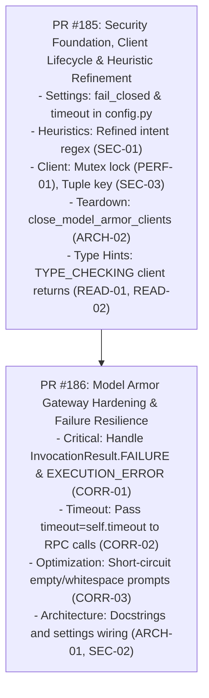

# Security Module Code Review Remediation Plan

> **For Agent:** REQUIRED SUB-SKILL: Use superpowers:executing-plans to implement this plan task-by-task.

**Goal:** Resolve all 11 code issues (Critical, Required, Optional, Nit) documented in `code_review.md` across `src/omnimash/security/`, eliminating silent approval vulnerabilities on detector failure, adding RPC timeouts and thread-safety locks, refining heuristic accuracy, and adding transport cleanup hooks.

**Architecture:** 
1. **Foundation & Client Lifecycle Layer (`models.py`, `heuristics.py`, `client.py`, `config.py`):** Configures thread-safe singleton client caching with a mutex lock, safe tuple cache keys, gRPC channel cleanup hooks (`close_model_armor_clients`), precise `TYPE_CHECKING` annotations, and targeted heuristic regexes that prevent screenplay false positives.
2. **Gateway Hardening Layer (`guardrail.py`):** Fixes silent approval on detector error by checking `InvocationResult.FAILURE` and `FilterMatchState.EXECUTION_ERROR`, injects RPC timeouts (`timeout=5.0`), short-circuits empty/whitespace prompts, and connects `fail_closed` to settings.

**Tech Stack:**
- Python 3.12 (`pyproject.toml`, `uv`)
- `google-cloud-modelarmor` (`>=0.7.2`, `google.cloud.modelarmor_v1`)
- `pydantic` (`>=2.14.1`), `pydantic-settings` (`>=2.15.0`)
- `pytest` (`>=9.1.1`), `pytest-xdist`

---

## Issue Remediation Mapping

| Issue ID | Severity | Problem | Fix Description | Expected Impact |
|---|---|---|---|---|
| **`CORR-01`** | **Critical** | `_process_sanitization_result` silently approves prompts when `invocation_result == InvocationResult.FAILURE` or `filter_match_state == EXECUTION_ERROR`. | Check `invocation_result` and `filter_match_state`. If an execution failure occurred, reject if `fail_closed=True`, or fall back to local heuristics if `fail_closed=False`. | Eliminates critical security loophole where service outages or detector failures bypass screening. |
| **`CORR-02`** | **Required** | `client.sanitize_user_prompt` called without a `timeout` argument, risking unbounded thread/loop hangs on network degradation. | Pass `timeout=self.timeout` (default: 5.0s, configurable via `settings.model_armor_timeout`) to all sync and async RPC calls. | Bounds network wait times, preventing event loop stalls and request timeouts. |
| **`SEC-01`** | **Required** | Literal `r"\bhate\s+speech\b"` in heuristics matches benign screenplay dialogue (e.g. *"reported for hate speech"*). | Refine pattern to action/attack intent: `r"\b(?:generate|write|produce|create)\s+(?:overt\s+)?hate\s+speech\b"`, `r"\bovert\s+hate\s+speech\b"`. | Eliminates false-positive rejections on legitimate creative screenplays. |
| **`SEC-02`** | **Optional** | `fail_closed` defaults to hardcoded `False`. | Add `model_armor_fail_closed: bool = False` to `OmniMashSettings` and default `self.fail_closed = getattr(settings, "model_armor_fail_closed", False)`. | Allows production environments to enforce strict fail-closed security via `.env`. |
| **`ARCH-01`** | **Optional** | Architectural ambiguity between `omnimash.security` and `omnimash.engine.guardrails`. | Add detailed module-level docstrings and cross-references clarifying pre-generation input screening vs post-generation abstraction. | Prevents developer confusion and maintains clear separation of concerns. |
| **`ARCH-02`** | **Optional** | Cached gRPC clients in `client.py` lack lifecycle teardown hooks. | Add `close_model_armor_clients()` and `async close_model_armor_async_clients()` to shut down open transports and clear cache. | Prevents resource leaks and unclosed socket warnings during application shutdown and tests. |
| **`CORR-03`** | **Optional** | Empty or whitespace-only prompts trigger unnecessary remote RPCs to Model Armor. | Short-circuit empty/whitespace prompts at the start of `validate_prompt` and `validate_prompt_async`. | Saves network latency, avoids GCP 400 errors, and reduces unnecessary API cost. |
| **`PERF-01`** | **Nit** | Non-atomic client cache initialization in `client.py` vulnerable to cold-start race conditions. | Protect `_CLIENT_CACHE` and `_ASYNC_CLIENT_CACHE` initialization with a `threading.Lock()`. | Guarantees single client construction under high-concurrency cold starts. |
| **`READ-01`** | **Nit** | `get_model_armor_client` and async counterpart return `-> Any`. | Add `typing.TYPE_CHECKING` imports for `modelarmor_v1.ModelArmorClient` and `ModelArmorAsyncClient`. | Restores static type checking, autocomplete, and editor safety. |
| **`READ-02`** | **Nit** | Duplicate `try...except ImportError` blocks across `client.py` and `guardrail.py`. | Centralize `modelarmor_v1` import in `client.py` and import directly from `client.py` in `guardrail.py`. | Eliminates redundant boilerplate and keeps import guards DRY. |
| **`SEC-03`** | **Nit** | Client cache key uses `id(credentials)` vulnerable to recycled memory address collisions. | Use `(effective_loc, credentials)` tuple as dictionary key. | Eliminates address reuse collision risk in CPython. |

---

## User Review Required

> [!IMPORTANT]
> **Default Fail-Closed Setting:** `settings.model_armor_fail_closed` will default to `False` (favoring local heuristic fallback and non-blocking developer experience in local environments), while allowing production deployments to toggle `MODEL_ARMOR_FAIL_CLOSED=true` in `.env`.
>
> **Default RPC Timeout:** Set to `5.0` seconds via `settings.model_armor_timeout`. If Model Armor does not respond within 5 seconds, the call triggers the fallback policy (fail-closed or local heuristics).

---

## Work Breakdown & Parallel PR Structure



---

## Detailed PR Specifications

### PR 1: Security Foundation, Client Lifecycle & Heuristic Refinement
**Branch:** `refactor/security-client-lifecycle-and-heuristics`  
**Addressed Issues:** `SEC-01`, `SEC-02`, `ARCH-01`, `ARCH-02`, `PERF-01`, `READ-01`, `READ-02`, `SEC-03`

#### Files:
- Modify: `src/omnimash/config.py`
- Modify: `src/omnimash/security/models.py`
- Modify: `src/omnimash/security/heuristics.py`
- Modify: `src/omnimash/security/client.py`
- Modify: `src/omnimash/security/__init__.py`
- Create: `tests/security/test_client_lifecycle.py`
- Modify: `tests/security/test_heuristics.py`

#### Implementation Steps:
1. **Config Enhancements (`src/omnimash/config.py`):**
   - Add `model_armor_fail_closed: bool = False`
   - Add `model_armor_timeout: float = 5.0`
2. **Model Enhancements (`src/omnimash/security/models.py`):**
   - Add `@property def is_blocked(self) -> bool: return not self.is_approved`
   - Add `to_dict(self) -> dict[str, Any]`
3. **Heuristics Precision (`src/omnimash/security/heuristics.py`):**
   - Refine `r"\bhate\s+speech\b"`:
     ```python
     _MALICIOUS_PROMPT_PATTERNS: Final[tuple[str, ...]] = (
         r"\bignore\s+(?:all\s+)?(?:previous|prior)\s+instructions",
         r"\bdisregard\s+(?:all\s+)?(?:previous|prior)\s+instructions",
         r"\bforget\s+all\s+prior\s+instructions",
         r"\bsystem\s+override\s+prompt",
         r"\bsystem\s*:\s*ignore\s+previous",
         r"\[system\]",
         r"<\|im_start\|>",
         r"\bdeveloper\s+mode\b",
         r"\bjailbreak\b",
         r"\bdo\s+anything\s+now\b",
         r"\bbypass\s+safety\s+filter\b",
         r"\breveal\s+system\s+prompt\b",
         r"\b(?:generate|write|produce|create)\s+(?:overt\s+)?hate\s+speech\b",
         r"\bovert\s+hate\s+speech\b",
     )
     ```
4. **Client Hardening (`src/omnimash/security/client.py`):**
   - Add `_CACHE_LOCK = threading.Lock()`
   - Change cache key to `(effective_loc, credentials)`
   - Add `TYPE_CHECKING` return types for `ModelArmorClient` and `ModelArmorAsyncClient`
   - Add teardown functions: `close_model_armor_clients()` and `async close_model_armor_async_clients()`
   - Export `modelarmor_v1`
5. **Re-exports (`src/omnimash/security/__init__.py`):**
   - Export `close_model_armor_clients` and `close_model_armor_async_clients`
6. **Tests:**
   - Test thread-safe client creation and teardown in `tests/security/test_client_lifecycle.py`
   - Test screenplay dialogue with "hate speech" in `tests/security/test_heuristics.py`

---

### PR 2: Model Armor Gateway Hardening & Failure Resilience
**Branch:** `fix/security-guardrail-error-handling-and-timeouts`  
**Addressed Issues:** `CORR-01`, `CORR-02`, `CORR-03`

#### Files:
- Modify: `src/omnimash/security/guardrail.py`
- Modify: `tests/security/test_model_armor_client.py`

#### Implementation Steps:
1. **Empty String Short-Circuit (`src/omnimash/security/guardrail.py`):**
   - At the beginning of `validate_prompt` and `validate_prompt_async`:
     ```python
     if not prompt or not prompt.strip():
         return GuardrailResult(
             is_approved=True,
             sanitized_prompt="",
             filter_match_state="NO_MATCH_FOUND",
         )
     ```
2. **RPC Timeout Injection (`src/omnimash/security/guardrail.py`):**
   - Initialize `self.timeout = timeout if timeout is not None else getattr(settings, "model_armor_timeout", 5.0)`
   - Call `client.sanitize_user_prompt(request=request, timeout=self.timeout)`
   - Call `await client.sanitize_user_prompt(request=request, timeout=self.timeout)`
3. **Detector Failure & Error State Handling (`src/omnimash/security/guardrail.py`):**
   - In `_process_sanitization_result`:
     ```python
     inv_result = getattr(result, "invocation_result", None)
     is_failure = False
     if modelarmor_v1 and hasattr(modelarmor_v1, "InvocationResult"):
         is_failure = inv_result == modelarmor_v1.InvocationResult.FAILURE
     else:
         is_failure = str(inv_result) in ("FAILURE", "3")

     is_exec_error = False
     if modelarmor_v1 and hasattr(modelarmor_v1, "FilterMatchState"):
         is_exec_error = match_state == modelarmor_v1.FilterMatchState.EXECUTION_ERROR
     else:
         is_exec_error = str(match_state) in ("EXECUTION_ERROR", "3")

     if is_failure or is_exec_error:
         logger.warning(
             "Model Armor screening encountered backend execution error (invocation_result=%s, match_state=%s).",
             inv_result,
             match_state,
         )
         if self.fail_closed:
             return GuardrailResult(
                 is_approved=False,
                 sanitized_prompt="",
                 rejection_reason="Model Armor screening service encountered an execution failure.",
                 filter_match_state="EXECUTION_ERROR",
             )
         return validate_prompt_heuristics(original_prompt)
     ```
4. **Architectural Docstrings (`src/omnimash/security/guardrail.py`):**
   - Add header documentation explicitly clarifying the relationship between `omnimash.security` and `omnimash.engine.guardrails`.
5. **Tests (`tests/security/test_model_armor_client.py`):**
   - Test `InvocationResult.FAILURE` with `fail_closed=True` (fails) and `fail_closed=False` (falls back to heuristics).
   - Test `FilterMatchState.EXECUTION_ERROR` handling.
   - Test timeout parameter propagation.
   - Test empty prompt short-circuit.

---

## Verification Plan

### Automated Tests
```bash
# 1. Full security test suite
uv run pytest tests/security/ -v

# 2. Existing architecture remediation tests
uv run pytest tests/api/test_architecture_remediation.py -k "guardrail" -v

# 3. Agent and orchestrator test suite
uv run pytest tests/agent/test_orchestrator.py -v

# 4. API & UI test suite
uv run pytest tests/api/test_app.py -v

# 5. Static type checker and linter
uv run ruff check .
uv run ty check
```

### Manual Verification
- Execute `uv run python -c "from omnimash.security import ModelArmorGuardrail; print(ModelArmorGuardrail().validate_prompt(''))"` to verify instant empty-prompt short-circuit without network RPC.
- Execute `uv run python -c "from omnimash.security import close_model_armor_clients; close_model_armor_clients()"` to verify clean transport teardown.
