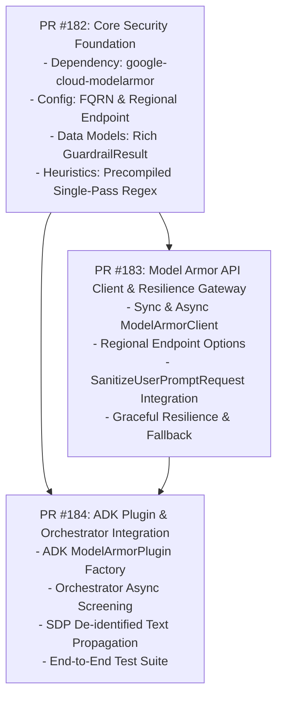

# Security Module Modernization & Model Armor Integration Implementation Plan

> **For Agent:** REQUIRED SUB-SKILL: Use superpowers:executing-plans to implement this plan task-by-task.

**Goal:** Modernize `src/omnimash/security` by integrating the official `google-cloud-modelarmor` SDK (`google.cloud.modelarmor_v1`), supporting asynchronous screening (`ModelArmorAsyncClient`), establishing regional endpoint routing, capturing rich sanitization/SDP metadata, and implementing a resilient local heuristic fallback.

**Architecture:** A dual-layer defense architecture where `ModelArmorGuardrail` serves as the unified security gateway. In production, prompts are screened against Google Cloud Model Armor regional endpoints (`modelarmor.{location}.rep.googleapis.com`) using `SanitizeUserPromptRequest`. If running in `mock_mode` or if the remote service is temporarily unreachable, execution seamlessly falls back to a high-speed precompiled regex heuristic engine with zero ReDoS risk and full parody pass-through.

**Tech Stack:**
- Python 3.12 (`pyproject.toml`, `uv`)
- `google-cloud-modelarmor` (`>=0.7.2`, `google.cloud.modelarmor_v1`)
- `google-adk` (`>=2.11.0`, `google.adk.integrations.model_armor`)
- `google-genai` (`>=2.31.0`)
- `pydantic` (`>=2.14.1`), `pydantic-settings` (`>=2.15.0`)
- `pytest` (`>=9.1.1`), `pytest-xdist`

---

## User Review Required

> [!IMPORTANT]
> **Dependency Addition:** Adding `google-cloud-modelarmor>=0.7.2` to `pyproject.toml`. This is an official Google Cloud client library for Model Armor and is already required by `google-adk[gcp]`.
>
> **Regional Routing vs Global:** Model Armor is a regional service (`modelarmor.{location}.rep.googleapis.com`). It will route to `settings.gcp_region` (default: `us-central1`), while Gemini Omni video models remain on `"global"`.
>
> **100% Backward Compatibility:** All existing interfaces (`ModelArmorGuardrail(mock_mode=True)`, `guardrail.validate_prompt(prompt)`, `guardrail.template_id`, and `GuardrailResult` fields `is_approved`, `sanitized_prompt`, `rejection_reason`) remain fully backward-compatible so all existing tests pass without modification.

---

## Work Breakdown & Parallel PR Structure



---

## Detailed PR Specifications

### PR 1: Core Security Foundation, Models & Local Heuristic Engine
**Branch:** `feature/security-core-and-heuristics`  
**Focus:** Dependency setup, configuration resolution, typed result models, and precompiled regex heuristic scanning.

#### Files:
- Modify: `pyproject.toml`
- Modify: `src/omnimash/config.py`
- Create: `src/omnimash/security/models.py`
- Create: `src/omnimash/security/heuristics.py`
- Modify: `src/omnimash/security/__init__.py`
- Create: `tests/security/test_heuristics.py`

#### Tasks:
1. **Add `google-cloud-modelarmor` dependency:**
   - Add `"google-cloud-modelarmor>=0.7.2"` to `pyproject.toml`.
   - Run `uv sync` to update `uv.lock`.
2. **Update `src/omnimash/config.py`:**
   - Add helper properties:
     - `model_armor_location`: returns `self.gcp_region` (default `"us-central1"`).
     - `model_armor_template_name`: formats `projects/{project}/locations/{location}/templates/{template}` if not already a fully-qualified resource name.
     - `model_armor_endpoint`: returns `f"modelarmor.{self.model_armor_location}.rep.googleapis.com"`.
3. **Create `src/omnimash/security/models.py`:**
   - Define `GuardrailResult`:
     ```python
     @dataclass
     class GuardrailResult:
         is_approved: bool
         sanitized_prompt: str
         rejection_reason: str | None = None
         filter_match_state: str | None = None
         triggers: list[str] = field(default_factory=list)
         filter_results: dict[str, Any] = field(default_factory=dict)
         deidentified: bool = False
     ```
4. **Create `src/omnimash/security/heuristics.py`:**
   - Single precompiled regex alternation `\b(?:...)\b` containing the expanded taxonomy of prompt injection and jailbreak patterns.
   - Fast evaluation (<0.1ms), guaranteed safe parody pass-through (e.g. *"illegal beat drop"*).
   - Function: `validate_prompt_heuristics(prompt: str) -> GuardrailResult`.
5. **Update `src/omnimash/security/__init__.py`:**
   - Export canonical symbols with `__all__`: `GuardrailResult`, `ModelArmorGuardrail`, `validate_prompt_heuristics`.
6. **Tests:**
   - `tests/security/test_heuristics.py` validating attack patterns, parody safety, and latency.

---

### PR 2: Google Cloud Model Armor Client & Resilience Gateway
**Branch:** `feature/security-model-armor-client`  
**Focus:** Official `google.cloud.modelarmor_v1` integration, sync & async clients, regional endpoint routing, and fallback resilience.

#### Files:
- Create: `src/omnimash/security/client.py`
- Modify: `src/omnimash/security/guardrail.py`
- Create: `tests/security/test_model_armor_client.py`
- Modify: `tests/security/test_guardrail.py`

#### Tasks:
1. **Create `src/omnimash/security/client.py`:**
   - Lazy client constructors:
     - `get_model_armor_client(location: str | None = None) -> modelarmor_v1.ModelArmorClient`
     - `get_model_armor_async_client(location: str | None = None) -> modelarmor_v1.ModelArmorAsyncClient`
   - Configure with `ClientOptions(api_endpoint=endpoint)`.
2. **Refactor `src/omnimash/security/guardrail.py`:**
   - Refactor `ModelArmorGuardrail`:
     - Keep `__init__(mock_mode: bool | None = None, template_id: str | None = None, location: str | None = None, fail_closed: bool = True)`.
     - `validate_prompt(self, prompt: str) -> GuardrailResult`: synchronous execution.
     - `validate_prompt_async(self, prompt: str) -> GuardrailResult`: asynchronous execution.
     - Build `SanitizeUserPromptRequest(name=template_name, user_prompt_data=DataItem(text=prompt))`.
     - Evaluate `SanitizationResult`:
       - Check `filter_match_state == FilterMatchState.MATCH_FOUND`.
       - Check for SDP de-identification result: if `sanitized_item.text` is present, populate `sanitized_prompt` with the de-identified text and set `deidentified=True`.
     - Fallback resilience: If `mock_mode=True`, or client creation fails, or RPC raises an exception, execute `validate_prompt_heuristics(prompt)` with structured warning log.
3. **Tests:**
   - `tests/security/test_model_armor_client.py`: Mock unit tests for `ModelArmorClient` / `ModelArmorAsyncClient` verifying `MATCH_FOUND`, `NO_MATCH_FOUND`, SDP de-identification, and RPC exception fallback.
   - Ensure `tests/security/test_guardrail.py` and `tests/api/test_architecture_remediation.py` continue to pass 100%.

---

### PR 3: ADK Middleware Plugin & Orchestrator Integration
**Branch:** `feature/security-adk-orchestrator-integration`  
**Focus:** Native ADK `ModelArmorPlugin` builder, orchestrator async prompt gating, and SDP de-identified prompt propagation.

#### Files:
- Create: `src/omnimash/security/adk_plugin.py`
- Modify: `src/omnimash/agent/orchestrator.py`
- Create: `tests/security/test_adk_plugin.py`
- Modify: `tests/agent/test_orchestrator.py`

#### Tasks:
1. **Create `src/omnimash/security/adk_plugin.py`:**
   - Helper factory `get_model_armor_adk_plugin()`:
     - Configures `google.adk.integrations.model_armor.ModelArmorPlugin` with `ModelArmorConfig(prompt_template_name=settings.model_armor_template_name)`.
     - Enables seamless pre-model screening in ADK `Runner(plugins=[...])`.
2. **Update `src/omnimash/agent/orchestrator.py`:**
   - Update prompt gating in `generate_turn`:
     - If `guard_res.deidentified` is `True`, use `input_prompt = guard_res.sanitized_prompt` so sanitized/redacted PII propagates safely to downstream prompts.
   - Provide async validation helper if needed for async endpoints.
3. **Documentation:**
   - Add explicit architectural comments noting that Gemini Omni video generation uses pre-generation Model Armor screening via `omnimash.security`, allowing video inference calls to use relaxed safety thresholds (`HarmBlockThreshold.BLOCK_NONE`) without triggering `google-genai`'s mutual exclusivity conflict.
4. **Tests:**
   - Verify `orchestrator.py` handles blocked prompts and de-identified prompts accurately.

---

## Verification Plan

### Automated Tests
Run via `uv`:
```bash
# 1. Full test suite for security module
uv run pytest tests/security/ -v

# 2. Existing architecture remediation tests
uv run pytest tests/api/test_architecture_remediation.py -k "guardrail" -v

# 3. Agent and orchestrator test suite
uv run pytest tests/agent/ -v

# 4. API & UI test suite
uv run pytest tests/api/test_app.py -v

# 5. Linting and type checking
uv run ruff check .
uv run ty check
```

### Manual Verification
- Verify `uv run python -c "from omnimash.security import ModelArmorGuardrail, GuardrailResult; print(ModelArmorGuardrail(mock_mode=True).validate_prompt('test'))"` runs cleanly and returns a valid `GuardrailResult`.
