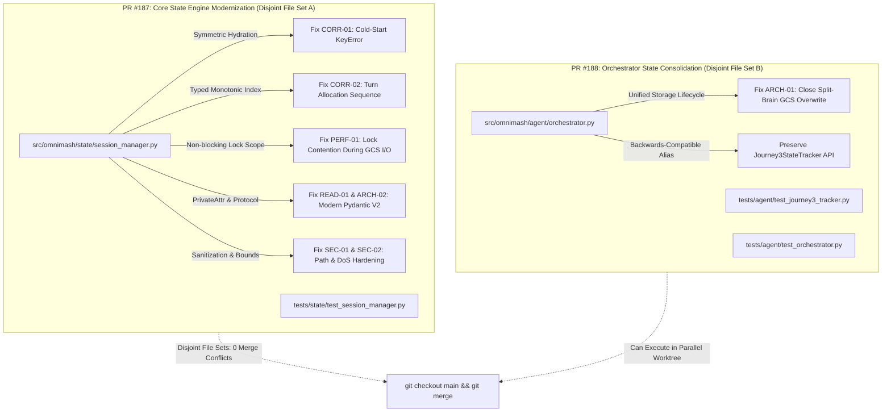

# State Module Code Review Remediation Plan

> **For Claude:** REQUIRED SUB-SKILL: Use superpowers:executing-plans to implement this plan task-by-task.

**Goal:** Remediate all 16 code review findings across [`src/omnimash/state`](file:///usr/local/google/home/jordantotten/omnimash/src/omnimash/state) and its consumer integrations in [`src/omnimash/agent`](file:///usr/local/google/home/jordantotten/omnimash/src/omnimash/agent), eliminating cold-start hydration crashes, lock-holding network latency, split-brain manifest overwrites, and Pydantic V2 anti-patterns.

**Architecture:** Split the remediation into two decoupled, parallel PRs with completely disjoint file sets: PR #187 modernizes the core `SessionManager` engine (symmetric hydration, non-blocking lock scoping, typed monotonic turn indexing, `PrivateAttr`, and `SessionStorageProtocol`), while PR #188 consolidates `CumulativeStateTracker` in `orchestrator.py` to route through `SessionManager`, unifying the GCS `session_manifest.json` persistence lifecycle into a single source of truth.

**Tech Stack:** Python 3.12, Pydantic V2 (`BaseModel`, `PrivateAttr`, `Field`, `field_validator`, `model_dump(mode="json")`), `threading.RLock`, `google-cloud-storage`, `google-adk`, `pytest`, `ruff`, `ty`.

---

## 🗺️ Parallel Execution Architecture & PR Breakdown



---

## 📋 Comprehensive Issues & Remediation Matrix

| Issue ID | Severity | File | Proposed Fix | Expected Impact |
| :--- | :--- | :--- | :--- | :--- |
| **`CORR-01`** | **Critical** | `src/omnimash/state/session_manager.py` | Replace raw `self._sessions[id]` in `add_turn` and `commit_turn` with `self.get_session(id)` to hydrate from GCS. | Eliminates unhandled `KeyError` crashes upon Cloud Run container restarts or cold starts. |
| **`CORR-02`** | **Critical** | `src/omnimash/state/session_manager.py` | Add typed `turn_index: int = 0` to `TurnNode`; compute monotonic index from `max(t.turn_index)` instead of regex on URLs or `clip_index`. | Prevents turn index skipping and output video file clobbering. |
| **`PERF-01`** | **Critical** | `src/omnimash/state/session_manager.py` | Scope `with self._lock:` strictly to in-memory mutations; snapshot model and execute GCS `save_session_manifest` outside the lock. | Unblocks concurrent worker threads; eliminates latency spikes across all users during GCS writes. |
| **`ARCH-01`** | **Critical** | `src/omnimash/agent/orchestrator.py` | Refactor `CumulativeStateTracker` to delegate state persistence through `SessionManager` instead of reading/writing GCS directly. | Single source of truth for `session_manifest.json`; eliminates race conditions and clobbered updates. |
| **`CORR-03`** | **Required** | `src/omnimash/state/session_manager.py` | Replace `except Exception: pass` with structured `logger.warning(..., exc_info=True)`. | Provides complete observability into GCS persistence failures in Cloud Logging. |
| **`CORR-04`** | **Required** | `src/omnimash/state/session_manager.py` | Validate `parent_turn_id` exists in `session.turns`; reject or reset invalid parent pointers. | Preserves Version Tree DAG integrity; prevents orphaned branch nodes. |
| **`PERF-02`** | **Required** | `src/omnimash/state/session_manager.py` | Remove redundant `get_session_manifest()` read-before-write inside `_persist_session()`. | Halves GCS API round-trips on every turn mutation (saves 200–500ms per turn). |
| **`ARCH-02`** | **Required** | `src/omnimash/state/session_manager.py` | Define `@runtime_checkable class SessionStorageProtocol(Protocol)`. | Enables static type checking with `ty check` and provides clean interface for alternative backends. |
| **`ARCH-03`** | **Required** | `src/omnimash/state/session_manager.py` | Bind default image model in `ProjectSession` and `_normalize_image_model` to `settings.image_model_id`. | Ensures environment variable overrides (`.env`, Cloud Run) propagate properly to state models. |
| **`SEC-01`** | **Required** | `src/omnimash/state/session_manager.py` | Sanitize `user_id` and `project_id` in default session keys (`clean_user_clean_project`). | Prevents path traversal and colon delimiters in GCS blob paths. |
| **`SEC-02`** | **Required** | `src/omnimash/state/session_manager.py` | Enforce `MAX_TURNS_PER_SESSION = 500` and session cache size bounds. | Protects against memory exhaustion and JSON payload DoS from unbounded generation loops. |
| **`READ-01`** | **Required** | `src/omnimash/state/session_manager.py` | Declare `_last_allocated_turn_index: int = PrivateAttr(default=-1)` on `ProjectSession`. | Eliminates `object.__setattr__` anti-pattern; restores idiomatic Pydantic V2 attribute mechanics. |
| **`PERF-03`** | **Optional** | `src/omnimash/state/session_manager.py` | Use `session.model_dump(mode="json")` for manifest serialization. | Guarantees clean JSON primitives; eliminates serialization errors with custom types. |
| **`ARCH-04`** | **Optional** | `src/omnimash/state/session_manager.py` | Add typed cumulative state models and structured fields to `ProjectSession`. | Prevents untyped dict leakage into session state. |
| **`READ-02`** | **Optional** | `src/omnimash/state/session_manager.py` | Extract reusable `sanitize_session_id(name: str) -> str` utility. | Removes duplicated regex logic across functions. |
| **`READ-03`** | **Nit** | `src/omnimash/state/session_manager.py` | Remove hardcoded 9-element key list during `_persist_session` cleanup. | Simplifies codebase and reduces cognitive overhead. |

---

## 🚀 Workstream PR 1: Core State Engine Modernization & Resilience

**Branch:** `refactor/state-engine-modernization`  
**Files:**
- Modify: [`src/omnimash/state/session_manager.py`](file:///usr/local/google/home/jordantotten/omnimash/src/omnimash/state/session_manager.py)
- Modify: [`tests/state/test_session_manager.py`](file:///usr/local/google/home/jordantotten/omnimash/tests/state/test_session_manager.py)

### Task 1.1: Storage Protocol, Sanitization & Pydantic V2 Private Attributes
Implement `SessionStorageProtocol`, `sanitize_session_id`, `PrivateAttr`, and binding to `settings.image_model_id`.

**Files:**
- Modify: `src/omnimash/state/session_manager.py:1-65`
- Test: `tests/state/test_session_manager.py`

**Step 1: Write failing tests in `tests/state/test_session_manager.py`:**
```python
def test_session_manager_sanitizes_default_key_and_private_attr():
    from omnimash.state.session_manager import SessionManager, sanitize_session_id
    sm = SessionManager()
    sess = sm.get_or_create_session("user/../admin", "proj:evil")
    assert ".." not in sess.session_id
    assert ":" not in sess.session_id
    assert sess.session_id == "user____admin_proj_evil"
    assert hasattr(sess, "_last_allocated_turn_index")
    assert sess._last_allocated_turn_index == -1
```

**Step 2: Run test to verify failure:**
`uv run pytest tests/state/test_session_manager.py -k "test_session_manager_sanitizes_default_key_and_private_attr" -v`  
Expected: FAIL (`assert sess.session_id == "user____admin_proj_evil"` fails because existing key is `user/../admin:proj:evil`).

**Step 3: Implement in `src/omnimash/state/session_manager.py`:**
- Define `SessionStorageProtocol(Protocol)`.
- Define `sanitize_session_id(name: str) -> str`.
- Add `_last_allocated_turn_index: int = PrivateAttr(default=-1)` to `ProjectSession`.
- Update `_normalize_image_model` to default to `getattr(settings, "image_model_id", "gemini-nano-banana-2.1")`.

**Step 4: Run test to verify pass:**
`uv run pytest tests/state/test_session_manager.py -k "test_session_manager_sanitizes_default_key_and_private_attr" -v`  
Expected: PASS.

**Step 5: Git commit:**
`git commit -m "feat(state): add SessionStorageProtocol, sanitize_session_id, and Pydantic PrivateAttr"`

---

### Task 1.2: Symmetric Storage Hydration & Non-Blocking GCS Persistence
Fix cold-start `KeyError` crashes in `add_turn` and `commit_turn`, and release `_lock` before calling GCS `save_session_manifest`.

**Files:**
- Modify: `src/omnimash/state/session_manager.py:66-260`
- Test: `tests/state/test_session_manager.py`

**Step 1: Write failing tests for cold-start `add_turn` and `commit_turn`:**
```python
def test_add_turn_and_commit_turn_hydrate_from_storage_on_cold_start():
    from omnimash.storage.gcs import GcsStorageManager
    storage = GcsStorageManager(bucket_name="test-bucket", mock_mode=True)
    sm1 = SessionManager(storage=storage)
    s1 = sm1.get_or_create_session("u1", "p1", session_name="cold_start_sess")
    t1 = sm1.add_turn(s1.session_id, 0, "Prompt 1", "thread_1", "/clip1.mp4")

    # Brand new session manager instance with empty _sessions dict
    sm2 = SessionManager(storage=storage)
    assert "cold_start_sess" not in sm2._sessions

    # add_turn should hydrate from storage rather than raising KeyError
    t2 = sm2.add_turn(
        "cold_start_sess", 0, "Prompt 2", "thread_1", "/clip2.mp4", parent_turn_id=t1.turn_id
    )
    assert t2.edit_depth_in_thread == 1

    # commit_turn should also hydrate
    sm3 = SessionManager(storage=storage)
    committed = sm3.commit_turn("cold_start_sess", t2.turn_id)
    assert committed.is_committed is True
```

**Step 2: Run test to verify failure:**
`uv run pytest tests/state/test_session_manager.py -k "test_add_turn_and_commit_turn_hydrate_from_storage_on_cold_start" -v`  
Expected: FAIL (`KeyError: 'cold_start_sess'`).

**Step 3: Implement in `src/omnimash/state/session_manager.py`:**
- In `add_turn()` and `commit_turn()`, replace `self._sessions[session_id]` with `session = self.get_session(session_id)`. If `session is None`, raise `KeyError(f"Session '{session_id}' not found")`.
- In `_persist_session()`:
  - Take snapshot: `manifest_data = session.model_dump(mode="json")`.
  - Remove redundant `get_session_manifest` read-before-write.
  - Call `self.storage.save_session_manifest(...)` with structured `try/except Exception as exc: logger.warning(...)`.
- Move `self._persist_session(session)` outside `with self._lock:`.

**Step 4: Run test to verify pass:**
`uv run pytest tests/state/test_session_manager.py -k "test_add_turn_and_commit_turn_hydrate_from_storage_on_cold_start" -v`  
Expected: PASS.

**Step 5: Git commit:**
`git commit -m "fix(state): implement symmetric storage hydration and non-blocking GCS persistence"`

---

### Task 1.3: Typed Monotonic Turn Indexing & Parent Node Validation
Add `turn_index: int = 0` to `TurnNode`, validate `parent_turn_id` in DAG, and enforce `MAX_TURNS_PER_SESSION`.

**Files:**
- Modify: `src/omnimash/state/session_manager.py`
- Test: `tests/state/test_session_manager.py`

**Step 1: Write failing test in `tests/state/test_session_manager.py`:**
```python
def test_allocate_turn_index_monotonic_with_nonstandard_url_and_shot_index():
    sm = SessionManager()
    sess = sm.get_or_create_session("u1", "p1")
    # Clip index is 5, but this is turn 1
    t1 = sm.add_turn(sess.session_id, clip_index=5, prompt="Shot 5", interaction_thread_id="t1", video_url="https://signed-url.com/custom_uuid.mp4")
    assert t1.turn_index == 1
    next_idx = sm.allocate_turn_index(sess)
    # Next turn index must be 2, not 6
    assert next_idx == 2
```

**Step 2: Run test to verify failure:**
`uv run pytest tests/state/test_session_manager.py -k "test_allocate_turn_index_monotonic_with_nonstandard_url_and_shot_index" -v`  
Expected: FAIL (`AttributeError: 'TurnNode' object has no attribute 'turn_index'` or `next_idx == 6`).

**Step 3: Implement in `src/omnimash/state/session_manager.py`:**
- Add `turn_index: int = 0` to `TurnNode`.
- In `add_turn()`:
  - If `len(session.turns) >= MAX_TURNS_PER_SESSION`: raise `ValueError("Session reached maximum turn limit")`.
  - Validate `parent_turn_id`: if supplied but not in `session.turns`, log warning and set `parent_turn_id = None`.
  - Auto-assign `turn_index = self.allocate_turn_index(session)`.
- Update `allocate_turn_index()` to inspect `max(getattr(t, 'turn_index', 0) for t in session.turns.values())`.

**Step 4: Run test to verify pass:**
`uv run pytest tests/state/test_session_manager.py -k "test_allocate_turn_index_monotonic_with_nonstandard_url_and_shot_index" -v`  
Expected: PASS.

**Step 5: Git commit:**
`git commit -m "feat(state): add typed turn_index, parent pointer validation, and turn limit enforcement"`

---

## 🚀 Workstream PR 2: Architectural Consolidation & Agent Orchestrator Unification

**Branch:** `refactor/state-orchestrator-unification`  
**Files:**
- Modify: [`src/omnimash/agent/orchestrator.py`](file:///usr/local/google/home/jordantotten/omnimash/src/omnimash/agent/orchestrator.py)
- Modify: [`tests/agent/test_journey3_tracker.py`](file:///usr/local/google/home/jordantotten/omnimash/tests/agent/test_journey3_tracker.py)
- Modify: [`tests/agent/test_orchestrator.py`](file:///usr/local/google/home/jordantotten/omnimash/tests/agent/test_orchestrator.py)

### Task 2.1: Unified Cumulative State Management via `SessionManager`
Refactor `CumulativeStateTracker` in `src/omnimash/agent/orchestrator.py` to delegate directly to `SessionManager`, consolidating `session_manifest.json` persistence into a single synchronized path.

**Files:**
- Modify: `src/omnimash/agent/orchestrator.py:46-130`
- Test: `tests/agent/test_journey3_tracker.py`

**Step 1: Write integration test proving no manifest write clobbering:**
```python
def test_cumulative_state_and_session_turns_share_single_manifest_lifecycle():
    from omnimash.agent.orchestrator import OmniMashAgent
    agent = OmniMashAgent(mock_mode=True)
    session = agent.session_manager.get_or_create_session("u1", "p1", session_name="unified_manifest_sess")
    
    # Add turn
    agent.session_manager.add_turn(session.session_id, 0, "Prompt 1", "thread_1", "/clip1.mp4")
    
    # Record cumulative shot directive
    agent.cumulative_tracker.record_shot_directive(
        session_id=session.session_id,
        shot_index=0,
        action_text="Chef Gordon enters holding a cyber spatula",
        project_id="p1"
    )
    
    # Reload from storage manifest
    manifest = agent.storage.get_session_manifest(session.session_id, project_id="p1")
    assert manifest is not None
    assert "turns" in manifest
    assert len(manifest["turns"]) == 1
    assert "cumulative_state" in manifest
    assert "Chef Gordon" in manifest["cumulative_state"]["character_states"]
```

**Step 2: Run test to verify existing behavior:**
`uv run pytest tests/agent/test_journey3_tracker.py -v`  
Verify current test suite status.

**Step 3: Implement in `src/omnimash/agent/orchestrator.py`:**
- In `CumulativeStateTracker.__init__`, accept `session_manager: SessionManager | None = None` in addition to `storage`.
- When persisting or hydrating cumulative state, use `session_manager.get_session()` and update `session.cumulative_state`, calling `session_manager._persist_session(session)`.
- If `session_manager` is not provided (e.g. standalone test), fall back to `self.storage` with deprecation warning.
- In `OmniMashAgent.__init__`, pass `session_manager=self.session_manager` to `CumulativeStateTracker(storage=self.storage, session_manager=self.session_manager)`.

**Step 4: Run all agent & tracker tests:**
`uv run pytest tests/agent/test_journey3_tracker.py tests/agent/test_orchestrator.py -v`  
Expected: PASS.

**Step 5: Git commit:**
`git commit -m "refactor(agent): consolidate CumulativeStateTracker persistence via SessionManager"`

---

## 🧪 Verification Plan

### Automated Test Suite Commands
Execute the complete test suite across unit, agent, api, and storage layers:

```bash
# 1. State unit test suite
uv run pytest tests/state/ -v

# 2. Agent orchestrator & cumulative state tracker tests
uv run pytest tests/agent/test_journey3_tracker.py tests/agent/test_orchestrator.py -v

# 3. Architecture remediation & session cold-start tests
uv run pytest tests/api/test_architecture_remediation.py -v

# 4. API & UI test suite
uv run pytest tests/api/test_app.py -v

# 5. Full test suite run
uv run pytest -v

# 6. Static type checking & linting
uv run ruff check .
uv run ty check
```

### Manual Verification
1. Launch local dev server: `uv run python -m omnimash.api.app` (or test via testclient).
2. Create session `dripwarts_vol1` with custom shot 0.
3. Simulate container restart (instantiate fresh `SessionManager` pointing to same mock storage) and execute `add_turn` on `dripwarts_vol1` — verify zero `KeyError` crashes and depth incrementing to 1.
4. Verify `session_manifest.json` contains both `turns` DAG and `cumulative_state` without write-clobbering.
