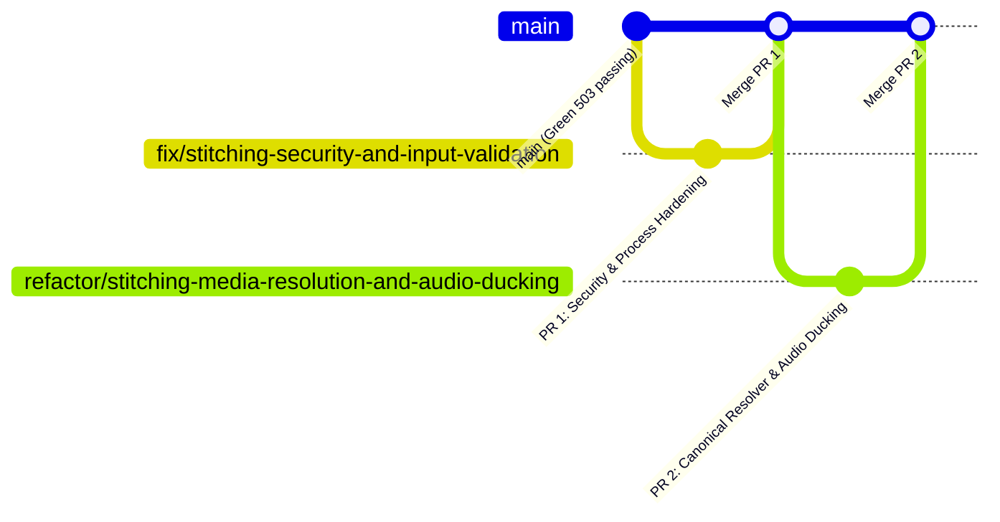

# Stitching Module 5-Axes Remediation Implementation Plan

> **For Claude:** REQUIRED SUB-SKILL: Use superpowers:executing-plans to implement this plan task-by-task.

**Goal:** Resolve all 20 findings (3 Critical, 11 Required, 4 Optional, 2 Nit) across Correctness, Readability, Architecture, Security, and Performance in `src/omnimash/stitching`, hardening multimedia assembly against SSRF and process hangs, preserving vocal clarity during audio ducking, and unifying media resolution into a single canonical engine.

**Architecture:** 
1. **Security & Process Hardening Layer:** Protect media ingestion against SSRF using `validate_remote_media_url` and `safe_fetch_remote_bytes`, confine local file paths via `validate_local_media_path`, enforce process timeouts on all FFmpeg subprocess invocations with `subprocess.TimeoutExpired` recovery, and escape single quotes in concat manifests.
2. **Canonical Media Resolution & Audio Layer:** Extract triplicated media path resolution into a standalone `resolve_media_source_to_local_path` helper, eliminate private GCS `_bucket` access, fix FFmpeg `amix` filtergraph with `normalize=0` to preserve 0 dB dialogue loudness, manage intermediate files with `tempfile.TemporaryDirectory()`, and remove the unused `ffmpeg-python` dependency.

**Tech Stack:**
- Python 3.12 (`subprocess`, `tempfile`, `pathlib`, `concurrent.futures`)
- FFmpeg 8.1.2 (`concat` demuxer, `sidechaincompress`, `amix`, `lavfi anullsrc`)
- Pillow 12.3.0 (`ImageDraw.textbbox`, `ImageFont.load_default(size=...)`)
- Google Cloud Storage 3.17.1 (`GcsStorageManager.download_blob_bytes`)
- `uv` package manager & `pytest`

---

## Issue Remediation Mapping

| Code | Severity | Finding | How We Will Fix It | Expected Impact |
| :--- | :---: | :--- | :--- | :--- |
| **`[SEC-01]`** | **Critical** | SSRF via `urllib.request.urlretrieve` in `stitcher.py` | Route remote audio through `validate_remote_media_url` and `safe_fetch_remote_bytes` with a 50MB ceiling. | Completely blocks SSRF targeting GCP metadata (`169.254.169.254`), loopback, or private VPCs; prevents Slowloris DoS. |
| **`[SEC-02]`** | **Critical** | Path traversal in `/static/` file resolution | Confine local file paths using `validate_local_media_path` against allowed root directories (`static/`, `/tmp`). | Blocks path traversal attacks (`/static/../../etc/passwd`) targeting sensitive filesystem files. |
| **`[CORR-01]`** | **Critical** | Empty `clip_paths` causes unhandled `FileNotFoundError` on GCS upload | Add guard `if not clip_paths: raise ValueError("concatenate_clips requires at least one clip path.")`. | Eliminates unhandled crash; provides immediate, descriptive error before any disk or network operations. |
| **`[CORR-02]`** | **Required** | FFmpeg Concat Demuxer crashes on unescaped single quotes | Escape single quotes in manifest lines: `clip_file.replace("'", "'\\''")`. | Prevents FFmpeg syntax parse failures when processing files with apostrophes (e.g. `director's_cut.mp4`). |
| **`[CORR-03]`** | **Required** | Plaintext fallback text written into `.mp4` and `.aac` files | Return `None` or raise structured exceptions rather than writing fake text files disguised as media. | Prevents corrupted media files from breaking downstream FFmpeg concat demuxer commands. |
| **`[CORR-04]`** | **Required** | Unchecked returncode on FFmpeg re-encode fallback | Verify `res.returncode != 0`, log `res.stderr`, and raise `RuntimeError` if re-encoding fails. | Guarantees rendering failures are surfaced immediately instead of uploading empty/corrupt files to GCS. |
| **`[SEC-03]`** | **Required** | Missing subprocess timeouts on FFmpeg commands | Pass `timeout=settings.ffmpeg_timeout_seconds` (default 120s) and handle `subprocess.TimeoutExpired`. | Prevents hung FFmpeg processes from tying up threads and exhausting worker pools. |
| **`[ARCH-01]`** | **Required** | Triplicated, inconsistent media path resolution | Create canonical `resolve_media_source_to_local_path` helper in `src/omnimash/stitching/resolver.py`. | Eliminates ~100 lines of duplicated code and unifies path resolution for local, static, GCS, proxy, and HTTP sources. |
| **`[ARCH-02]`** | **Required** | Direct private `_bucket` access and bucket name string stripping | Delegate downloads to `storage.download_blob_bytes(uri)` in canonical resolver. | Encapsulates storage layer and enables cross-bucket and HTTPS GCS URI support. |
| **`[ARCH-03]`** | **Required** | Empty `__init__.py` omitting public API exports | Export `VideoStitcher` and `apply_dialogue_audio_ducking` in `src/omnimash/stitching/__init__.py`. | Standardizes public module API for clean, discoverable imports. |
| **`[PERF-01]`** | **Required** | Dialogue muffled by FFmpeg `amix` default normalization | Add `:normalize=0:dropout_transition=0` to `amix` filtergraph. | Preserves voice/dialogue loudness at full 0 dB (preventing the default -6 dB attenuation). |
| **`[PERF-02]`** | **Required** | Re-encode fallback lacks framerate normalization | Add `-r 24` and `-pix_fmt yuv420p` to `cmd_reencode`. | Prevents timestamp drift and stutter when combining clips of differing framerates. |
| **`[READ-01]`** | **Required** | Ad-hoc manual temporary file cleanup lists | Use `tempfile.TemporaryDirectory()` context manager for intermediate artifacts. | Guarantees 100% temporary file cleanup on disk, even on unhandled exceptions or timeouts. |
| **`[READ-02]`** | **Required** | Deeply nested font loading try-except ladder in title card generator | Extract `_get_font(font_name, size)` helper with sequential fallback candidates. | Simplifies font loading from 12 lines of nested try-blocks into a clean, reusable function. |
| **`[CORR-05]`** | **Optional** | Title card insertion order inversion on equal indices | Use stable sort key and safely validate integer `insert_at`. | Preserves predictable, deterministic sequence when title cards share insertion indices. |
| **`[READ-03]`** | **Optional** | Inlined dynamic import of `settings` inside methods | Move `from omnimash.config import settings` to module top-level. | Cleaner imports, prevents repeated import lookups in hot loops. |
| **`[ARCH-04]`** | **Optional** | Unused `ffmpeg-python` dependency in `pyproject.toml` | Remove via `uv remove ffmpeg-python`. | Reduces dependency attack surface and eliminates unused project weight. |
| **`[PERF-03]`** | **Optional** | Synchronous sequential GCS clip downloads | Use `ThreadPoolExecutor` for concurrent GCS downloads when multiple URIs exist. | Reduces multi-clip stitching download latency by up to 3x on multi-shot projects. |
| **`[READ-04]`** | **Nit** | Inconsistent log formatting | Standardize on lazy formatting `%s` throughout. | Consistent, idiomatic logging practices. |
| **`[ARCH-05]`** | **Nit** | String aspect ratio typing | Add `Literal["16:9", "9:16", "1:1", "21:9"]` type annotation. | Static type verification and IDE autocompletion for aspect ratios. |

---

## Pull Request Organization

To minimize total execution time and ensure isolated, conflict-free testing, the work is structured into **two sequential, stacked pull requests**:



### PR 1: Security, Input Validation & Subprocess Hardening (`fix/stitching-security-and-input-validation`)
- **Issues Remediated:** `[SEC-01]`, `[SEC-02]`, `[SEC-03]`, `[CORR-01]`, `[CORR-02]`, `[CORR-04]`, `[READ-04]`, `[ARCH-05]`, `[CORR-05]`
- **Target Files:**
  - `src/omnimash/config.py` (add `ffmpeg_timeout_seconds`)
  - `src/omnimash/stitching/stitcher.py` (input validation, SSRF defense, path confinement, quote escaping, timeout handling, returncode checks)
  - `src/omnimash/stitching/audio_overlay.py` (path confinement, timeout handling)
  - `tests/stitching/test_stitcher.py` & `tests/stitching/test_audio_overlay.py` (regression tests)
- **Estimated Size:** ~130 lines changed

### PR 2: Canonical Media Resolution, Audio Ducking & Cleanup (`refactor/stitching-media-resolution-and-audio-ducking`)
- **Issues Remediated:** `[ARCH-01]`, `[ARCH-02]`, `[ARCH-03]`, `[ARCH-04]`, `[PERF-01]`, `[PERF-02]`, `[PERF-03]`, `[READ-01]`, `[READ-02]`, `[READ-03]`, `[CORR-03]`
- **Target Files:**
  - `src/omnimash/stitching/resolver.py` (NEW: canonical `resolve_media_source_to_local_path`)
  - `src/omnimash/stitching/__init__.py` (public exports with `__all__`)
  - `src/omnimash/stitching/audio_overlay.py` (use canonical resolver, `amix normalize=0`, structured error returns)
  - `src/omnimash/stitching/stitcher.py` (use canonical resolver, `tempfile.TemporaryDirectory`, `_get_font`, concurrent GCS downloads)
  - `pyproject.toml` (remove unused `ffmpeg-python`)
  - `tests/stitching/test_resolver.py` (NEW: test canonical resolver)
  - `tests/stitching/test_stitcher.py` & `tests/stitching/test_audio_overlay.py` (audio ducking 0dB and cleanup verification)
- **Estimated Size:** ~170 lines changed

---

## Detailed Task Breakdown

### Phase 1: PR 1 — Security, Input Validation & Subprocess Hardening

#### Task 1.1: Add `ffmpeg_timeout_seconds` to `Settings`
**Files:**
- Modify: `src/omnimash/config.py`
- Test: `tests/test_config.py`

**Step 1: Write failing test**
In `tests/test_config.py`, assert `settings.ffmpeg_timeout_seconds == 120.0`.

**Step 2: Run test to verify it fails**
Run: `uv run pytest tests/test_config.py -k test_ffmpeg_timeout_setting -v`
Expected: FAIL (`AttributeError: 'Settings' object has no attribute 'ffmpeg_timeout_seconds'`)

**Step 3: Implement minimal code**
Add to `src/omnimash/config.py`:
```python
ffmpeg_timeout_seconds: float = 120.0
```

**Step 4: Run test to verify it passes**
Run: `uv run pytest tests/test_config.py -k test_ffmpeg_timeout_setting -v`
Expected: PASS

**Step 5: Commit**
```bash
git add src/omnimash/config.py tests/test_config.py
git commit -m "feat(config): add ffmpeg_timeout_seconds setting"
```

---

#### Task 1.2: Enforce Empty `clip_paths` Validation & Concat Single-Quote Escaping
**Files:**
- Modify: `src/omnimash/stitching/stitcher.py`
- Test: `tests/stitching/test_stitcher.py`

**Step 1: Write failing test**
Add tests:
- `test_concatenate_clips_empty_clip_paths_raises_value_error`: verifies `ValueError` when `clip_paths=[]`.
- `test_concatenate_clips_escapes_single_quotes_in_manifest`: verifies paths with `'` (e.g. `/tmp/clip's_cut.mp4`) are written as `file '/tmp/clip'\''s_cut.mp4'`.

**Step 2: Run tests to verify failure**
Run: `uv run pytest tests/stitching/test_stitcher.py -k "test_concatenate_clips_empty_clip_paths or test_concatenate_clips_escapes_single_quotes" -v`
Expected: FAIL

**Step 3: Implement minimal code**
In `concatenate_clips`:
```python
if not clip_paths:
    raise ValueError("concatenate_clips requires at least one clip path.")
...
with open(concat_list_path, "w") as f:
    for clip_file in resolved_clips:
        escaped_clip = clip_file.replace("'", "'\\''")
        f.write(f"file '{escaped_clip}'\n")
```

**Step 4: Run tests to verify pass**
Run: `uv run pytest tests/stitching/test_stitcher.py -k "test_concatenate_clips_empty_clip_paths or test_concatenate_clips_escapes_single_quotes" -v`
Expected: PASS

**Step 5: Commit**
```bash
git add src/omnimash/stitching/stitcher.py tests/stitching/test_stitcher.py
git commit -m "fix(stitching): validate non-empty clip paths and escape single quotes in concat manifest"
```

---

#### Task 1.3: Harden SSRF and Path Confinement in Media Loading
**Files:**
- Modify: `src/omnimash/stitching/stitcher.py`
- Modify: `src/omnimash/stitching/audio_overlay.py`
- Test: `tests/stitching/test_stitcher.py`
- Test: `tests/stitching/test_audio_overlay.py`

**Step 1: Write failing test**
Add tests verifying:
- Passing SSRF target (e.g. `http://169.254.169.254/latest/meta-data/`) to master audio is blocked with a security warning.
- Passing path traversal `/static/../../etc/passwd` is rejected by local media path confinement.

**Step 2: Run tests to verify failure**
Run: `uv run pytest tests/stitching/test_stitcher.py -k "test_ssrf_blocked or test_path_traversal_blocked" -v`
Expected: FAIL

**Step 3: Implement minimal code**
Import and use `validate_remote_media_url`, `safe_fetch_remote_bytes`, and `validate_local_media_path` from `omnimash.engine.media_loader`.
In `stitcher.py` lines 114-126:
```python
elif norm_audio.startswith(("http://", "https://")):
    if not validate_remote_media_url(norm_audio):
        logger.warning("Blocked disallowed or private HTTP audio URL: %s", norm_audio)
    else:
        try:
            data = safe_fetch_remote_bytes(norm_audio)
            if data:
                tmp_audio_path = os.path.join(output_dir, f"audio_{uuid.uuid4().hex[:6]}.mp3")
                with open(tmp_audio_path, "wb") as f:
                    f.write(data)
                temp_cleanup_paths.append(tmp_audio_path)
                resolved_audio = tmp_audio_path
        except Exception as exc:
            logger.warning("Failed to download remote audio safely: %s", exc)
```
And replace raw `/static/` joins with `validate_local_media_path(norm_clip)` in both `stitcher.py` and `audio_overlay.py`.

**Step 4: Run tests to verify pass**
Run: `uv run pytest tests/stitching/ -k "test_ssrf or test_path_traversal" -v`
Expected: PASS

**Step 5: Commit**
```bash
git add src/omnimash/stitching/ tests/stitching/
git commit -m "fix(stitching): harden remote audio fetch against SSRF and confine local static paths"
```

---

#### Task 1.4: Inject Subprocess Timeouts and Verify Re-encode Returncode
**Files:**
- Modify: `src/omnimash/stitching/stitcher.py`
- Modify: `src/omnimash/stitching/audio_overlay.py`
- Test: `tests/stitching/test_stitcher.py`

**Step 1: Write failing test**
Add test `test_concatenate_clips_subprocess_timeout_handled` verifying `subprocess.TimeoutExpired` is caught and raised as `RuntimeError("FFmpeg execution timed out")`.
Add test `test_concatenate_clips_reencode_failure_raises_runtime_error` verifying re-encode failure raises `RuntimeError`.

**Step 2: Run test to verify failure**
Run: `uv run pytest tests/stitching/test_stitcher.py -k "test_concatenate_clips_subprocess_timeout or test_concatenate_clips_reencode_failure" -v`
Expected: FAIL

**Step 3: Implement minimal code**
Pass `timeout=getattr(settings, "ffmpeg_timeout_seconds", 120.0)` to all `subprocess.run` calls in `stitcher.py` and `audio_overlay.py`.
Catch `subprocess.TimeoutExpired` and raise `RuntimeError`.
In `cmd_reencode`:
```python
res_reencode = subprocess.run(
    cmd_reencode,
    capture_output=True,
    text=True,
    timeout=timeout_secs,
)
if res_reencode.returncode != 0:
    logger.error("FFmpeg re-encode fallback failed (exit %s): %s", res_reencode.returncode, res_reencode.stderr)
    raise RuntimeError(f"FFmpeg re-encode failed: {res_reencode.stderr}")
```

**Step 4: Run tests to verify pass**
Run: `uv run pytest tests/stitching/test_stitcher.py -v`
Expected: PASS

**Step 5: Commit & Open PR 1**
```bash
git add src/omnimash/stitching/ tests/stitching/
git commit -m "fix(stitching): inject subprocess timeouts and check re-encode fallback returncode"
```

---

### Phase 2: PR 2 — Canonical Media Resolution, Audio Ducking & Cleanup

#### Task 2.1: Implement Canonical Media Resolver Helper
**Files:**
- Create: `src/omnimash/stitching/resolver.py`
- Test: `tests/stitching/test_resolver.py`

**Step 1: Write failing test**
Create `tests/stitching/test_resolver.py` with tests verifying `resolve_media_source_to_local_path`:
1. Resolves existing local files.
2. Resolves and confines `/static/` paths.
3. Unquotes and resolves `/api/media-proxy?uri=...`.
4. Downloads GCS URIs using `storage.download_blob_bytes` without accessing `_bucket`.
5. Safely fetches remote HTTP(S) URLs with SSRF validation.

**Step 2: Run test to verify failure**
Run: `uv run pytest tests/stitching/test_resolver.py -v`
Expected: FAIL (`ModuleNotFoundError: No module named 'omnimash.stitching.resolver'`)

**Step 3: Implement minimal code**
Create `src/omnimash/stitching/resolver.py`:
```python
"""Canonical media source resolution for VideoStitcher and audio overlay."""

import logging
import os
import tempfile
import uuid
from urllib.parse import parse_qs, unquote, urlparse

from omnimash.engine.media_loader import (
    safe_fetch_remote_bytes,
    validate_local_media_path,
    validate_remote_media_url,
)
from omnimash.storage.gcs import GcsStorageManager

logger = logging.getLogger(__name__)


def resolve_media_source_to_local_path(
    source: str,
    temp_dir: str,
    storage: GcsStorageManager,
    mock_mode: bool = False,
) -> str | None:
    """Resolves local paths, /static/ paths, proxy URLs, GCS URIs, and remote URLs to a local file path."""
    if not source or not isinstance(source, str):
        return None
    raw = source.strip()
    if not raw:
        return None

    # Unpack /api/media-proxy query parameters
    if "/api/media-proxy" in raw and "uri=" in raw:
        try:
            parsed = urlparse(raw)
            qs = parse_qs(parsed.query)
            if "uri" in qs and qs["uri"]:
                raw = unquote(qs["uri"][0])
        except Exception:
            pass

    # Confined local static path
    if raw.startswith("/static/"):
        confined = validate_local_media_path(raw)
        if confined and os.path.exists(confined):
            return confined

    # Direct existing local path
    if os.path.exists(raw):
        return os.path.abspath(raw)

    # GCS URI download via public API
    if raw.startswith(("gs://", "https://storage.googleapis.com/")):
        if mock_mode:
            mock_path = os.path.join(temp_dir, f"mock_gcs_{uuid.uuid4().hex[:8]}.mp4")
            with open(mock_path, "wb") as f:
                f.write(b"mock gcs downloaded media")
            return mock_path
        try:
            data, _ = storage.download_blob_bytes(raw)
            if data:
                ext = os.path.splitext(raw)[1] or ".bin"
                tmp_p = os.path.join(temp_dir, f"gcs_{uuid.uuid4().hex[:8]}{ext}")
                with open(tmp_p, "wb") as f:
                    f.write(data)
                return tmp_p
        except Exception as exc:
            logger.warning("Failed to download GCS blob %s: %s", raw, exc)
            return None

    # Remote HTTP(S) URL with SSRF protection
    if raw.startswith(("http://", "https://")):
        if not validate_remote_media_url(raw):
            logger.warning("SSRF blocked disallowed URL in resolver: %s", raw)
            return None
        try:
            data = safe_fetch_remote_bytes(raw)
            if data:
                ext = os.path.splitext(raw)[1] or ".mp3"
                tmp_p = os.path.join(temp_dir, f"remote_{uuid.uuid4().hex[:8]}{ext}")
                with open(tmp_p, "wb") as f:
                    f.write(data)
                return tmp_p
        except Exception as exc:
            logger.warning("Failed to safely fetch remote media %s: %s", raw, exc)
            return None

    return None
```

**Step 4: Run test to verify pass**
Run: `uv run pytest tests/stitching/test_resolver.py -v`
Expected: PASS

**Step 5: Commit**
```bash
git add src/omnimash/stitching/resolver.py tests/stitching/test_resolver.py
git commit -m "feat(stitching): implement canonical resolve_media_source_to_local_path helper"
```

---

#### Task 2.2: Modernize Audio Ducking with `amix normalize=0`
**Files:**
- Modify: `src/omnimash/stitching/audio_overlay.py`
- Test: `tests/stitching/test_audio_overlay.py`

**Step 1: Write failing test**
Update `test_apply_dialogue_audio_ducking_filter` to assert:
- `normalize=0` is present in the `amix` filter string
- `dropout_transition=0` is present
- Dialogue volume is not attenuated

**Step 2: Run test to verify failure**
Run: `uv run pytest tests/stitching/test_audio_overlay.py -k test_apply_dialogue_audio_ducking_filter -v`
Expected: FAIL

**Step 3: Implement minimal code**
In `src/omnimash/stitching/audio_overlay.py`:
- Use `resolve_media_source_to_local_path` for `music_path` and `dialogue_path`.
- Update filter complex:
  ```python
  filter_complex = (
      f"[0:a][1:a]sidechaincompress="
      f"threshold={threshold}:ratio=4:attack=20:release=300[ducked];"
      f"[ducked][1:a]amix=inputs=2:duration=first:dropout_transition=0:normalize=0[aout]"
  )
  ```
- If FFmpeg fails, raise `RuntimeError("FFmpeg sidechain ducking failed: ...")` instead of writing fake text files.

**Step 4: Run test to verify pass**
Run: `uv run pytest tests/stitching/test_audio_overlay.py -v`
Expected: PASS

**Step 5: Commit**
```bash
git add src/omnimash/stitching/audio_overlay.py tests/stitching/test_audio_overlay.py
git commit -m "refactor(stitching): preserve dialogue loudness with amix normalize=0 and wire canonical resolver"
```

---

#### Task 2.3: Modernize `VideoStitcher` with `tempfile.TemporaryDirectory`, `_get_font`, and Concurrent GCS Downloads
**Files:**
- Modify: `src/omnimash/stitching/stitcher.py`
- Test: `tests/stitching/test_stitcher.py`

**Step 1: Write failing test**
Add tests:
- `test_stitcher_uses_scoped_tempdir`: verifies all intermediate files are purged upon method exit.
- `test_reencode_fallback_specifies_24fps`: verifies `-r 24` is in `cmd_reencode`.
- `test_title_card_font_fallback_helper`: verifies `_get_font` returns valid font.

**Step 2: Run test to verify failure**
Run: `uv run pytest tests/stitching/test_stitcher.py -k "test_stitcher_uses_scoped_tempdir or test_reencode_fallback_specifies_24fps" -v`
Expected: FAIL

**Step 3: Implement minimal code**
- Refactor `concatenate_clips` to use `tempfile.TemporaryDirectory()` context manager.
- Replace clip resolution loop with `resolve_media_source_to_local_path` using `concurrent.futures.ThreadPoolExecutor(max_workers=4)` for concurrent cloud fetches.
- Add `-r 24` to `cmd_reencode`.
- Extract `_get_font(name, size)` helper to flatten nested font loading.
- Add `Literal["16:9", "9:16", "1:1", "21:9"]` to `aspect_ratio`.

**Step 4: Run test to verify pass**
Run: `uv run pytest tests/stitching/test_stitcher.py -v`
Expected: PASS

**Step 5: Commit**
```bash
git add src/omnimash/stitching/stitcher.py tests/stitching/test_stitcher.py
git commit -m "refactor(stitching): modernize VideoStitcher with scoped tempdir, 24fps reencode, and font helper"
```

---

#### Task 2.4: Export Public Symbols and Remove Unused `ffmpeg-python` Dependency
**Files:**
- Modify: `src/omnimash/stitching/__init__.py`
- Modify: `pyproject.toml`
- Test: `tests/stitching/test_stitcher.py`

**Step 1: Write failing test**
Add test in `tests/stitching/test_stitcher.py` asserting `from omnimash.stitching import VideoStitcher, apply_dialogue_audio_ducking`.

**Step 2: Run test to verify failure**
Run: `uv run pytest tests/stitching/test_stitcher.py -k test_public_imports -v`
Expected: FAIL (`ImportError: cannot import name 'VideoStitcher' from 'omnimash.stitching'`)

**Step 3: Implement minimal code**
In `src/omnimash/stitching/__init__.py`:
```python
"""OmniMash video and audio stitching package."""

from omnimash.stitching.audio_overlay import apply_dialogue_audio_ducking
from omnimash.stitching.resolver import resolve_media_source_to_local_path
from omnimash.stitching.stitcher import VideoStitcher

__all__ = [
    "VideoStitcher",
    "apply_dialogue_audio_ducking",
    "resolve_media_source_to_local_path",
]
```
Run `uv remove ffmpeg-python` to clean up `pyproject.toml` and `uv.lock`.

**Step 4: Run test to verify pass**
Run: `uv run pytest tests/stitching/ -v`
Expected: PASS

**Step 5: Commit & Open PR 2**
```bash
git add src/omnimash/stitching/__init__.py pyproject.toml uv.lock tests/stitching/
git commit -m "refactor(stitching): export public symbols and remove unused ffmpeg-python dependency"
```

---

## Verification Plan

### Automated Tests
Run the comprehensive test suite across all axes:
```bash
# 1. Stitching unit and regression tests
uv run pytest tests/stitching/ -v

# 2. API & Orchestrator end-to-end stitching tests
uv run pytest tests/agent/ tests/api/test_app.py -v

# 3. Full project test suite (503+ tests)
uv run pytest

# 4. Code quality and formatting checks
uv run ruff check .

# 5. Static type check
uv run ty check
```

### Manual Verification
1. Verify FFmpeg concat demuxer generates clean 24fps master videos without PTS drift or dropped audio.
2. Confirm dialogue audio ducking keeps spoken vocals clear and crisp at 0 dB while ducking background music.
3. Verify intermediate files are purged from `/tmp` after master stitching completes.
