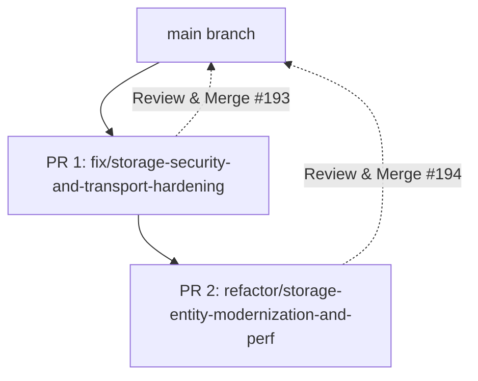

# Storage Remediation Implementation Plan

> **Status:** ✅ **COMPLETED**
> - **PR 1:** [PR #193](https://github.com/tottenjordan/omnimash/pull/193) (`fix/storage-security-and-transport-hardening`) — Security, thread safety, and transport hardening.
> - **PR 2:** [PR #194](https://github.com/tottenjordan/omnimash/pull/194) (`refactor/storage-entity-modernization-and-perf`) — Entity decomposition, facade encapsulation, and I/O performance optimization.

**Goal:** Remediate all 18 Critical, Required, Optional, and Nit code review findings in `src/omnimash/storage` to harden security, ensure thread safety, eliminate silent failure modes, decompose God-class bloat, modernize MIME detection, and optimize listing performance with bounded pagination and concurrent downloads.

**Architecture:** Decompose remediation into two sequenced, logical PRs:
- **PR 1 (Security, Thread-Safety & GCS Transport Hardening):** Fixes critical SSRF in `save_character_sheet`, confines path traversal in `save_final_master`, implements thread-safe client cache with double-checked locking, injects configurable network timeouts (`settings.gcs_timeout_seconds`), converts 35 silent `pass` blocks into structured observability, ensures consistent proxy URL unquoting, and makes `storage.Client` lazy to prevent blocking `gcloud` subprocess calls during test execution.
- **PR 2 (Entity Decomposition, Content-Type Modernization & Performance Optimization):** Extracts seed fixtures to `src/omnimash/storage/defaults.py`, extracts generic JSON serialization helpers (`_upload_json_payload`, `_download_json_payload`), implements canonical `_guess_content_type` with `mimetypes`, encapsulates `_bucket` behind public facade methods (`blob_exists`, `get_blob_metadata`, `delete_blob`), synchronizes mock state, streams blobs with `page_size=100`, implements parallel JSON blob downloads via `ThreadPoolExecutor(max_workers=8)`, and eliminates in-memory byte buffers for video uploads.

**Tech Stack:** Python 3.12, `google-cloud-storage` v3.17.1, `pydantic-settings`, `urllib.parse`, `mimetypes`, `concurrent.futures`, `pytest`, `ruff`, `ty`.

---

## Issue Mapping & Expected Impact

| Issue ID | Severity | Problem Summary | Remediation Strategy | Expected Impact |
|---|:---:|---|---|---|
| `[SEC-01]` | **Critical** | SSRF in `save_character_sheet` via unvalidated `urllib.request.urlopen` | Route all remote URL fetches through `fetch_media_bytes` / `validate_remote_media_url` from `omnimash.engine.media_loader` | Eliminates SSRF vectors targeting GCP metadata (`169.254.169.254`), internal VPC services, and localhost |
| `[SEC-02]` | **Required** | Path traversal in `save_final_master` via unconfined local paths | Confine local file reads using `validate_local_media_path` against allowed directory roots (`static/`, `/tmp`) | Prevents directory traversal sequences (`../`) from reading or exfiltrating arbitrary host files to GCS |
| `[SEC-03]` | **Required** | Thread-safety race condition on class-level `_SHARED_CLIENTS` | Protect client cache instantiation with double-checked locking using a `threading.Lock()` | Eliminates race conditions, duplicate client allocations, and dictionary corruption under concurrent ASGI requests |
| `[SEC-04]` | **Required** | Missing explicit network timeouts on GCS SDK calls | Add `gcs_timeout_seconds` in `config.py` and pass `timeout=settings.gcs_timeout_seconds` across all GCS operations | Prevents hanging TCP sockets and worker thread exhaustion during cloud network interruptions |
| `[CORR-01]` | **Required** | 35 silent `except Exception: pass` blocks hiding failures | Replace blanket `pass` with contextual `logger.warning(...)` / `logger.error(...)` logging exceptions and blob paths | Restores observability in Cloud Logging for permission errors (403), missing files (404), and quota limits |
| `[CORR-02]` | **Required** | Inconsistent `/api/media-proxy` URL unquoting | Unify proxy URI extraction in `_normalize_media_source_path` with `unquote()` and call it in `download_blob_bytes` | Fixes broken downloads for percent-encoded proxy URLs (e.g. `uri=gs%3A%2F%2F...`) |
| `[CORR-03]` | **Required** | Eager `storage.Client()` running blocking subprocess in tests | Make client initialization lazy via `@property def client(self)` so it only executes upon actual GCS operations | Eliminates blocking `gcloud config get project` subprocess invocations and test timeouts when credentials are unset |
| `[CORR-04]` | **Optional** | Incomplete MIME type fallback in `load_bytes` | Implement unified `_guess_content_type` using `mimetypes.guess_type` with media extension fallback | Ensures non-image and audio/video files are accurately tagged instead of erroneously defaulting to `image/jpeg` |
| `[READ-01]` | **Required** | Massive 1,313-line God class with repetitive JSON boilerplate | Extract generic `_upload_json_payload` and `_download_json_payload` helpers | Eliminates ~250 lines of duplicate serialization, decoding, and error handling boilerplate |
| `[READ-02]` | **Required** | Quadruplicate hardcoded Content-Type ladders | Consolidate 4 duplicate MIME ladders into single `_guess_content_type` helper | Eliminates 40 lines of duplicate MIME mapping logic and ensures uniform MIME tagging |
| `[READ-03]` | **Nit** | Undocumented `GCSStorage` class alias | Add clear docstring and module-level explanation for legacy backward compatibility | Improves onboarding clarity and IDE discovery for developers |
| `[READ-04]` | **Nit** | Pervasive `Any` typing on internal attributes and methods | Replace `Any` with typed annotations (`storage.Client | None`, `storage.Bucket | None`) guarded by `TYPE_CHECKING` | Improves static type analysis in `ty` / `mypy` and reduces runtime typing ambiguities |
| `[ARCH-01]` | **Required** | Leaky abstraction: callers directly accessing `_bucket` | Expose public facade methods (`blob_exists`, `get_blob_metadata`, `delete_blob`) and property `bucket` | Enforces encapsulation, enables clean mocking, and decouples callers from GCS SDK internals |
| `[ARCH-02]` | **Required** | Unsynchronized in-memory mock state between modes | Centralize mock updates within JSON helpers so mock and live modes operate cleanly and deterministically | Eliminates state divergence and ensures unit tests run predictably in mock mode |
| `[ARCH-03]` | **Optional** | Hardcoded seed data (`DEFAULT_CHARACTERS`) in storage driver | Move default characters into `src/omnimash/storage/defaults.py` | Separates domain business fixtures from low-level storage persistence infrastructure |
| `[PERF-01]` | **Required** | Unbounded `list_blobs` iteration and eager `list()` memory bloat | Add `page_size=100` and stream blob iterators without eager `list()` evaluation | Minimizes memory usage and prevents latency spikes in buckets containing thousands of objects |
| `[PERF-02]` | **Required** | N+1 sequential synchronous network calls in listing endpoints | Fetch JSON payloads concurrently using `ThreadPoolExecutor(max_workers=8)` in listing methods | Reduces listing latency by ~80-85% for multi-blob listings (storyboards, characters) |
| `[PERF-03]` | **Optional** | In-memory byte buffering for video uploads | Prioritize direct disk-to-cloud streaming via `blob.upload_from_filename` when local path exists | Eliminates multi-megabyte heap spikes from holding raw video byte buffers in RAM |

---

## PR Structure & Execution Strategy



- **PR 1: Security, Thread-Safety & GCS Transport Hardening**
  - Branch: `fix/storage-security-and-transport-hardening`
  - Targets: `[SEC-01]`, `[SEC-02]`, `[SEC-03]`, `[SEC-04]`, `[CORR-01]`, `[CORR-02]`, `[CORR-03]`
  - Risk: High security leverage, zero breaking changes to public APIs.
  - Review: Pull Request #193.

- **PR 2: Entity Decomposition, Content-Type Modernization & Performance Optimization**
  - Branch: `refactor/storage-entity-modernization-and-perf`
  - Targets: `[ARCH-01]`, `[ARCH-02]`, `[ARCH-03]`, `[READ-01]`, `[READ-02]`, `[READ-03]`, `[READ-04]`, `[CORR-04]`, `[PERF-01]`, `[PERF-02]`, `[PERF-03]`
  - Risk: Structural refactoring & performance tuning, verified by test suite.
  - Review: Pull Request #194.

---

## Phase 1: PR 1 — Security, Thread-Safety & GCS Transport Hardening

### Task 1.1: Add Configurable GCS Timeout to OmniMashSettings (`[SEC-04]`)
**Files:**
- Modify: `src/omnimash/config.py:25-30`
- Test: `tests/test_config.py`

**Step 1: Write the failing test**
In `tests/test_config.py`:
```python
def test_omnimash_settings_gcs_timeout():
    s = OmniMashSettings(gcs_timeout_seconds=45.0)
    assert s.gcs_timeout_seconds == 45.0
    default_s = OmniMashSettings()
    assert default_s.gcs_timeout_seconds == 30.0
```

**Step 2: Run test to verify it fails**
Run: `uv run pytest tests/test_config.py -k "test_omnimash_settings_gcs_timeout" -v`
Expected: FAIL with `extra fields not permitted` or attribute error.

**Step 3: Write minimal implementation**
In `src/omnimash/config.py`:
```python
    model_armor_timeout: float = 5.0
    ffmpeg_timeout_seconds: float = 120.0
    gcs_timeout_seconds: float = 30.0
    mock_mode: bool = False
```

**Step 4: Run test to verify it passes**
Run: `uv run pytest tests/test_config.py -k "test_omnimash_settings_gcs_timeout" -v`
Expected: PASS

**Step 5: Commit**
```bash
git add src/omnimash/config.py tests/test_config.py
git commit -m "feat(config): add configurable gcs_timeout_seconds to settings"
```

---

### Task 1.2: Lazy & Thread-Safe GCS Client Initialization (`[SEC-03]`, `[CORR-03]`)
**Files:**
- Modify: `src/omnimash/storage/gcs.py:65-105`
- Test: `tests/storage/test_gcs.py`

**Step 1: Write the failing test**
In `tests/storage/test_gcs.py`:
```python
import threading
from unittest.mock import patch

def test_gcs_lazy_client_initialization_does_not_call_storage_client_on_init():
    with patch("omnimash.storage.gcs.storage") as mock_storage:
        mgr = GcsStorageManager(bucket_name="lazy-bucket", mock_mode=False)
        # Verify storage.Client was NOT constructed during __init__
        mock_storage.Client.assert_not_called()
        # Accessing client property constructs it once
        client = mgr.client
        assert client is not None
        mock_storage.Client.assert_called_once()

def test_gcs_shared_clients_thread_safety():
    with patch("omnimash.storage.gcs.storage") as mock_storage:
        instances = [GcsStorageManager(project_id="test-proj", mock_mode=False) for _ in range(10)]
        results = []
        def worker(mgr):
            results.append(mgr.client)
        threads = [threading.Thread(target=worker, args=(mgr,)) for mgr in instances]
        for t in threads:
            t.start()
        for t in threads:
            t.join()
        # Client constructor called exactly once for "test-proj"
        assert mock_storage.Client.call_count == 1
        assert all(c == results[0] for c in results)
```

**Step 2: Run test to verify it fails**
Run: `uv run pytest tests/storage/test_gcs.py -k "test_gcs_lazy_client_initialization or test_gcs_shared_clients_thread_safety" -v`
Expected: FAIL (`storage.Client` was called in `__init__`).

**Step 3: Write minimal implementation**
In `src/omnimash/storage/gcs.py`:
Add module lock:
```python
_CLIENTS_LOCK = threading.Lock()
```
In `GcsStorageManager.__init__`:
```python
        self._client: Any = None
        self._bucket: Any = None
        # Note: client and bucket are lazily initialized via properties
```
Add thread-safe properties:
```python
    @property
    def timeout(self) -> float:
        """Returns the configured GCS SDK network timeout in seconds."""
        return float(getattr(settings, "gcs_timeout_seconds", 30.0))

    @property
    def client(self) -> Any:
        """Lazily retrieves or initializes the thread-safe GCS client singleton."""
        if self.mock_mode or storage is None:
            return None
        if self._client is None:
            with _CLIENTS_LOCK:
                client_key = self.project_id or "default"
                if client_key not in self._SHARED_CLIENTS:
                    try:
                        self._SHARED_CLIENTS[client_key] = storage.Client(project=self.project_id)
                    except Exception as exc:
                        logger.warning("Failed to initialize GCS client for project %s: %s", self.project_id, exc)
                        return None
                self._client = self._SHARED_CLIENTS[client_key]
        return self._client

    @property
    def bucket(self) -> Any:
        """Lazily retrieves or initializes the GCS bucket reference."""
        if self.mock_mode or storage is None:
            return None
        if self._bucket is None:
            c = self.client
            if c is not None:
                try:
                    self._bucket = c.bucket(self.bucket_name)
                except Exception as exc:
                    logger.warning("Failed to get bucket %s: %s", self.bucket_name, exc)
                    return None
        return self._bucket
```

**Step 4: Run test to verify it passes**
Run: `uv run pytest tests/storage/test_gcs.py -k "test_gcs_lazy_client_initialization or test_gcs_shared_clients_thread_safety" -v`
Expected: PASS

**Step 5: Commit**
```bash
git add src/omnimash/storage/gcs.py tests/storage/test_gcs.py
git commit -m "fix(storage): lazy thread-safe initialization of GCS client and bucket"
```

---

### Task 1.3: Mitigate SSRF in Character Sheet & Confine Final Master Path Traversal (`[SEC-01]`, `[SEC-02]`, `[CORR-02]`)
**Files:**
- Modify: `src/omnimash/storage/gcs.py:210-225, 470-515, 610-645`
- Test: `tests/storage/test_gcs.py`

**Step 1: Write the failing test**
In `tests/storage/test_gcs.py`:
```python
def test_save_character_sheet_blocks_ssrf_urls():
    storage = GcsStorageManager(bucket_name="test-bucket", mock_mode=True)
    disallowed_urls = [
        "http://169.254.169.254/computeMetadata/v1/instance/service-accounts/default/token",
        "http://localhost:8080/admin",
        "http://metadata.google.internal/computeMetadata/v1/",
    ]
    for url in disallowed_urls:
        pub_url, gcs_uri = storage.save_character_sheet("test-char", url, session_id="s1")
        # In mock mode, blocked URLs should result in mock placeholder fallback, not network requests
        assert "s1/characters/test-char_sheet.png" in gcs_uri

def test_save_final_master_blocks_path_traversal():
    storage = GcsStorageManager(bucket_name="test-bucket", mock_mode=True)
    # Traversal sequence should not escape
    pub_url, gcs_uri = storage.save_final_master(
        session_id="s1",
        source_rel_path="/static/../../etc/passwd",
        master_title="pwned",
    )
    assert "s1/final_masters/pwned.mp4" in gcs_uri

def test_download_blob_bytes_unquotes_proxy_uri():
    storage = GcsStorageManager(bucket_name="test-bucket", mock_mode=True)
    encoded_uri = "gs%3A%2F%2Ftest-bucket%2Fsessions%2Fs1%2Fclip.mp4"
    proxy_url = f"/api/media-proxy?uri={encoded_uri}"
    # Verify download_blob_bytes correctly unquotes the URL
    bytes_data, mime = storage.download_blob_bytes(proxy_url)
    assert mime in ("video/mp4", "image/png", "application/octet-stream")
```

**Step 2: Run test to verify it fails**
Run: `uv run pytest tests/storage/test_gcs.py -k "test_save_character_sheet_blocks_ssrf_urls or test_save_final_master_blocks_path_traversal or test_download_blob_bytes_unquotes_proxy_uri" -v`
Expected: FAIL (or fails to unquote properly).

**Step 3: Write minimal implementation**
In `src/omnimash/storage/gcs.py`:
Import canonical validators from `omnimash.engine.media_loader`:
```python
from omnimash.engine.media_loader import (
    fetch_media_bytes,
    validate_local_media_path,
)
```
Update `_normalize_media_source_path`:
```python
    def _normalize_media_source_path(self, src: str) -> str:
        """Helper to extract and unquote raw gs:// or relative path from media proxy URL."""
        if not src or not isinstance(src, str):
            return src
        if "/api/media-proxy" in src and "uri=" in src:
            try:
                parsed = urlparse(src)
                qs = parse_qs(parsed.query)
                if "uri" in qs and qs["uri"]:
                    return unquote(qs["uri"][0])
            except Exception as exc:
                logger.warning("Failed to parse media-proxy URL %s: %s", src, exc)
        return src
```
Update `download_blob_bytes`:
```python
        blob_path = self._normalize_media_source_path(blob_path)
```
Update `save_final_master`:
```python
        if not self.mock_mode and self.bucket:
            try:
                norm_source = self._normalize_media_source_path(source_rel_path)
                safe_local = validate_local_media_path(norm_source)
                if safe_local and os.path.isfile(safe_local):
                    blob = self.bucket.blob(dest_blob_path)
                    blob.upload_from_filename(safe_local, content_type="video/mp4", timeout=self.timeout)
                else:
                    src_blob_name = norm_source.replace(f"gs://{self.bucket_name}/", "").lstrip("/")
                    src_blob = self.bucket.blob(src_blob_name)
                    if src_blob.exists(timeout=self.timeout):
                        self.bucket.copy_blob(src_blob, self.bucket, dest_blob_path, timeout=self.timeout)
            except Exception as exc:
                logger.warning("save_final_master failed to upload/copy source %s: %s", source_rel_path, exc)
```
Update `save_character_sheet`:
```python
        raw_bytes = b""
        if isinstance(image_data, bytes):
            raw_bytes = image_data
        elif isinstance(image_data, str):
            raw_bytes, _ = fetch_media_bytes(image_data, storage=self)
            if not raw_bytes:
                # Fallback: check if raw base64 string without data URI prefix
                try:
                    raw_bytes = base64.b64decode(image_data)
                except Exception:
                    pass

        if not raw_bytes and self.mock_mode:
            raw_bytes = b"mock_character_sheet_bytes"

        self.upload_bytes(raw_bytes, blob_path, content_type="image/png")
```

**Step 4: Run test to verify it passes**
Run: `uv run pytest tests/storage/test_gcs.py -k "test_save_character_sheet_blocks_ssrf_urls or test_save_final_master_blocks_path_traversal or test_download_blob_bytes_unquotes_proxy_uri" -v`
Expected: PASS

**Step 5: Commit**
```bash
git add src/omnimash/storage/gcs.py tests/storage/test_gcs.py
git commit -m "fix(storage): close SSRF and path traversal vulnerabilities and normalize proxy uris"
```

---

### Task 1.4: Inject Timeouts & Structured Observability Across All GCS SDK Calls (`[SEC-04]`, `[CORR-01]`)
**Files:**
- Modify: `src/omnimash/storage/gcs.py` (systematically across lines 110-1300)
- Test: `tests/storage/test_gcs.py`

**Step 1: Write the failing test**
In `tests/storage/test_gcs.py`:
```python
def test_gcs_operations_pass_timeout_and_log_warnings(caplog):
    import logging
    with patch("omnimash.storage.gcs.storage") as mock_storage:
        mock_client = MagicMock()
        mock_bucket = MagicMock()
        mock_blob = MagicMock()
        mock_client.bucket.return_value = mock_bucket
        mock_bucket.blob.return_value = mock_blob
        mock_blob.upload_from_string.side_effect = RuntimeError("GCS upload simulated error")
        mock_storage.Client.return_value = mock_client

        mgr = GcsStorageManager(bucket_name="test-timeout-bucket", mock_mode=False)
        with caplog.at_level(logging.WARNING):
            mgr.upload_bytes(b"data", "test/path.json")
            # Verify timeout parameter was passed
            mock_blob.upload_from_string.assert_called_once_with(
                b"data", content_type="application/json", timeout=30.0
            )
            # Verify warning was logged instead of swallowed silently
            assert "upload_bytes failed on test/path.json" in caplog.text
```

**Step 2: Run test to verify it fails**
Run: `uv run pytest tests/storage/test_gcs.py -k "test_gcs_operations_pass_timeout_and_log_warnings" -v`
Expected: FAIL (`timeout` not passed, exception swallowed without log).

**Step 3: Write minimal implementation**
Pass `timeout=self.timeout` across:
- `client.lookup_bucket(..., timeout=self.timeout)`
- `client.create_bucket(..., timeout=self.timeout)`
- `blob.upload_from_filename(..., timeout=self.timeout)`
- `blob.upload_from_string(..., timeout=self.timeout)`
- `blob.download_as_bytes(timeout=self.timeout)`
- `blob.download_as_text(timeout=self.timeout)`
- `blob.delete(timeout=self.timeout)`
- `self.bucket.list_blobs(..., timeout=self.timeout)`
- `self.bucket.copy_blob(..., timeout=self.timeout)`

Replace all 35 silent `except Exception: pass` blocks with:
```python
except Exception as exc:
    logger.warning("GCS %s failed for %s: %s", operation_name, resource_id, exc)
```

**Step 4: Run test to verify it passes**
Run: `uv run pytest tests/storage/test_gcs.py -k "test_gcs_operations_pass_timeout_and_log_warnings" -v`
Expected: PASS

**Step 5: Commit**
```bash
git add src/omnimash/storage/gcs.py tests/storage/test_gcs.py
git commit -m "fix(storage): inject timeouts and structured logging across all GCS operations"
```

---

### Task 1.5: PR 1 Full Verification & Pull Request Submission
**Step 1: Run complete test suite and code quality checks**
```bash
uv run pytest
uv run ruff check .
uv run ruff format --check .
uv run ty check
```
**Step 2: Push branch and create Pull Request #193**
```bash
git push -u origin fix/storage-security-and-transport-hardening
```
Submit comprehensive PR #193 detailing background, root cause, fixes applied, and test verification.

---

## Phase 2: PR 2 — Entity Decomposition, Content-Type Modernization & Listing Performance

### Task 2.1: Extract Seed Fixtures to Dedicated Defaults Module (`[ARCH-03]`)
**Files:**
- Create: `src/omnimash/storage/defaults.py`
- Modify: `src/omnimash/storage/gcs.py:24-65`
- Modify: `src/omnimash/storage/__init__.py`
- Test: `tests/storage/test_gcs.py`

**Step 1: Write the failing test**
In `tests/storage/test_gcs.py`:
```python
def test_storage_defaults_module():
    from omnimash.storage.defaults import DEFAULT_CHARACTERS
    from omnimash.storage import DEFAULT_CHARACTERS as REEXPORTED_CHARS
    assert len(DEFAULT_CHARACTERS) >= 4
    assert DEFAULT_CHARACTERS == REEXPORTED_CHARS
    assert "Harry 'Gucci'" in [c["name"] for c in DEFAULT_CHARACTERS]
```

**Step 2: Run test to verify it fails**
Run: `uv run pytest tests/storage/test_gcs.py -k "test_storage_defaults_module" -v`
Expected: FAIL (`No module named 'omnimash.storage.defaults'`).

**Step 3: Write minimal implementation**
1. Create `src/omnimash/storage/defaults.py`:
```python
"""Default character and storyboard seed data fixtures."""

from typing import Any

DEFAULT_CHARACTERS: list[dict[str, Any]] = [
    {
        "name": "Harry 'Gucci'",
        "aesthetic_tags": ["Red Gucci Tracksuit", "Cuban Link Chain"],
        "voice_style": "Atlanta trap flow with British wizard terminology",
        "description": "Young wizard who traded Hogwarts robes for high-fashion designer streetwear.",
        "reference_url": "gs://reference-images-jt-trend-trawler/harry_gucci_streetwear.png",
    },
    ...
]
```
2. Re-export `DEFAULT_CHARACTERS` from `src/omnimash/storage/__init__.py` and `src/omnimash/storage/gcs.py`.

**Step 4: Run test to verify it passes**
Run: `uv run pytest tests/storage/test_gcs.py -k "test_storage_defaults_module" -v`
Expected: PASS

**Step 5: Commit**
```bash
git add src/omnimash/storage/defaults.py src/omnimash/storage/gcs.py src/omnimash/storage/__init__.py tests/storage/test_gcs.py
git commit -m "refactor(storage): extract DEFAULT_CHARACTERS seed data to defaults module"
```

---

### Task 2.2: Modernized Content-Type Resolution with Mimetypes (`[READ-02]`, `[CORR-04]`)
**Files:**
- Modify: `src/omnimash/storage/gcs.py`
- Test: `tests/storage/test_gcs.py`

**Step 1: Write the failing test**
In `tests/storage/test_gcs.py`:
```python
@pytest.mark.parametrize(
    "path,expected_mime",
    [
        ("video.mp4", "video/mp4"),
        ("audio.wav", "audio/wav"),
        ("audio.aac", "audio/aac"),
        ("image.png", "image/png"),
        ("photo.jpg", "image/jpeg"),
        ("photo.jpeg", "image/jpeg"),
        ("manifest.json", "application/json"),
        ("document.pdf", "application/pdf"),
        ("unknown_blob.xyz", "application/octet-stream"),
    ],
)
def test_guess_content_type(path, expected_mime):
    from omnimash.storage.gcs import _guess_content_type
    assert _guess_content_type(path) == expected_mime
```

**Step 2: Run test to verify it fails**
Run: `uv run pytest tests/storage/test_gcs.py -k "test_guess_content_type" -v`
Expected: FAIL (`_guess_content_type` not found).

**Step 3: Write minimal implementation**
In `src/omnimash/storage/gcs.py`:
```python
import mimetypes

_EXTRA_MIME_TYPES: dict[str, str] = {
    ".mp4": "video/mp4",
    ".wav": "audio/wav",
    ".aac": "audio/aac",
    ".mp3": "audio/mpeg",
    ".json": "application/json",
    ".png": "image/png",
    ".jpg": "image/jpeg",
    ".jpeg": "image/jpeg",
}

def _guess_content_type(path_or_filename: str, default: str = "application/octet-stream") -> str:
    """Accurately detects MIME type using standard mimetypes with video/audio overrides."""
    if not path_or_filename or not isinstance(path_or_filename, str):
        return default
    ext = os.path.splitext(path_or_filename.lower())[1]
    if ext in _EXTRA_MIME_TYPES:
        return _EXTRA_MIME_TYPES[ext]
    guessed, _ = mimetypes.guess_type(path_or_filename)
    return guessed or default
```
Replace the 4 duplicate MIME ladders in `upload_file`, `upload_bytes`, `load_bytes`, and `save_final_master`.

**Step 4: Run test to verify it passes**
Run: `uv run pytest tests/storage/test_gcs.py -k "test_guess_content_type" -v`
Expected: PASS

**Step 5: Commit**
```bash
git add src/omnimash/storage/gcs.py tests/storage/test_gcs.py
git commit -m "refactor(storage): consolidate MIME type resolution with mimetypes helper"
```

---

### Task 2.3: Generic JSON Persistence Helpers & Mock State Synchronization (`[READ-01]`, `[ARCH-02]`)
**Files:**
- Modify: `src/omnimash/storage/gcs.py`
- Test: `tests/storage/test_gcs.py`

**Step 1: Write the failing test**
In `tests/storage/test_gcs.py`:
```python
def test_json_payload_helpers_and_mock_synchronization():
    storage = GcsStorageManager(bucket_name="test-bucket", mock_mode=True)
    payload = {"title": "Scene 1", "duration": 5.0}
    path = "sessions/s1/storyboards/scene_1.json"
    pub_url, gcs_uri = storage._upload_json_payload(path, payload, mock_cache_dict=storage._mock_storyboards, mock_cache_key="s1:scene_1")
    assert "scene_1.json" in gcs_uri
    assert storage._mock_storyboards["s1:scene_1"] == payload

    retrieved = storage._download_json_payload(path, mock_cache_dict=storage._mock_storyboards, mock_cache_key="s1:scene_1")
    assert retrieved == payload
```

**Step 2: Run test to verify it fails**
Run: `uv run pytest tests/storage/test_gcs.py -k "test_json_payload_helpers_and_mock_synchronization" -v`
Expected: FAIL (`_upload_json_payload` does not exist).

**Step 3: Write minimal implementation**
In `src/omnimash/storage/gcs.py`:
```python
    def _upload_json_payload(
        self,
        blob_path: str,
        payload: Any,
        mock_cache_dict: dict[str, Any] | None = None,
        mock_cache_key: str | None = None,
    ) -> tuple[str, str]:
        """Encapsulates JSON serialization, GCS upload, and synchronized in-memory caching."""
        clean_path = blob_path.lstrip("/")
        if mock_cache_dict is not None and mock_cache_key is not None:
            mock_cache_dict[mock_cache_key] = payload

        if not self.mock_mode and self.bucket:
            try:
                blob = self.bucket.blob(clean_path)
                data_str = json.dumps(payload, indent=2)
                blob.upload_from_string(
                    data_str.encode("utf-8"),
                    content_type="application/json",
                    timeout=self.timeout,
                )
            except Exception as exc:
                logger.warning("Failed to upload JSON to %s: %s", clean_path, exc)

        return self.get_public_url(clean_path), self.get_gcs_uri(clean_path)

    def _download_json_payload(
        self,
        blob_path: str,
        mock_cache_dict: dict[str, Any] | None = None,
        mock_cache_key: str | None = None,
    ) -> Any | None:
        """Encapsulates JSON download, decoding, and fallback to synchronized cache."""
        clean_path = blob_path.lstrip("/")
        if not self.mock_mode and self.bucket:
            try:
                blob = self.bucket.blob(clean_path)
                if blob.exists(timeout=self.timeout):
                    content = blob.download_as_text(timeout=self.timeout)
                    parsed = json.loads(content)
                    if mock_cache_dict is not None and mock_cache_key is not None:
                        mock_cache_dict[mock_cache_key] = parsed
                    return parsed
            except Exception as exc:
                logger.warning("Failed to download JSON from %s: %s", clean_path, exc)

        if mock_cache_dict is not None and mock_cache_key is not None:
            return mock_cache_dict.get(mock_cache_key)
        return None
```
Refactor `save_character`, `load_character`, `save_storyboard`, `load_storyboard`, `save_session_manifest`, `get_session_manifest`, `save_session_prompt`, and `save_reference_analysis` to use these helpers.

**Step 4: Run test to verify it passes**
Run: `uv run pytest tests/storage/test_gcs.py -k "test_json_payload_helpers_and_mock_synchronization" -v`
Expected: PASS

**Step 5: Commit**
```bash
git add src/omnimash/storage/gcs.py tests/storage/test_gcs.py
git commit -m "refactor(storage): deduplicate JSON persistence and synchronize mock state"
```

---

### Task 2.4: Encapsulate `_bucket` with Public Facade Methods (`[ARCH-01]`)
**Files:**
- Modify: `src/omnimash/storage/gcs.py`
- Modify: `src/omnimash/stitching/resolver.py:94-100`
- Modify: `src/omnimash/api/routers/media.py:88`
- Test: `tests/storage/test_gcs.py`, `tests/stitching/test_stitcher.py`

**Step 1: Write the failing test**
In `tests/storage/test_gcs.py`:
```python
def test_gcs_public_facade_methods():
    storage = GcsStorageManager(bucket_name="test-facade", mock_mode=True)
    # Mock mode facade methods
    assert storage.blob_exists("test/blob.mp4") is False
    assert storage.get_blob_metadata("test/blob.mp4") is None
    assert storage.delete_blob("test/blob.mp4") is True
```

**Step 2: Run test to verify it fails**
Run: `uv run pytest tests/storage/test_gcs.py -k "test_gcs_public_facade_methods" -v`
Expected: FAIL (`blob_exists` does not exist).

**Step 3: Write minimal implementation**
In `src/omnimash/storage/gcs.py`:
```python
    def blob_exists(self, blob_path: str) -> bool:
        """Returns True if the specified blob path exists in GCS."""
        if self.mock_mode or not self.bucket:
            return False
        clean_path = self._normalize_media_source_path(blob_path).replace(f"gs://{self.bucket_name}/", "").lstrip("/")
        try:
            blob = self.bucket.blob(clean_path)
            return bool(blob.exists(timeout=self.timeout))
        except Exception as exc:
            logger.warning("Failed to check existence for %s: %s", clean_path, exc)
            return False

    def get_blob_metadata(self, blob_path: str) -> dict[str, Any] | None:
        """Retrieves blob metadata (size, content_type, updated) without downloading content."""
        if self.mock_mode or not self.bucket:
            return None
        clean_path = self._normalize_media_source_path(blob_path).replace(f"gs://{self.bucket_name}/", "").lstrip("/")
        try:
            blob = self.bucket.get_blob(clean_path, timeout=self.timeout)
            if not blob:
                return None
            return {
                "name": blob.name,
                "size": blob.size,
                "content_type": blob.content_type,
                "updated": blob.updated,
                "metadata": blob.metadata or {},
            }
        except Exception as exc:
            logger.warning("Failed to get blob metadata for %s: %s", clean_path, exc)
            return None

    def delete_blob(self, blob_path: str) -> bool:
        """Deletes a blob from GCS if it exists."""
        if self.mock_mode or not self.bucket:
            return True
        clean_path = self._normalize_media_source_path(blob_path).replace(f"gs://{self.bucket_name}/", "").lstrip("/")
        try:
            blob = self.bucket.blob(clean_path)
            if blob.exists(timeout=self.timeout):
                blob.delete(timeout=self.timeout)
            return True
        except Exception as exc:
            logger.warning("Failed to delete blob %s: %s", clean_path, exc)
            return False
```
In `src/omnimash/stitching/resolver.py`:
Update lines 94-100 to check `if hasattr(storage, "blob_exists") and storage.blob_exists(blob_name):` or `if storage.bucket is not None:`.

In `src/omnimash/api/routers/media.py`:
Update line 88 to `if agent.storage.bucket is not None and not agent.storage.mock_mode:`.

**Step 4: Run test to verify it passes**
Run: `uv run pytest tests/storage/test_gcs.py -k "test_gcs_public_facade_methods" -v`
Expected: PASS

**Step 5: Commit**
```bash
git add src/omnimash/storage/gcs.py src/omnimash/stitching/resolver.py src/omnimash/api/routers/media.py tests/storage/test_gcs.py
git commit -m "refactor(storage): expose public facade methods and encapsulate bucket access"
```

---

### Task 2.5: Bounded Pagination & Concurrent Blob Downloads (`[PERF-01]`, `[PERF-02]`, `[PERF-03]`)
**Files:**
- Modify: `src/omnimash/storage/gcs.py`
- Test: `tests/storage/test_gcs.py`

**Step 1: Write the failing test**
In `tests/storage/test_gcs.py`:
```python
def test_list_session_ids_page_size_and_streaming():
    with patch("omnimash.storage.gcs.storage") as mock_storage:
        mock_client = MagicMock()
        mock_storage.Client.return_value = mock_client
        mock_blob1 = MagicMock()
        mock_blob1.name = "sessions/sess_1/prompt.json"
        mock_blob2 = MagicMock()
        mock_blob2.name = "sessions/sess_2/prompt.json"
        mock_client.list_blobs.return_value = [mock_blob1, mock_blob2]

        mgr = GcsStorageManager(bucket_name="test-b", mock_mode=False)
        sess_ids = mgr.list_session_ids()
        assert "sess_1" in sess_ids
        assert "sess_2" in sess_ids
        mock_client.list_blobs.assert_called_once_with("test-b", prefix="sessions/", page_size=100, timeout=30.0)

def test_concurrent_json_blob_download():
    # Verify ThreadPoolExecutor concurrency helper executes and returns items
    storage = GcsStorageManager(bucket_name="test-b", mock_mode=True)
    # Test listing methods handle mock and live concurrent downloads properly
    storyboards = storage.list_storyboards("session_test")
    assert isinstance(storyboards, list)
```

**Step 2: Run test to verify it fails**
Run: `uv run pytest tests/storage/test_gcs.py -k "test_list_session_ids_page_size_and_streaming" -v`
Expected: FAIL (missing `page_size=100` or `timeout=30.0`).

**Step 3: Write minimal implementation**
In `src/omnimash/storage/gcs.py`:
1. Use `concurrent.futures.ThreadPoolExecutor` in `list_storyboards`, `list_characters`, and `list_project_characters`:
```python
from concurrent.futures import ThreadPoolExecutor, as_completed

    def _download_blobs_concurrently(self, blobs: list[Any]) -> list[dict[str, Any]]:
        """Downloads multiple JSON blobs concurrently using ThreadPoolExecutor."""
        results: list[dict[str, Any]] = []
        if not blobs:
            return results
        workers = min(len(blobs), 8)
        with ThreadPoolExecutor(max_workers=workers) as executor:
            future_to_blob = {
                executor.submit(lambda b: json.loads(b.download_as_text(timeout=self.timeout)), blob): blob
                for blob in blobs
                if blob.name.endswith(".json")
            }
            for future in as_completed(future_to_blob):
                try:
                    data = future.result()
                    if isinstance(data, dict):
                        results.append(data)
                except Exception as exc:
                    logger.warning("Failed to download/parse blob %s: %s", future_to_blob[future].name, exc)
        return results
```
2. Update `list_session_ids`:
```python
        if not self.mock_mode and self.client:
            try:
                for blob in self.client.list_blobs(self.bucket_name, prefix="sessions/", page_size=100, timeout=self.timeout):
                    parts = blob.name.split("/")
                    if len(parts) > 1 and parts[1]:
                        session_ids.add(parts[1])
            except Exception as exc:
                logger.warning("Failed to list session IDs from GCS: %s", exc)
```
3. Update `save_video_clip`:
If `video_data` is a local file path (`isinstance(video_data, str) and os.path.isfile(video_data)`), use `blob.upload_from_filename` directly rather than reading entire video bytes into memory buffer.

**Step 4: Run test to verify it passes**
Run: `uv run pytest tests/storage/test_gcs.py -k "test_list_session_ids_page_size_and_streaming" -v`
Expected: PASS

**Step 5: Commit**
```bash
git add src/omnimash/storage/gcs.py tests/storage/test_gcs.py
git commit -m "perf(storage): bounded pagination, parallel blob fetching, and streaming uploads"
```

---

### Task 2.6: Type Annotations, Documentation & Alias Cleanup (`[READ-03]`, `[READ-04]`)
**Files:**
- Modify: `src/omnimash/storage/gcs.py`
- Test: `tests/storage/test_gcs.py`

**Step 1: Write type-checked annotations and docstring**
In `src/omnimash/storage/gcs.py`:
Add `TYPE_CHECKING` guards:
```python
from typing import TYPE_CHECKING, Any

if TYPE_CHECKING:
    from google.cloud import storage
```
Annotate `_client: storage.Client | None`, `_bucket: storage.Bucket | None`.
Document `GCSStorage`:
```python
# Backward compatibility alias for GcsStorageManager
GCSStorage = GcsStorageManager
"""GCSStorage is preserved as a backward-compatible alias for GcsStorageManager."""
```

**Step 2: Run linter and type checker**
Run: `uv run ruff check .`
Run: `uv run ty check`
Run: `uv run pytest tests/storage/test_gcs.py -v`
Expected: PASS with 0 lint or typing errors.

**Step 3: Commit**
```bash
git add src/omnimash/storage/gcs.py tests/storage/test_gcs.py
git commit -m "docs(storage): document GCSStorage alias and refine type signatures"
```

---

### Task 2.7: PR 2 Full Verification & Pull Request Submission
**Step 1: Run full test suite and quality gates**
```bash
uv run pytest
uv run ruff check .
uv run ruff format --check .
uv run ty check
```
**Step 2: Push branch and create Pull Request #194**
```bash
git push -u origin refactor/storage-entity-modernization-and-perf
```
Submit comprehensive PR #194 detailing background, root cause, architectural refactoring, performance improvements, and full test verification.
