# DOMA Phase 1 & Phase 2 Implementation Plan
### Closed-Loop Multimodal Prompt Optimization & Directorial Memory Agent

> **For Agent:** REQUIRED SUB-SKILL: Use superpowers:executing-plans to implement this plan task-by-task.

**Goal:** Build an end-to-end closed-loop evaluation and memory system for OmniMash that captures directorial user feedback on rendered videos, performs on-demand multimodal critique (`gemini-3.8-flash`), integrates with the Vertex AI Agent Platform Memory Bank, and enables automated regression evaluation in CI/CD.

**Architecture:**
1. **Telemetry & Feedback Layer**: Pydantic schemas in `src/omnimash/evaluation/models.py` and `POST /api/feedback` to persist structured evaluation triplets $(\text{Prompt}, \text{Video}, \text{Feedback})$ in GCS.
2. **Multimodal Critic & Refiner Layer**: `VideoCriticAgent` inspecting GCS MP4 video artifacts via `Part.from_uri`, coupled with `PromptRefiner` (Reflexion verbal self-reflection) and `StrategyBankManager` (Vertex AI Agent Platform Memory Bank + GCS hybrid mirror).
3. **Screening Room UI**: Directorial Review Bar in Act 3 with 1–5 stars, defect tags, critique input, and an AI Diagnosis card with a 1-click "Approve & Re-Render" patch.

**Tech Stack:** Python 3.12, FastAPI, Pydantic v2, Google ADK 2.5+, Google GenAI SDK (`gemini-3.8-flash`), Vertex AI Agent Engine (`agent_engines`), Google Cloud Storage, Pytest, Ruff, Ty.

---

## User Review Required

> [!IMPORTANT]
> **Confirmed Execution Strategy**:
> - **PR Track 1 (Backend Telemetry & Persistence)**: Models, GCS methods, and `feedback` router. Fully self-contained.
> - **PR Track 2 (Evaluation & Strategy Bank Engine)**: `VideoCriticAgent`, `PromptRefiner`, `StrategyBankManager` with Agent Platform Memory Bank adapter.
> - **PR Track 3 (Directorial Studio UI & Always-On E2E Test Suite)**: Act 3 Review Bar, AI Diagnosis Card, and Playwright / Pytest CI/CD test suite.
>
> All tracks are designed so Tracks 1 and 2 can be developed in parallel, and Track 3 builds on top of their verified API contracts.

---

## Proposed Changes

```mermaid
graph LR
    subgraph Track1["Track 1: Models & Telemetry API"]
        M[src/omnimash/evaluation/models.py]
        G[src/omnimash/storage/gcs.py]
        RF[src/omnimash/api/routers/feedback.py]
    end

    subgraph Track2["Track 2: Multimodal Critic & Memory"]
        VC[src/omnimash/evaluation/video_critic.py]
        PR[src/omnimash/evaluation/prompt_refiner.py]
        SB[src/omnimash/evaluation/strategy_bank.py]
    end

    subgraph Track3["Track 3: UI & CI/CD Guard"]
        UI[src/omnimash/api/templates/index.html]
        E2E[tests/evaluation/test_eval_e2e.py]
    end

    Track1 --> Track2
    Track1 --> Track3
    Track2 --> Track3
```



---

## Track 1: Models, GCS Persistence & Telemetry API (PR #1)

### [NEW] `src/omnimash/evaluation/__init__.py`
Empty package initializer exposing core models and evaluation classes.

### [NEW] `src/omnimash/evaluation/models.py`
Pydantic v2 schemas:
- `DefectCategory`: Enum (`TAG_COLLISION`, `PHANTOM_KEYFRAME`, `LIKENESS_DRIFT`, `WARDROBE_CONTRADICTION`, `AUDIO_DROWNED`, `AUDIO_VOCAL_HALLUCINATION`, `TEMPORAL_BEAT_MISSED`, `OFFSCREEN_LIPSYNC_ERROR`).
- `UserFeedbackRecord`: `feedback_id`, `session_id`, `turn_id`, `rating` (1–5), `defects`, `critique_text`, `timestamp`.
- `DimensionScore`: `score` (0–100), `passed`, `evidence`, `timestamp_range`.
- `VideoEvaluationScorecard`: `evaluation_id`, `session_id`, `turn_id`, `overall_rating`, `video_text_adherence`, `character_likeness`, `audio_visual_harmony`, `tag_and_index_integrity`, `detected_defects`, `verbal_critique`, `suggested_prompt_patch`, `pass_verdict`.
- `DirectorialInvariantRule`: `rule_id`, `category`, `trigger_pattern`, `invariant_directive`, `rationale`, `confidence_score`, `times_applied`, `defect_reduction_rate`.
- `StrategyBank`: `version`, `updated_at`, `rules`.
- `ExemplarPromptRecord`: `exemplar_id`, `session_id`, `concept`, `style_preset`, `compiled_4block_prompt`, `scorecard`, `user_rating`, `created_at`.

### [MODIFY] `src/omnimash/storage/gcs.py`
Add GCS persistence helpers with `mock_mode` support:
- `save_feedback(session_id: str, turn_id: str, feedback: dict[str, Any]) -> str`: Persists to `sessions/{session_id}/turns/{turn_id}/feedback.json`.
- `get_feedback(session_id: str, turn_id: str) -> dict[str, Any] | None`: Reads feedback JSON.
- `save_scorecard(session_id: str, turn_id: str, scorecard: dict[str, Any]) -> str`: Persists to `sessions/{session_id}/turns/{turn_id}/evaluation_scorecard.json`.
- `get_scorecard(session_id: str, turn_id: str) -> dict[str, Any] | None`: Reads scorecard JSON.
- `save_strategy_bank(bank_data: dict[str, Any], project_id: str | None = None) -> str`: Persists to `meta/strategy_bank.json` (global) or `projects/{project_id}/strategy_bank.json` (project-scoped).
- `get_strategy_bank(project_id: str | None = None) -> dict[str, Any] | None`: Retrieves strategy bank JSON.

### [NEW] `src/omnimash/api/routers/feedback.py`
FastAPI router (`/api/feedback` and `/api/eval`):
- `POST /api/feedback`: Submits `UserFeedbackRecord`, saves to GCS, returns confirmation.
- `GET /api/feedback/{session_id}/{turn_id}`: Retrieves existing feedback.
- `GET /api/eval/scorecard/{session_id}/{turn_id}`: Retrieves the latest evaluation scorecard.

### [MODIFY] `src/omnimash/api/app.py`
Register `feedback_router.router` in `create_app()`.

### [NEW] `tests/evaluation/test_models.py`
Validate serialization, enum conversions, default values, and range validators for all evaluation schemas.

### [NEW] `tests/api/test_feedback.py`
Integration tests for `POST /api/feedback`, `GET /api/feedback`, and `GET /api/eval/scorecard` with `TestClient` in both live and `mock_mode`.

---

## Track 2: Multimodal Video Critic & Strategy Bank Memory Engine (PR #2)

### [NEW] `src/omnimash/evaluation/video_critic.py`
`VideoCriticAgent`:
- Uses `gemini-3.8-flash` via the `google-genai` SDK (`location="global"`).
- Ingests video directly via `types.Part.from_uri(file_uri=gcs_uri, mime_type="video/mp4")`.
- Ingests reference images via `types.Part.from_uri` or bytes.
- Rubric Evaluation Prompt: Deconstructs 4-Block prompt into verification checks:
  1. *Video-Text Adherence* (chronological check of `[0-3s]`, `[3-6s]`, `[6-10s]`).
  2. *Character Likeness & Zero Wardrobe Redundancy* (facial drift check, clothing contradiction check).
  3. *Audio Balance* (background instrumental ducking under spoken dialogue).
  4. *Tag & Index Symmetry* (1:1 ordinal matching).
- Returns validated `VideoEvaluationScorecard`. Supports deterministic mock mode when `mock_mode=True`.

### [NEW] `src/omnimash/evaluation/prompt_refiner.py`
`PromptRefiner`:
- Implements the **Reflexion** framework.
- Consumes Triplet: `(original_prompt, scorecard, user_feedback)`.
- Generates natural-language diagnostic critique.
- Employs regex/heuristic prompt mutators to generate `repaired_prompt`:
  - Strips conflicting wardrobe descriptions from `### CHARACTER PROFILES` if likeness drifted.
  - Fixes missing `instrumental` prefix or ducking directives if audio drowned.
  - Re-anchors missing character reference tags.
- Returns `suggested_prompt_patch` and diff summary.

### [NEW] `src/omnimash/evaluation/strategy_bank.py`
`StrategyBankManager`:
- Implements the **Dual-Layer Memory System**:
  - **Vertex AI Agent Platform Memory Bank**: Uses `PreloadMemoryTool` and `client.search_memories()` / `client.generate_memories()` when `GOOGLE_CLOUD_AGENT_ENGINE_ID` is set.
  - **GCS Storage Mirror**: Reads/writes to `meta/strategy_bank.json` (global engineering rules) and `projects/{project_id}/strategy_bank.json` (project-scoped stylistic rules).
- Seeds 12 foundational invariants:
  - *Rule 1*: Instrumental audio prefix and ducking.
  - *Rule 2*: Zero Wardrobe Redundancy with reference sheets.
  - *Rule 3*: Dynamic keyframe offset ($1 + \text{len(keyframes)}$).
  - *Rule 4*: Spatial screen-staging for multi-character interaction.
- Provides `query_applicable_rules(concept, characters, has_keyframe) -> list[DirectorialInvariantRule]`.

### [MODIFY] `src/omnimash/api/routers/feedback.py`
Add on-demand diagnosis endpoint:
- `POST /api/eval/diagnose`:
  - Request: `session_id`, `turn_id`, optional `critique`, optional `defects`.
  - Executes `VideoCriticAgent.evaluate_video()` and `PromptRefiner.refine_prompt()`.
  - Saves scorecard to GCS and returns `VideoEvaluationScorecard` with `suggested_prompt_patch`.

### [NEW] `tests/evaluation/test_video_critic.py`
Tests for `VideoCriticAgent` rubric parsing, scorecard generation, defect identification, and mock-mode execution.

### [NEW] `tests/evaluation/test_prompt_refiner.py`
Tests for `PromptRefiner` Reflexion critique synthesis, wardrobe text stripping, audio ducking injection, and prompt patch generation.

### [NEW] `tests/evaluation/test_strategy_bank.py`
Tests for `StrategyBankManager` rule seeding, hybrid global/project scoping, rule querying, and GCS persistence.

---

## Track 3: Screening Room Directorial Review UI & Always-On CI/CD Guard (PR #3)

### [MODIFY] `src/omnimash/api/templates/index.html`
In Act 3 (The Screening Room), directly underneath the video playback toolbar:
1. **Directorial Review Bar**:
   - 1–5 Star interactive rating widget (`star-rating-btn`).
   - Defect category chips (`[Likeness Drift]`, `[Phantom Seed]`, `[Tag Collision]`, `[Audio Drowned]`, `[Beat Missed]`).
   - Directorial critique text input with placeholder: *"Describe what needs tuning (e.g. face drifted at second 5, bass drowned dialogue)..."*.
   - **"⭐ Submit Review"** button (`POST /api/feedback`).
   - **"🎯 Diagnose Shot with AI Critic"** button (`POST /api/eval/diagnose`).
2. **AI Diagnosis & Prompt Patch Card**:
   - Appears upon scorecard receipt.
   - Shows overall score gauge and dimension breakdown pills (VTA, Likeness, Audio, Tag Integrity).
   - Displays verbal critique and timestamped defect evidence.
   - Expandable diff view comparing original prompt vs repaired prompt.
   - **"⚡ Approve & Re-Render Clip"** button that sends the repaired prompt to `/api/generate` with zero manual copy-pasting.

### [NEW] `tests/evaluation/test_eval_e2e.py`
End-to-end integration test suite:
- Runs full loop: Concept &rarr; Storyboard Compilation &rarr; Video Generation &rarr; Director Review &rarr; On-Demand AI Critic Evaluation &rarr; Prompt Repair &rarr; Re-Render.
- Validates that `VideoCriticAgent` catches injected defects (e.g., wardrobe contradiction, audio drowning) and that `PromptRefiner` successfully resolves them.

### [MODIFY] `tests/api/test_app.py`
Add UI test assertions:
- `test_ui_html_screening_room_directorial_review_bar()`
- `test_ui_html_ai_critic_diagnosis_card_and_patch_controls()`
- Validate JSX tag balance and Playwright browser rendering.

---

## Detailed Task-by-Task Implementation Steps

### Phase 1: Models & Persistence (Track 1)

#### Task 1.1: Evaluation Models
**Files:**
- Create: `src/omnimash/evaluation/__init__.py`
- Create: `src/omnimash/evaluation/models.py`
- Test: `tests/evaluation/test_models.py`

**Steps:**
1. Write failing tests in `tests/evaluation/test_models.py` testing Pydantic validation of `UserFeedbackRecord`, `VideoEvaluationScorecard`, and `DirectorialInvariantRule`.
2. Run `uv run pytest tests/evaluation/test_models.py -v` (verify FAIL).
3. Implement `src/omnimash/evaluation/models.py` with all Pydantic v2 schemas and validators.
4. Run `uv run pytest tests/evaluation/test_models.py -v` (verify PASS).
5. Commit: `feat(evaluation): add Pydantic models for DOMA feedback and scorecards`.

#### Task 1.2: GCS Storage Manager Persistence Methods
**Files:**
- Modify: `src/omnimash/storage/gcs.py`
- Test: `tests/storage/test_gcs.py`

**Steps:**
1. Write failing tests in `tests/storage/test_gcs.py` for `save_feedback`, `get_feedback`, `save_scorecard`, `get_scorecard`, `save_strategy_bank`, and `get_strategy_bank`.
2. Run `uv run pytest tests/storage/test_gcs.py -k "feedback or scorecard or strategy_bank" -v` (verify FAIL).
3. Implement methods in `GcsStorageManager` with mock dictionary caching and GCS blob upload/download.
4. Run tests (verify PASS).
5. Commit: `feat(storage): add GCS persistence methods for feedback, scorecards, and strategy bank`.

#### Task 1.3: Feedback & Scorecard API Router
**Files:**
- Create: `src/omnimash/api/routers/feedback.py`
- Modify: `src/omnimash/api/app.py`
- Test: `tests/api/test_feedback.py`

**Steps:**
1. Write failing API route tests in `tests/api/test_feedback.py` for `POST /api/feedback`, `GET /api/feedback/{session_id}/{turn_id}`, and `GET /api/eval/scorecard/{session_id}/{turn_id}`.
2. Run `uv run pytest tests/api/test_feedback.py -v` (verify FAIL).
3. Implement `src/omnimash/api/routers/feedback.py` and register in `src/omnimash/api/app.py`.
4. Run tests (verify PASS).
5. Commit: `feat(api): add feedback and evaluation scorecard API routes`.

---

### Phase 2: Video Critic & Strategy Bank (Track 2)

#### Task 2.1: Multimodal Video Critic Agent
**Files:**
- Create: `src/omnimash/evaluation/video_critic.py`
- Test: `tests/evaluation/test_video_critic.py`

**Steps:**
1. Write failing unit tests in `tests/evaluation/test_video_critic.py` testing prompt construction, rubric generation, mock evaluation, and defect extraction.
2. Run `uv run pytest tests/evaluation/test_video_critic.py -v` (verify FAIL).
3. Implement `VideoCriticAgent` in `src/omnimash/evaluation/video_critic.py` using `gemini-3.8-flash` via `google-genai` with `mock_mode` support.
4. Run tests (verify PASS).
5. Commit: `feat(evaluation): implement multimodal VideoCriticAgent with gemini-3.8-flash`.

#### Task 2.2: Prompt Refiner (Reflexion Self-Correction)
**Files:**
- Create: `src/omnimash/evaluation/prompt_refiner.py`
- Test: `tests/evaluation/test_prompt_refiner.py`

**Steps:**
1. Write failing tests in `tests/evaluation/test_prompt_refiner.py` asserting that flagged likeness defects strip wardrobe text, audio defects add `instrumental` ducking, and patches are returned.
2. Run `uv run pytest tests/evaluation/test_prompt_refiner.py -v` (verify FAIL).
3. Implement `PromptRefiner` in `src/omnimash/evaluation/prompt_refiner.py`.
4. Run tests (verify PASS).
5. Commit: `feat(evaluation): implement PromptRefiner using Reflexion prompt repair`.

#### Task 2.3: Strategy Bank & Memory Manager
**Files:**
- Create: `src/omnimash/evaluation/strategy_bank.py`
- Test: `tests/evaluation/test_strategy_bank.py`

**Steps:**
1. Write failing tests in `tests/evaluation/test_strategy_bank.py` testing global invariant seeding, project override merging, and querying.
2. Run `uv run pytest tests/evaluation/test_strategy_bank.py -v` (verify FAIL).
3. Implement `StrategyBankManager` supporting Vertex AI Agent Platform Memory Bank and GCS JSON hybrid persistence.
4. Run tests (verify PASS).
5. Commit: `feat(evaluation): implement StrategyBankManager with Agent Platform Memory Bank adapter`.

#### Task 2.4: On-Demand Diagnose API Endpoint
**Files:**
- Modify: `src/omnimash/api/routers/feedback.py`
- Test: `tests/api/test_feedback.py`

**Steps:**
1. Write failing test for `POST /api/eval/diagnose`.
2. Implement route in `feedback.py` invoking `VideoCriticAgent` and `PromptRefiner`.
3. Run tests (verify PASS).
4. Commit: `feat(api): add on-demand POST /api/eval/diagnose endpoint`.

---

### Phase 3: Studio UI & E2E Regression Guard (Track 3)

#### Task 3.1: Screening Room Directorial Review Bar & AI Patch Card
**Files:**
- Modify: `src/omnimash/api/templates/index.html`
- Test: `tests/api/test_app.py`

**Steps:**
1. Write failing tests in `tests/api/test_app.py` asserting presence of review bar, star buttons, defect chips, and diagnose handler.
2. Implement React state hooks (`userRating`, `selectedDefects`, `critiqueText`, `evaluationScorecard`, `isDiagnosing`) and JSX elements in Act 3 of `index.html`.
3. Verify JSX tag balance with `uv run pytest tests/api/test_app.py -k "test_ui_html_syntax_and_tag_balance or test_ui_html_renders_in_browser_without_syntax_error" -v`.
4. Run full `test_app.py` suite (verify PASS).
5. Commit: `feat(ui): add Directorial Review Bar and AI Diagnosis Patch card to Act 3 Screening Room`.

#### Task 3.2: E2E Closed-Loop Integration Test
**Files:**
- Create: `tests/evaluation/test_eval_e2e.py`

**Steps:**
1. Write end-to-end integration test exercising the complete feedback &rarr; diagnose &rarr; patch &rarr; re-render loop.
2. Run `uv run pytest tests/evaluation/test_eval_e2e.py -v` (verify PASS).
3. Commit: `test(evaluation): add end-to-end closed-loop evaluation and repair test`.

---

## Verification Plan

### Automated Test Suite Execution
```bash
# 1. Linting & Formatting Check
uv run ruff check .
uv run ruff format --check .

# 2. Static Type Checking
uv run ty check

# 3. Unit & Integration Tests for Evaluation Module
uv run pytest tests/evaluation/ -v

# 4. API & UI Tests (Tag balance & Playwright rendering)
uv run pytest tests/api/test_feedback.py tests/api/test_app.py -v

# 5. Full Test Suite Regression Check
uv run pytest -m "not browser"
```

### Manual Verification
1. Launch app locally: `uv run python main.py`.
2. Open `http://127.0.0.1:8000/`.
3. Render a scene in Act 1 / Act 2, proceeding to Act 3 (The Screening Room).
4. Observe the newly added **Directorial Review Bar** beneath the video player.
5. Select a rating (e.g. 2 stars), click the `[Likeness Drift]` chip, enter critique, and click **"🎯 Diagnose Shot with AI Critic"**.
6. Verify that the **AI Directorial Diagnosis** card appears with dimension scores and a proposed prompt patch.
7. Click **"⚡ Approve & Re-Render Clip"** and confirm that the repaired prompt renders without manual copy-paste.
