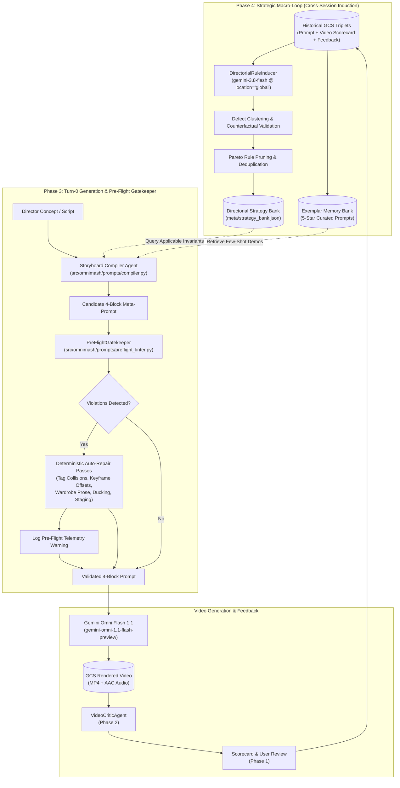

# Directorial Observability & Meta-Optimization Architecture (DOMA): Phase 3 & Phase 4 Implementation Plan

> **For Claude:** REQUIRED SUB-SKILL: Use superpowers:executing-plans to implement this plan task-by-task.

**Goal:** Establish Turn-0 prompt optimization and strategic macro-loop learning for OmniMash by implementing a deterministic pre-flight invariant gatekeeper, compiler strategy injection, a 5-star exemplar memory bank, and an offline rule induction engine that continuously optimizes original video generation prompts.

**Architecture:** A dual-layer meta-optimization pipeline where Turn-0 prompt compilation dynamically queries the `StrategyBankManager` and `ExemplarBankManager` for learned heuristics and few-shot exemplars, filters candidate prompts through an in-memory `PreFlightGatekeeper` that deterministically intercepts and auto-repairs structural defects (tag collisions, keyframe offset shifts, wardrobe contradictions, audio ducking, spatial staging) before Omni Flash generation, while a background `DirectorialRuleInducer` clusters historical feedback triplets across sessions to synthesize and Pareto-prune new invariant rules into the Vertex AI Agent Platform Memory Bank and GCS mirror.

**Tech Stack:** Python 3.12, Google GenAI SDK (`gemini-3.8-flash`, `location="global"`), Google ADK (Workflow DAGs, `PreloadMemoryTool`), Vertex AI Agent Platform Memory Bank, Google Cloud Storage (GCS JSON/JSONL mirrors), FastAPI, Pydantic v2, Pytest, Ruff.

---

## Architecture & System Design



---

## User Review Required

> [!IMPORTANT]
> **Deterministic Auto-Repair vs. Hard Blocking**: The `PreFlightGatekeeper` is designed to auto-repair formatting and invariant violations (e.g., auto-prepending `instrumental`, auto-injecting ducking directives, auto-shifting keyframe indices, and stripping redundant wardrobe prose) rather than hard-failing user requests. A structured telemetry report (`PreFlightLintResult`) is logged and returned in API responses so directors are notified of prompt enhancements.

> [!NOTE]
> **Rule Induction Triggering**: Rule induction operates on-demand via `POST /api/eval/induce-rules` or via scheduled CI/background jobs. It requires a minimum quorum of historical sessions (default: $\ge 2$ sessions with identical defect categories) to prevent overfitting to one-off director critiques.

---

## Open Questions

None. The architectural decisions for the hybrid Strategy Bank scope (global baseline + project-level overrides) and execution modes (on-demand in Studio UI + always-on in test suites) were confirmed in Phase 1 & 2.

---

## Work Tracks Overview

The work is split into **5 modular, parallelizable work tracks**:
1. **Track 1: Deterministic Pre-Flight Gatekeeper & Linter (Phase 3 Core)**
2. **Track 2: Turn-0 Compiler Integration & ADK / Orchestrator Interceptors (Phase 3 Integration)**
3. **Track 3: Exemplar Memory Bank & GCS Storage Extensions (Phase 4 Foundation)**
4. **Track 4: Macro-Loop Rule Induction Engine & API Endpoints (Phase 4 Intelligence)**
5. **Track 5: Screening Room UI Directorial Memory & Full End-to-End Verification**

---

## Proposed Changes

### Track 1: Deterministic Pre-Flight Gatekeeper & Linter (Phase 3 Core)

#### [NEW] `src/omnimash/prompts/preflight_linter.py`
Deterministic, zero-latency in-memory gatekeeper enforcing 5 core invariant passes before video generation:
- `repair_tag_collisions`: Removes stacked tokens (e.g. `<IMAGE_REF_0> <IMAGE_REF_1>`) on character identifiers, enforces 1:1 role tag mappings.
- `repair_keyframe_offsets`: Dynamically offsets character reference indices to $1 + \text{len(keyframes)}$ when `<FIRST_FRAME>` keyframe seed is present.
- `repair_zero_wardrobe_redundancy`: Detects characters with image reference sheets and scrubs conflicting wardrobe prose from `### CHARACTER PROFILES`.
- `repair_audio_ducking`: Prefixes beat stems with `instrumental` and injects background score ducking directive when dialogue is present.
- `repair_spatial_staging`: Injects left/right screen-staging directives for multi-character interaction scenes with reference sheets.
- Entry point `PreFlightGatekeeper.lint_and_repair(prompt_text, characters, keyframes, has_dialogue) -> PreFlightLintResult`.

#### [MODIFY] `src/omnimash/prompts/models.py`
Add `PreFlightViolation` and `PreFlightLintResult` Pydantic models:
```python
class PreFlightViolation(BaseModel):
    rule_id: str
    category: str
    description: str
    repaired: bool = True
    original_snippet: str = ""
    repaired_snippet: str = ""


class PreFlightLintResult(BaseModel):
    is_valid: bool
    repaired_prompt: str
    violations: list[PreFlightViolation] = Field(default_factory=list)
    invariants_applied: list[str] = Field(default_factory=list)
```

#### [NEW] `tests/prompts/test_preflight_linter.py`
Comprehensive test suite asserting:
- Detection and repair of stacked image tags.
- Dynamic keyframe index shifting (`@Image1` to `@Image2` when `<FIRST_FRAME>` present).
- Wardrobe prose stripping while preserving voice style and personality.
- Instrumental prefix and audio ducking clause injection.
- Spatial staging injection for multi-character scenes.

---

### Track 2: Turn-0 Compiler Integration & ADK / Orchestrator Interceptors (Phase 3 Integration)

#### [MODIFY] `src/omnimash/prompts/compiler.py`
- Update `compile_storyboard()` and `compile_turn0_prompt()` to:
  1. Accept optional `strategy_bank: StrategyBankManager | None` and `project_id: str | None`.
  2. Query `strategy_bank.query_applicable_rules(...)` based on characters, audio stems, and concept keywords.
  3. Inject active invariant directives into Block 3 (`### SCENE INSTRUCTIONS`) and Block 4 (`### TIMELINE`).
  4. Run `PreFlightGatekeeper.lint_and_repair()` before returning compiled prompt strings.

#### [MODIFY] `src/omnimash/prompts/journey3.py`
- Hook `PreFlightGatekeeper.lint_and_repair()` into `compile_journey3_shot_prompt()` as the final validation and auto-repair step.

#### [MODIFY] `src/omnimash/agent/adk_pipeline.py` & `src/omnimash/agent/orchestrator.py`
- In `build_production_orchestrator()`: Integrate `PreFlightGatekeeper` into the workflow DAG before shot execution.
- In `OmniMashOrchestrator.process_user_turn()`: Run pre-flight linting on incoming prompts and compiled overrides.

#### [NEW] `tests/prompts/test_compiler_doma.py` & `tests/agent/test_adk_pipeline_doma.py`
- Test that Turn-0 storyboard compilation applies Strategy Bank rules automatically.
- Test that pre-flight violations are repaired transparently during orchestrator turns.

---

### Track 3: Exemplar Memory Bank & GCS Storage Extensions (Phase 4 Foundation)

#### [NEW] `src/omnimash/evaluation/exemplar_bank.py`
`ExemplarBankManager`:
- Ingests prompts that received $\ge 4.5$ stars and a passed evaluation scorecard into `ExemplarPromptRecord`s.
- Categorizes exemplars by style preset, character count, and genre.
- Exposes `query_relevant_exemplars(concept, style_preset, character_count, limit=2) -> list[ExemplarPromptRecord]`.
- Formats few-shot demonstrations for in-context injection into `StoryboardCompilerAgent`.
- Supports dual persistence: GCS (`meta/exemplar_bank.json`, `projects/{project_id}/exemplars/`) and Vertex AI Agent Platform Memory Bank adapter.

#### [MODIFY] `src/omnimash/storage/gcs.py`
Add GCS storage methods:
- `save_exemplar(exemplar: ExemplarPromptRecord, project_id: str | None = None) -> str`
- `get_exemplar(exemplar_id: str, project_id: str | None = None) -> dict[str, Any] | None`
- `list_exemplars(project_id: str | None = None, style_preset: str | None = None) -> list[dict[str, Any]]`
- `list_feedback_records(project_id: str | None = None, limit: int = 100) -> list[dict[str, Any]]`
- `list_scorecards(project_id: str | None = None, limit: int = 100) -> list[dict[str, Any]]`

#### [NEW] `tests/evaluation/test_exemplar_bank.py` & `tests/storage/test_gcs_exemplars.py`
- Verify saving, retrieval, listing, and filtering of exemplars.
- Verify fallback handling and few-shot formatting.

---

### Track 4: Macro-Loop Rule Induction Engine & API Endpoints (Phase 4 Intelligence)

#### [NEW] `src/omnimash/evaluation/rule_inducer.py`
`DirectorialRuleInducer`:
- Background / offline meta-learner powered by `gemini-3.8-flash` (`location="global"`).
- Analyzes historical triplets: $(\text{Prompt}, \text{Scorecard}, \text{Feedback})$.
- Groups defects into recurring clusters (e.g. 2+ sessions with `AUDIO_DROWNED` or `LIKENESS_DRIFT`).
- Synthesizes candidate `DirectorialInvariantRule`s with trigger patterns, directives, and rationales.
- Counterfactual validation: Evaluates whether candidate rules resolve the historical defect without altering passing criteria.
- Promotes validated rules to `StrategyBankManager`.
- **Pareto Rule Pruner**:
  - Deduplicates overlapping rules using semantic similarity.
  - Prunes rules with `confidence_score < 0.70` or `defect_reduction_rate <= 0` after evaluation.
  - Caps maximum active injected rules per scene category (default: top 5).

#### [NEW] `src/omnimash/api/routers/evaluation.py`
Exposes management endpoints for rules and exemplars:
- `POST /api/eval/induce-rules`: Triggers rule induction over collected session history.
- `GET /api/eval/rules`: Lists active global and project-scoped rules with telemetry stats.
- `POST /api/eval/rules/prune`: Triggers Pareto rule pruning.
- `GET /api/eval/exemplars`: Lists curated 5-star exemplars.
- `POST /api/eval/exemplars`: Ingests a new 5-star prompt as an exemplar.

#### [MODIFY] `src/omnimash/api/app.py`
- Mount `evaluation_router` under `/api/eval`.

#### [NEW] `tests/evaluation/test_rule_inducer.py` & `tests/api/test_evaluation_router.py`
- Test defect clustering, candidate rule synthesis, counterfactual validation, and rule promotion.
- Test all evaluation API endpoints.

---

### Track 5: Screening Room UI Directorial Memory & Full End-to-End Verification

#### [MODIFY] `src/omnimash/api/templates/index.html`
- Update Compiled Prompt preview to display a **"Pre-Flight Status"** badge (`✅ All Invariants Verified` / `⚠️ 2 Invariants Auto-Repaired`).
- Add a **"Directorial Memory & Invariants"** drawer in Act 3 displaying active rules applied to the current shot.
- Add a **"🌟 Save as Exemplar"** action button when a user awards 5 stars to a shot.

#### [NEW] `tests/evaluation/test_doma_macro_e2e.py`
Comprehensive E2E test verifying the complete macro-loop:
1. Render generation with defect $\to$ Director submits low rating.
2. Rule Inducer analyzes defect $\to$ Synthesizes new invariant rule.
3. Rule promoted to Strategy Bank.
4. Next session Turn-0 compilation queries Strategy Bank $\to$ Injects new invariant.
5. Pre-flight linter verifies zero violations.
6. Subsequent generation produces 5-star render $\to$ Saved as exemplar $\to$ Few-shot injected in future prompts.

---

## Detailed Task Breakdown

### Task 1: Pre-Flight Models & Linter Implementation (Track 1)
**Files:**
- Modify: `src/omnimash/prompts/models.py`
- Create: `src/omnimash/prompts/preflight_linter.py`
- Create: `tests/prompts/test_preflight_linter.py`

**Step 1: Write failing tests in `tests/prompts/test_preflight_linter.py`:**
- `test_linter_repairs_stacked_image_tags()`
- `test_linter_offsets_keyframe_references()`
- `test_linter_enforces_zero_wardrobe_redundancy()`
- `test_linter_injects_instrumental_and_ducking()`
- `test_linter_injects_spatial_staging_multi_character()`

**Step 2: Run test to verify it fails:**
- `uv run pytest tests/prompts/test_preflight_linter.py -v` (Fails with ImportError)

**Step 3: Implement `PreFlightGatekeeper` in `src/omnimash/prompts/preflight_linter.py` and models in `models.py`.**

**Step 4: Run test to verify it passes:**
- `uv run pytest tests/prompts/test_preflight_linter.py -v` (All pass)

**Step 5: Commit:**
- `git commit -m "feat(prompts): implement deterministic pre-flight invariant gatekeeper"`

---

### Task 2: Compiler & Pipeline Integration (Track 2)
**Files:**
- Modify: `src/omnimash/prompts/compiler.py`
- Modify: `src/omnimash/prompts/journey3.py`
- Modify: `src/omnimash/agent/adk_pipeline.py`
- Modify: `src/omnimash/agent/orchestrator.py`
- Create: `tests/prompts/test_compiler_doma.py`
- Create: `tests/agent/test_adk_pipeline_doma.py`

**Step 1: Write failing tests in `tests/prompts/test_compiler_doma.py` & `tests/agent/test_adk_pipeline_doma.py`:**
- Assert Strategy Bank rules are queried and injected into Turn-0 prompts.
- Assert PreFlightGatekeeper runs automatically on compiled prompts.

**Step 2: Run test to verify failure.**

**Step 3: Implement integration in `compiler.py`, `journey3.py`, `adk_pipeline.py`, and `orchestrator.py`.**

**Step 4: Run test to verify it passes:**
- `uv run pytest tests/prompts/test_compiler_doma.py tests/agent/test_adk_pipeline_doma.py -v`

**Step 5: Commit:**
- `git commit -m "feat(compiler,agent): integrate strategy bank invariants and pre-flight gatekeeper into Turn-0 compilation"`

---

### Task 3: Exemplar Memory Bank & Storage Extensions (Track 3)
**Files:**
- Modify: `src/omnimash/storage/gcs.py`
- Create: `src/omnimash/evaluation/exemplar_bank.py`
- Create: `tests/evaluation/test_exemplar_bank.py`
- Create: `tests/storage/test_gcs_exemplars.py`

**Step 1: Write failing tests for exemplar storage and retrieval.**

**Step 2: Run test to verify failure.**

**Step 3: Implement GCS storage methods in `gcs.py` and `ExemplarBankManager` in `exemplar_bank.py`.**

**Step 4: Run test to verify it passes:**
- `uv run pytest tests/evaluation/test_exemplar_bank.py tests/storage/test_gcs_exemplars.py -v`

**Step 5: Commit:**
- `git commit -m "feat(evaluation,storage): implement 5-star exemplar memory bank and GCS persistence"`

---

### Task 4: Macro-Loop Rule Inducer & Evaluation Router (Track 4)
**Files:**
- Create: `src/omnimash/evaluation/rule_inducer.py`
- Create: `src/omnimash/api/routers/evaluation.py`
- Modify: `src/omnimash/api/app.py`
- Create: `tests/evaluation/test_rule_inducer.py`
- Create: `tests/api/test_evaluation_router.py`

**Step 1: Write failing tests for `DirectorialRuleInducer` and evaluation API endpoints.**

**Step 2: Run test to verify failure.**

**Step 3: Implement `rule_inducer.py`, `evaluation.py`, and mount in `app.py`.**

**Step 4: Run test to verify it passes:**
- `uv run pytest tests/evaluation/test_rule_inducer.py tests/api/test_evaluation_router.py -v`

**Step 5: Commit:**
- `git commit -m "feat(evaluation,api): implement macro-loop rule induction engine and evaluation API router"`

---

### Task 5: Screening Room UI & End-to-End Verification (Track 5)
**Files:**
- Modify: `src/omnimash/api/templates/index.html`
- Create: `tests/evaluation/test_doma_macro_e2e.py`
- Modify: `tests/api/test_app.py`

**Step 1: Write failing tests in `tests/evaluation/test_doma_macro_e2e.py` asserting the complete closed macro-loop.**

**Step 2: Run test to verify failure.**

**Step 3: Implement UI controls in `index.html` and verify JSX tag balance.**

**Step 4: Run all tests to verify they pass:**
- `uv run pytest tests/evaluation/test_doma_macro_e2e.py -v`
- `uv run pytest tests/api/test_app.py -v`

**Step 5: Commit:**
- `git commit -m "feat(ui,evaluation): add directorial memory UI controls and end-to-end macro-loop verification"`

---

## Verification Plan

### Automated Tests
Execute the comprehensive test suites in order:
1. `uv run ruff check .`
2. `uv run ruff format --check .`
3. `uv run ty check`
4. `uv run pytest tests/prompts/test_preflight_linter.py tests/prompts/test_compiler_doma.py -v`
5. `uv run pytest tests/evaluation/test_exemplar_bank.py tests/evaluation/test_rule_inducer.py tests/evaluation/test_doma_macro_e2e.py -v`
6. `uv run pytest tests/api/test_evaluation_router.py tests/api/test_app.py -v`
7. `uv run pytest -n auto` (Assert 100% pass across all 725+ tests)

### Manual Verification
1. Launch Studio UI: `uv run python main.py`
2. In the Director's Chair (Act 1), verify that compiled 4-block prompts display the green "✅ Pre-Flight Passed" badge.
3. Review an existing shot in Act 3 with 5 stars and click "🌟 Save as Exemplar".
4. Navigate to the Directorial Memory drawer and verify active Strategy Bank rules and saved exemplars.
