# Mode 4: Director's Co-Pilot (Intent Auto-Orchestrator) Implementation Plan

> **For Claude / Executor:** REQUIRED SUB-SKILL: Use superpowers:executing-plans to implement this plan task-by-task.

**Goal:** Implement Mode 4 ("Director's Co-Pilot"), the simplest and most accessible creation mode in OmniMash, allowing users to enter a basic intent with optional sparse inputs (characters, setting, music, sound effects, dialogue), autonomously analyze missing production dimensions, and resolve them via interactive 2–3 question clarification or instant randomized gap-filling into a cohesive 4-block Gemini Omni Flash prompt. This engine must be accessible both as a standalone dedicated studio mode and as an in-context assistant across all existing User Journey modes (Mode 1: Guided Fine-Tune, Mode 2: Screenplay Storyboard, Mode 3: Continuity Studio).

**Architecture:** A 7-slot production model (Intent, Characters, Setting, Camera, Music, SFX, Dialogue) orchestrated by an `IntentGapAnalyzer` and `IntentAutoFiller` in `src/omnimash/prompts/intent_agent.py`, exposed via dedicated REST endpoints (`/api/intent/analyze-gaps`, `/api/intent/auto-fill`, `/api/intent/render-direct`) and a Google ADK agent (`create_intent_clarifier_agent`), integrated into the React SPA in `src/omnimash/api/templates/index.html` using a crisp Cyan visual design system aligned with `frontend-ui-engineering`.

**Tech Stack:** Python 3.12, FastAPI (`fastapi>=0.141.1`), Pydantic v2 (`pydantic>=2.14.1`), Google ADK (`google-adk>=2.11.0`), Gemini Omni Flash 1.1 (`gemini-omni-1.1-flash`), Gemini 3.8 Flash (`gemini-3.8-flash`), Tailwind CSS / React SPA in `index.html`, `pytest` with `pytest-xdist`.

---

## Executive Architecture & Parallel PR Breakdown

```mermaid
flowchart TD
    subgraph TrackA["Track A (PR 1): Core Engine & Domain Models"]
        A1["Pydantic Schemas in models.py"] --> A2["7-Slot Gap Analyzer in intent_agent.py"]
        A2 --> A3["Cohesive Plan Auto-Filler & 4-Block Compiler"]
        A3 --> A4["Offline Deterministic Engine & Unit Tests"]
    end

    subgraph TrackB["Track B (PR 2): API Router & ADK Agent"]
        B1["Endpoints: /api/intent/analyze-gaps, auto-fill, render-direct"]
        B1 --> B2["ADK Agent: create_intent_clarifier_agent() in adk_pipeline.py"]
        B2 --> B3["Router Registration in app.py & API Integration Tests"]
    end

    subgraph TrackC["Track C (PR 3): Frontend Studio Workspace & Ubiquitous Assist"]
        C1["Studio Mode Switcher 4th Tab (studioMode === 'intent')"]
        C1 --> C2["IntentWizardStudio Workspace (Intake, Cards, Plan, Actions)"]
        C2 --> C3["Contextual IntentGapFillerAssistModal in Modes 1, 2, 3"]
        C3 --> C4["DOM Tests & AST Tag Balance Validation in test_app.py"]
    end

    TrackA --> Integration["Phase 4: Full Suite Integration & Docs"]
    TrackB --> Integration
    TrackC --> Integration
```



### Parallel Execution Matrix

| Track / PR | Branch Name | Component Ownership | Files Touched (Zero Overlap) | Est. Dev Time |
| :--- | :--- | :--- | :--- | :--- |
| **Track A (PR 1)** | `feature/intent-engine-models` | Domain Models & Prompt Engine | `src/omnimash/api/models.py`<br>`src/omnimash/prompts/intent_agent.py`<br>`tests/prompts/test_intent_agent.py` | ~25 min |
| **Track B (PR 2)** | `feature/intent-api-router` | REST API & ADK Agent Wiring | `src/omnimash/api/routers/intent.py`<br>`src/omnimash/agent/adk_pipeline.py`<br>`src/omnimash/api/app.py`<br>`tests/api/test_intent_api.py` | ~20 min |
| **Track C (PR 3)** | `feature/ui-mode4-copilot` | Frontend Workspace & Cross-Mode Assist | `src/omnimash/api/templates/index.html`<br>`tests/api/test_app.py` | ~30 min |
| **Integration** | `main` | Final Verification & Architecture Note | `docs/notes/mode4_directors_copilot.md`<br>`docs/notes/README.md` | ~10 min |

---

## User Review Required

> [!IMPORTANT]
> **Layout & AST Ordering Guardrail in `index.html`:**
> `tests/api/test_app.py#L2686-2694` strictly asserts `mode2_start < act3_pos < mode1_start` based on exact substring matching in `UI_HTML`.
> To prevent breaking existing AST layout assertions, Mode 4's JSX container inside `<main>` MUST be placed strictly **after** `mode1` (after line ~8150), and must be guarded by `studioMode === "intent" && activeTab !== "journey3"`.

> [!TIP]
> **Visual Design Alignment (`frontend-ui-engineering`):**
> Mode 4 will reject the stereotypical AI purple/indigo gradient anti-pattern. Instead, it will feature purposeful **Cyan studio tokens** (`cyan-500`, `cyan-400`, `cyan-950/80`, `border-cyan-800/60`). This visually complements Mode 1 (Amber), Mode 2 (Blue), and Mode 3 (Emerald).

---

## Open Questions

All requirements have been confirmed:
- **Questions vs. Random:** Supported via two balanced action buttons: `[ ❓ Ask Me Questions ]` (2–3 interactive option cards) and `[ 🎲 Surprise Me ]` (instant aesthetic auto-fill).
- **Per-Question Fast Exit:** Every question card provides a `[ 🎲 Auto-Fill Remainder & Generate Plan ]` button so users can answer 1 question and let the AI finish the rest.
- **Cross-Mode Availability:** Accessible via the top Mode Switcher tab, plus contextual in-place assist modal buttons in Mode 1, Mode 2, and Mode 3.
- **Outbound Promotion:** Direct 1-click render in Mode 4, plus 1-click transfer buttons to promote the compiled plan into Mode 1, Mode 2, or Mode 3.

---

## Detailed Task Breakdown

### Track A: Domain Models & Prompt Engine (PR 1)

#### Task A1: Define Pydantic Models for Intent Intake & Slot Representation
**Files:**
- Modify: `src/omnimash/api/models.py`

**Step 1: Write Pydantic models in `src/omnimash/api/models.py`**
```python
class IntentSlotInputs(BaseModel):
    characters: list[str] = Field(default_factory=list, description="Explicit character names or roles")
    setting: str | None = Field(default=None, description="Specific location or environment")
    style_tone: str | None = Field(default=None, description="Visual aesthetic and lighting tone")
    audio_beat: str | None = Field(default=None, description="Background music genre and tempo")
    sound_effects: str | None = Field(default=None, description="Parenthetical diegetic sound effects")
    dialogue: str | None = Field(default=None, description="Specific spoken dialogue or monologue")


class ClarificationQuestionOption(BaseModel):
    id: str
    label: str
    description: str = ""


class ClarificationQuestion(BaseModel):
    question_id: str
    slot_target: str  # "characters" | "setting" | "style_tone" | "audio_beat" | "sound_effects" | "dialogue"
    title: str
    subtitle: str = ""
    options: list[ClarificationQuestionOption] = Field(default_factory=list)
    allow_custom: bool = True


class AnalyzeIntentGapsRequest(BaseModel):
    intent: str = Field(..., description="Raw user intent or premise")
    optional_inputs: IntentSlotInputs = Field(default_factory=IntentSlotInputs)
    session_name: str | None = None


class AnalyzeIntentGapsResponse(BaseModel):
    success: bool = True
    intent: str
    filled_slots: dict[str, Any] = Field(default_factory=dict)
    missing_slots: list[str] = Field(default_factory=list)
    questions: list[ClarificationQuestion] = Field(default_factory=list)
    can_auto_fill_immediately: bool = True


class AutoFillIntentPlanRequest(BaseModel):
    intent: str
    optional_inputs: IntentSlotInputs = Field(default_factory=IntentSlotInputs)
    question_answers: dict[str, str] = Field(default_factory=dict, description="Mapping of question_id to chosen option or write-in")
    resolution: str = "720p"
    aspect_ratio: str = "16:9"
    enable_safety_sanitization: bool = True
    session_name: str | None = None


class CohesiveProductionPlan(BaseModel):
    intent: str
    style_tone: str
    characters: list[CharacterRoleModel] = Field(default_factory=list)
    environment: str
    camera_lighting: str
    audio_beat: str
    sound_effects: str = ""
    vocal_delivery: str
    screenplay_script: str
    scenes: list[DeconstructedSceneModel] = Field(default_factory=list)
    keyframe_image_prompt: str
    raw_compiled_prompt: str


class AutoFillIntentPlanResponse(BaseModel):
    success: bool = True
    plan: CohesiveProductionPlan
    raw_compiled_prompt: str
    details: str = ""
```

#### Task A2: Implement Intent Gap Analyzer & Auto-Filler in `src/omnimash/prompts/intent_agent.py`
**Files:**
- Create: `src/omnimash/prompts/intent_agent.py`
- Create: `tests/prompts/test_intent_agent.py`

**Step 2: Write failing unit test in `tests/prompts/test_intent_agent.py`**
```python
"""Tests for IntentGapAnalyzer and IntentAutoFiller."""

import pytest
from omnimash.api.models import IntentSlotInputs
from omnimash.prompts.intent_agent import IntentGapAnalyzer, IntentAutoFiller


def test_analyze_gaps_identifies_empty_slots_and_generates_questions():
    analyzer = IntentGapAnalyzer(mock_mode=True)
    res = analyzer.analyze(
        intent="Two wizards having an aggressive rap battle in a medieval tavern",
        inputs=IntentSlotInputs(),
    )
    assert res.success is True
    assert "audio_beat" in res.missing_slots or "characters" in res.missing_slots
    assert len(res.questions) >= 2
    assert len(res.questions) <= 3
    for q in res.questions:
        assert len(q.options) >= 2
        assert q.allow_custom is True


def test_analyze_gaps_respects_supplied_inputs():
    analyzer = IntentGapAnalyzer(mock_mode=True)
    res = analyzer.analyze(
        intent="A cooking showdown",
        inputs=IntentSlotInputs(
            characters=["Chef Gordon", "Chef Julia"],
            audio_beat="140 BPM Heavy 808 Trap Beat",
        ),
    )
    assert "characters" not in res.missing_slots
    assert "audio_beat" not in res.missing_slots
    assert res.filled_slots["audio_beat"] == "140 BPM Heavy 808 Trap Beat"


def test_auto_fill_plan_produces_valid_four_block_prompt():
    autofiller = IntentAutoFiller(mock_mode=True)
    res = autofiller.generate_plan(
        intent="Cyberpunk detectives investigating a glitching neon alley",
        inputs=IntentSlotInputs(setting="Neo Tokyo rainy alleyway"),
        answers={},
    )
    assert res.success is True
    plan = res.plan
    assert "Neo Tokyo" in plan.environment
    assert len(plan.characters) >= 2
    assert "### INPUT ROLES & REFERENCES" in plan.raw_compiled_prompt
    assert "### CHARACTER PROFILES" in plan.raw_compiled_prompt
    assert "### SCENE INSTRUCTIONS" in plan.raw_compiled_prompt
    assert "### TIMELINE" in plan.raw_compiled_prompt
    assert "[0-3s]" in plan.raw_compiled_prompt
    assert "[3-6s]" in plan.raw_compiled_prompt
    assert "[6-10s]" in plan.raw_compiled_prompt
```

**Step 3: Run test to verify failure**
```bash
uv run pytest tests/prompts/test_intent_agent.py -v
```
Expected: FAIL with `ModuleNotFoundError: No module named 'omnimash.prompts.intent_agent'`.

**Step 4: Implement minimal code in `src/omnimash/prompts/intent_agent.py`**
- Implement `IntentGapAnalyzer`:
  - Extracts present entities: parses names via `REAL_NAME_PARODY_MAP`, detects setting keywords, checks `IntentSlotInputs`.
  - Determines missing slots from the 7-slot model.
  - Builds 2–3 focused `ClarificationQuestion` cards (e.g. Setting visual tone, Audio soundscape beat, Character dynamic).
  - Uses `gemini-3.8-flash` in production or deterministic rule-based cards in `mock_mode=True`.
- Implement `IntentAutoFiller`:
  - Synthesizes remaining gaps using aesthetic harmony pairings (e.g., Cyberpunk -> 140 BPM Dark Synth -> Anamorphic tracking shot -> Neon rim light).
  - Compiles valid 4-block Gemini Omni Flash prompt via `compile_journey3_shot_prompt` or 4-block meta-prompt compiler.
  - Returns `CohesiveProductionPlan`.

**Step 5: Verify tests pass**
```bash
uv run pytest tests/prompts/test_intent_agent.py -v
uv run ruff check src/omnimash/prompts/intent_agent.py tests/prompts/test_intent_agent.py
uv run ty check
```

**Step 6: Commit Track A**
```bash
git add src/omnimash/api/models.py src/omnimash/prompts/intent_agent.py tests/prompts/test_intent_agent.py
git commit -m "feat(prompts): implement 7-slot intent gap analyzer and cohesive plan auto-filler"
```

---

### Track B: REST API Router & ADK Multi-Agent (PR 2)

#### Task B1: Create REST Router in `src/omnimash/api/routers/intent.py`
**Files:**
- Create: `src/omnimash/api/routers/intent.py`
- Modify: `src/omnimash/agent/adk_pipeline.py`
- Modify: `src/omnimash/api/app.py`
- Create: `tests/api/test_intent_api.py`

**Step 1: Write integration tests in `tests/api/test_intent_api.py`**
```python
import pytest
from fastapi.testclient import TestClient
from omnimash.api.app import create_app


@pytest.fixture
def client():
    app = create_app(mock_mode=True)
    with TestClient(app) as c:
        yield c


def test_api_intent_analyze_gaps_endpoint(client):
    payload = {
        "intent": "Two space pirates fighting over a treasure chest on Mars",
        "optional_inputs": {"characters": ["Captain Zara", "Scoundrel Jax"]},
    }
    res = client.post("/api/intent/analyze-gaps", json=payload)
    assert res.status_code == 200
    data = res.json()
    assert data["success"] is True
    assert "questions" in data
    assert len(data["questions"]) >= 2


def test_api_intent_auto_fill_endpoint(client):
    payload = {
        "intent": "Epic samurai duel in a bamboo forest at sunset",
        "optional_inputs": {"setting": "Misty bamboo forest"},
        "question_answers": {},
    }
    res = client.post("/api/intent/auto-fill", json=payload)
    assert res.status_code == 200
    data = res.json()
    assert data["success"] is True
    assert "plan" in data
    assert "raw_compiled_prompt" in data
    assert "### SCENE INSTRUCTIONS" in data["raw_compiled_prompt"]


def test_api_intent_render_direct_endpoint(client):
    payload = {
        "intent": "A friendly robot serving espresso in a cozy cafe",
        "optional_inputs": {},
        "question_answers": {},
    }
    res = client.post("/api/intent/render-direct", json=payload)
    assert res.status_code == 200
    data = res.json()
    assert data["success"] is True
    assert "video_url" in data
```

**Step 2: Implement `src/omnimash/api/routers/intent.py`**
- Mount `POST /api/intent/analyze-gaps`: invokes `IntentGapAnalyzer`.
- Mount `POST /api/intent/auto-fill`: invokes `IntentAutoFiller`.
- Mount `POST /api/intent/render-direct`: auto-fills the plan and delegates to `agent.process_user_turn()`, returning live or mocked video.

**Step 3: Add `create_intent_clarifier_agent()` in `src/omnimash/agent/adk_pipeline.py`**
- Adds Google ADK Agent definition with instructions optimized for directorial intent clarification and 4-block compilation.

**Step 4: Register router in `src/omnimash/api/app.py`**
```python
from omnimash.api.routers import intent as intent_router
...
app.include_router(intent_router.router)
```

**Step 5: Verify tests pass**
```bash
uv run pytest tests/api/test_intent_api.py -v
uv run ruff check .
uv run ty check
```

**Step 6: Commit Track B**
```bash
git add src/omnimash/api/routers/intent.py src/omnimash/agent/adk_pipeline.py src/omnimash/api/app.py tests/api/test_intent_api.py
git commit -m "feat(api): add intent clarification and auto-fill endpoints with ADK agent wiring"
```

---

### Track C: Frontend Studio Mode 4 Workspace & Ubiquitous Assist (PR 3)

#### Task C1: Implement Mode 4 Workspace & Contextual Assist in `index.html`
**Files:**
- Modify: `src/omnimash/api/templates/index.html`
- Modify: `tests/api/test_app.py`

**Step 1: Add State & Handlers to `index.html`**
- State:
  - `intentText`: User's primary intent spark.
  - `intentInputs`: Object `{ characters: [], setting: "", style_tone: "", audio_beat: "", sound_effects: "", dialogue: "" }`.
  - `intentQuestions`: Array of clarification questions from `/api/intent/analyze-gaps`.
  - `currentQuestionIdx`: Active question index.
  - `questionAnswers`: Object mapping question ID to selected option or write-in.
  - `compiledIntentPlan`: Active `CohesiveProductionPlan`.
  - `intentLoading`, `intentRenderLoading`.
  - `showIntentAssistModal`: Controls visibility of cross-mode assist modal.
  - `intentAssistTargetMode`: `"stages" | "acts" | "journey3"`.

- Handlers:
  - `handleAnalyzeIntent(actionType)`: Calls `/api/intent/analyze-gaps`. If `actionType === 'random'`, directly calls `/api/intent/auto-fill`.
  - `handleAnswerQuestion(qId, val)`: Records answer and advances question, or auto-fills remainder.
  - `handleAutoFillPlan()`: Calls `/api/intent/auto-fill` and stores plan.
  - `handleRenderIntentDirect()`: Calls `/api/intent/render-direct` and plays video.
  - `handleTransferPlanToMode(targetMode)`: Transfers plan parameters into Mode 1, Mode 2, or Mode 3 state and switches modes.
  - `handleOpenIntentAssist(targetMode)`: Pre-populates intent state from active mode and opens assist modal.

**Step 2: Add 4th Tab to Mode Switcher (lines ~4450–4500)**
```jsx
<button
    type="button"
    onClick={() => { setStudioMode("intent"); setActiveTab("intent"); }}
    className={`px-3 py-2 rounded-lg text-xs font-semibold transition flex items-center justify-between gap-2.5 ${
        (studioMode === "intent" && activeTab !== "journey3")
            ? "bg-cyan-500/20 text-cyan-200 border border-cyan-500/40 shadow-sm font-bold"
            : "text-gray-400 hover:text-gray-200 hover:bg-gray-900/80 border border-transparent"
    }`}
>
    <span className="flex items-center gap-1.5">
        <span>Mode 4: Director's Co-Pilot</span>
    </span>
    <span className="text-xs px-1.5 py-0.5 rounded font-mono font-medium bg-cyan-950/80 text-cyan-300 border border-cyan-800/60">
        Zero-Friction Intent Target
    </span>
</button>
```

**Step 3: Implement Mode 4 Workspace Container (placed safely after line ~8150)**
```jsx
{studioMode === "intent" && activeTab !== "journey3" && (
    <div className="space-y-8 animate-fadeIn" role="region" aria-label="Mode 4: Director's Co-Pilot Workspace">
        {/* Header Banner */}
        <div className="bg-gradient-to-r from-gray-950 via-cyan-950/40 to-gray-950 border border-cyan-800/50 rounded-2xl p-6 shadow-2xl flex flex-col md:flex-row items-start md:items-center justify-between gap-4">
            <div>
                <div className="flex items-center gap-2.5">
                    <span className="text-2xl">🎯</span>
                    <h2 className="text-xl font-black text-white tracking-tight">Director's Co-Pilot</h2>
                    <span className="text-xs font-mono px-2 py-0.5 rounded bg-cyan-950 text-cyan-300 border border-cyan-700">Zero-Friction Intent Target</span>
                </div>
                <p className="text-xs text-gray-300 mt-1 max-w-2xl">
                    Describe any scene idea in plain English. Optionally add characters, setting, or music. We'll ask a couple quick questions or auto-fill all gaps into a production-ready video.
                </p>
            </div>
        </div>

        {/* Primary Intake Card */}
        <div className="bg-gray-900/90 border border-gray-800 rounded-2xl p-6 shadow-xl space-y-5">
            <div>
                <label htmlFor="intent-input" className="block text-xs font-bold text-gray-200 uppercase tracking-wider mb-2">
                    Enter Basic Video Intent / Idea
                </label>
                <textarea
                    id="intent-input"
                    rows={3}
                    value={intentText}
                    onChange={(e) => setIntentText(e.target.value)}
                    placeholder="e.g., Two rival chefs having an aggressive culinary rap battle in a high-tech kitchen colosseum..."
                    className="w-full bg-black/60 border border-gray-700 focus:border-cyan-500 rounded-xl p-4 text-sm text-gray-100 placeholder-gray-500 focus:outline-none focus:ring-2 focus:ring-cyan-500/30 transition resize-none font-sans"
                />
            </div>

            {/* Collapsible Optional Specifics Accordion */}
            ...
            
            {/* Dual Action Buttons */}
            <div className="grid grid-cols-1 sm:grid-cols-2 gap-4 pt-2">
                <button
                    type="button"
                    disabled={!intentText.trim() || intentLoading}
                    onClick={() => handleAnalyzeIntent("questions")}
                    className="bg-cyan-600 hover:bg-cyan-500 text-white font-bold text-xs py-3 px-5 rounded-xl shadow-lg flex items-center justify-center gap-2 transition disabled:opacity-50"
                >
                    <span>❓</span>
                    <span>Ask Me Questions (Clarify Gaps)</span>
                </button>
                <button
                    type="button"
                    disabled={!intentText.trim() || intentLoading}
                    onClick={() => handleAnalyzeIntent("random")}
                    className="bg-gray-800 hover:bg-gray-700 text-cyan-300 border border-cyan-800/80 font-bold text-xs py-3 px-5 rounded-xl shadow-lg flex items-center justify-center gap-2 transition disabled:opacity-50"
                >
                    <span>🎲</span>
                    <span>Surprise Me (Auto-Fill Gaps Cohesively)</span>
                </button>
            </div>
        </div>

        {/* Question Flow Card (Conditional) */}
        ...

        {/* Cohesive Production Plan & Execution Card (Conditional) */}
        ...

        {/* Outbound Promotion Bar ("Open in Mode 1 / 2 / 3") */}
        ...
    </div>
)}
```

**Step 4: Implement Inbound Contextual Assist Buttons in Modes 1, 2, and 3**
- Mode 1: Next to concept textarea, button `✨ Co-Pilot Gap Filler`.
- Mode 2: In Act 1 and Act 2 next to Screenplay Editor, button `✨ Co-Pilot Script & Shot Generator`.
- Mode 3: In Step 1 Master Setup, button `✨ Co-Pilot Master Setup`.
- Clicking any of these opens the shared `<IntentGapFillerAssistModal>`, pre-fills the input from current mode state, and applies generated values directly back to that mode's state variables upon approval.

**Step 5: Write UI DOM Tests in `tests/api/test_app.py`**
```python
def test_ui_html_contains_mode4_directors_copilot_workspace():
    from omnimash.api.app import UI_HTML
    assert "Mode 4: Director's Co-Pilot" in UI_HTML
    assert "Zero-Friction Intent Target" in UI_HTML
    assert "intent-input" in UI_HTML
    assert "Ask Me Questions (Clarify Gaps)" in UI_HTML
    assert "Surprise Me (Auto-Fill Gaps Cohesively)" in UI_HTML
    assert "IntentGapFillerAssistModal" in UI_HTML or "handleOpenIntentAssist" in UI_HTML
```

**Step 6: Validate JSX Tag Balance & Browser DOM Rendering**
```bash
uv run pytest tests/api/test_app.py -k "test_ui_html_syntax_and_tag_balance or test_ui_html_renders_in_browser_without_syntax_error or test_ui_html_contains_mode4_directors_copilot_workspace" -v
uv run ruff check .
uv run ty check
```

**Step 7: Commit Track C**
```bash
git add src/omnimash/api/templates/index.html tests/api/test_app.py
git commit -m "feat(ui): add Mode 4 Director's Co-Pilot studio and ubiquitous cross-mode gap filler"
```

---

### Phase 4: Integration, Full Suite Verification & Documentation

1. Create topic note: `docs/notes/mode4_directors_copilot.md` documenting the 7-slot model, gap analysis, question flow, and cross-mode synchronization.
2. Update `docs/notes/README.md`.
3. Run full verification:
   ```bash
   uv run pytest
   uv run ruff check .
   uv run ty check
   ```

---

## Verification Plan

### Automated Tests
```bash
# 1. Prompt Engine unit tests
uv run pytest tests/prompts/test_intent_agent.py -v

# 2. REST API endpoint integration tests
uv run pytest tests/api/test_intent_api.py -v

# 3. UI syntax, JSX tag balance, and Playwright DOM rendering tests
uv run pytest tests/api/test_app.py -k "test_ui_html_syntax_and_tag_balance or test_ui_html_renders_in_browser_without_syntax_error or test_ui_html_contains_mode4_directors_copilot_workspace" -v

# 4. Full test suite (all 626+ tests)
uv run pytest

# 5. Linters and Type Checking
uv run ruff check .
uv run ty check
```

### Manual Verification
1. Start application: `uv run python main.py` and open `http://localhost:8080`.
2. Switch to **Mode 4: Director's Co-Pilot**.
3. Enter intent: *"Two wizards in a rap battle in a medieval tavern"*.
4. Click **"❓ Ask Me Questions"**. Verify 2–3 question cards appear with option chips.
5. Click **"🎲 Auto-Fill Remainder & Generate Plan"**. Verify the 4-block compiled plan displays with cast, setting, audio beat, and timeline beats.
6. Click **"➡️ Open in Mode 1 (Guided Fine-Tune)"**. Verify Mode 1 loads with concept and sliders pre-populated.
7. Switch back to Mode 2 (Screenplay Storyboard), click **"✨ Co-Pilot Script Generator"**, and verify the assist modal populates screenplay script and scenes.

---

## Execution Handoff

Plan complete and saved to artifact and `docs/plans/2026-10-22-mode4-directors-copilot.md`.

**Two execution options:**

1. **Subagent-Driven (this session):** Dispatch parallel subagents for Track A, Track B, and Track C concurrently, review between tasks, and perform final integration.
2. **Parallel Session (separate):** Open separate sessions/worktrees with `executing-plans`, batch executing with checkpoints.

Which approach would you prefer?
