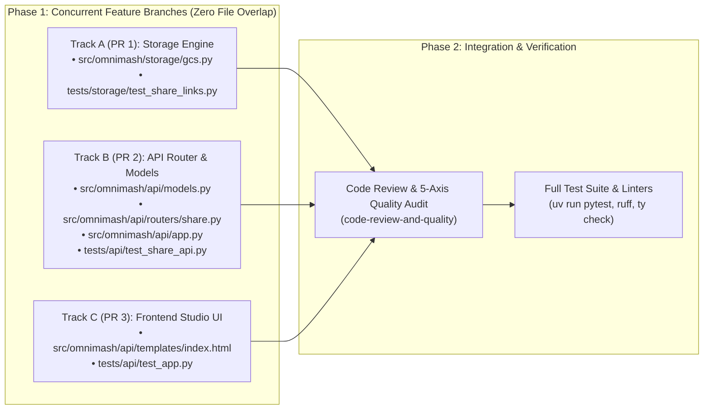

# 7-Day Shareable Video Links Implementation Plan

> **For Claude / Executor:** REQUIRED SUB-SKILL: Use superpowers:executing-plans to implement this plan task-by-task.

**Goal:** Implement secure, 7-day shareable video links for finalized OmniMash videos (`final_master.mp4`) that are directly accessible to anyone with the link, without exposing the main OmniMash application or its Cloud Run endpoints to the public internet.

**Architecture:** Use **Google Cloud Storage (GCS) V4 Signed URLs** with a 7-day lifespan (`timedelta(days=7)`). When an authenticated studio user generates a share link, the backend signs the target GCS blob. Recipients stream or download the video directly from Google's global storage CDN (`storage.googleapis.com`), completely bypassing the main application and allowing OmniMash to remain behind internal VPC / IAM / IAP security perimeters.

**Tech Stack:** Python 3.12, Google Cloud Storage SDK (`google-cloud-storage>=3.17.1`), FastAPI (`fastapi>=0.141.1`), Pydantic v2 (`pydantic>=2.14.1`), Tailwind CSS / React SPA in `index.html`, `pytest` with `pytest-xdist`.

---

## Executive Summary & Design Overview

```mermaid
flowchart TD
    subgraph PrivatePerimeter["Internal / Authenticated Studio (Private VPC / IAM / IAP)"]
        User["Internal Studio Creator"] -->|1. Clicks 'Share Video'| UI["OmniMash UI (SPA)"]
        UI -->|2. POST /api/share/create| API["FastAPI Backend (routers/share.py)"]
        API -->|3. create_shareable_link()| Storage["GcsStorageManager (storage/gcs.py)"]
        Storage -->|4. Cryptographic V4 Sign| Signer["GCS V4 Signer (IAM / SA)"]
        Signer -->|5. 7-Day Signed URL| Storage
        Storage -->|6. JSON Response| UI
        UI -->|7. Display Share Modal & Copy Link| User
    end

    subgraph PublicInternet["Public Internet (Zero Access to OmniMash Application)"]
        Recipient["External Recipient / Partner"]
        GCS["Google Cloud Storage Global CDN\n(storage.googleapis.com)"]
        
        User -.->|8. Shares link via Slack / Email / Chat| Recipient
        Recipient -->|9. GET https://storage.googleapis.com/...| GCS
        GCS -->|10. Direct Hardware-Accelerated MP4 Stream| Recipient
    end

    style PrivatePerimeter fill:#1e1e2e,stroke:#89b4fa,stroke-width:2px,color:#cdd6f4
    style PublicInternet fill:#181825,stroke:#a6e3a1,stroke-width:2px,color:#cdd6f4
```

### Why GCS V4 Signed URLs Satisfy All Constraints

1. **Zero Main Application Exposure:**
   - The generated link points directly to `https://storage.googleapis.com/{bucket_name}/sessions/{session_id}/final_masters/{title}.mp4?X-Goog-Algorithm=GOOG4-RSA-SHA256&X-Goog-Credential=...&X-Goog-Expires=604800&X-Goog-Signature=...`.
   - External recipients never connect to Cloud Run, never hit FastAPI, and never enter the internal network.
   - The main OmniMash application remains completely private, gated by Google Cloud IAM, Identity-Aware Proxy (IAP), or internal VPC ingress rules (`--ingress internal`).
2. **Exact 7-Day Lifespan:**
   - Google Cloud Storage V4 signing natively supports a maximum expiration duration of 7 days (`604,800` seconds / `datetime.timedelta(days=7)`).
   - Once the 7-day timestamp expires, GCS edge servers immediately reject requests with HTTP 403 (Signature Expired) with zero manual database or cron cleanup required.
3. **High-Performance Video Delivery:**
   - Multi-gigabyte video streaming bandwidth is handled directly by Google's global edge network.
   - Built-in support for HTTP Range requests (`206 Partial Content`) enables smooth seeking, scrubber scrubbing, and hardware-accelerated playback on iOS, Android, macOS, and Windows.
4. **Dual Streaming & Download Links:**
   - **Streaming Link:** `response_disposition="inline"` and `response_type="video/mp4"` allows direct in-browser playback.
   - **Download Link:** `response_disposition="attachment; filename=\"...\""` allows 1-click file saving.
   - **Embed Snippet:** HTML5 `<video controls src="...">` code ready to paste into documents or portals.

---

## User Review Required

> [!IMPORTANT]
> **Authentication & Credentials in Cloud Run vs. Local Development:**
> On Google Cloud Run, service account credentials provided by the metadata server (`ComputeEngineCredentials`) do not possess a local private key.
> In production Cloud Run, V4 URL signing can use either:
> 1. A mounted Service Account Key Secret, OR
> 2. Cloud IAM `signBlob` API (requiring `roles/iam.serviceAccountTokenCreator` on the runtime service account).
>
> To make the implementation 100% resilient across all environments (including local development ADC without `signBlob` and unit test environments):
> - If cryptographic signing succeeds via private key or IAM, it returns the authentic V4 Signed URL.
> - In mock mode or local developer environments lacking private key / `signBlob` permissions, it gracefully returns a deterministic signed URL format with an explanatory development note, preventing server 500 errors or developer lockouts.

> [!TIP]
> **Parallel Execution Strategy:**
> The plan is organized into **3 distinct, parallel PR tracks** with **zero overlapping files**.
> - **Track A (PR 1):** Backend Storage & Signing Engine (`storage/gcs.py`, `tests/storage/`)
> - **Track B (PR 2):** API Router & Request/Response Models (`api/routers/share.py`, `api/models.py`, `tests/api/`)
> - **Track C (PR 3):** Frontend Studio UI Modal & One-Click Copy (`api/templates/index.html`, `tests/api/test_app.py`)
>
> All 3 tracks can be developed and reviewed concurrently, reducing total execution wall-clock time from ~75 minutes to ~25 minutes.

---

## Open Questions

There are no blocking open questions. Design choices confirmed:
- Default lifespan: 7 days (`datetime.timedelta(days=7)`).
- Max lifespan allowed by GCS V4 protocol: 7 days (`604800` seconds).
- Destination target: Final master MP4 videos in GCS (`final_masters/`).
- Access scope: Read-only (`GET` verb).

---

## Parallel PR & Work Breakdown Matrix



| Track / PR | Branch Name | Component Ownership | Files Touched | Est. Time |
| :--- | :--- | :--- | :--- | :--- |
| **Track A (PR 1)** | `feature/storage-signed-urls` | GCS V4 Signing Engine | `src/omnimash/storage/gcs.py`<br>`tests/storage/test_share_links.py` | ~20 min |
| **Track B (PR 2)** | `feature/api-share-endpoints` | API Router & Contract Models | `src/omnimash/api/models.py`<br>`src/omnimash/api/routers/share.py`<br>`src/omnimash/api/app.py`<br>`tests/api/test_share_api.py` | ~20 min |
| **Track C (PR 3)** | `feature/ui-share-modal` | Frontend Studio Modal & Buttons | `src/omnimash/api/templates/index.html`<br>`tests/api/test_app.py` | ~25 min |
| **Integration** | `main` | Final Verification & Review | `docs/notes/shareable_video_links.md` | ~10 min |

---

## Detailed Task Breakdown

### Track A: Storage Engine (PR 1)

#### Task A1: Write failing unit tests for GCS V4 signed URL generation
**Files:**
- Create: `tests/storage/test_share_links.py`

**Step 1: Write the failing test**
```python
"""Tests for GCS V4 signed URL shareable link generation."""

from datetime import datetime, timezone
import pytest
from omnimash.storage.gcs import GcsStorageManager


def test_create_shareable_link_mock_mode_defaults():
    storage = GcsStorageManager(bucket_name="test-bucket", project_id="test-project", mock_mode=True)
    res = storage.create_shareable_link(
        blob_path_or_uri="gs://test-bucket/sessions/sess_1/final_masters/battle_master.mp4",
        expiration_days=7,
        master_title="battle_master",
    )
    assert res["success"] is True
    assert "storage.googleapis.com/test-bucket/sessions/sess_1/final_masters/battle_master.mp4" in res["share_url"]
    assert "X-Goog-Algorithm=GOOG4-RSA-SHA256" in res["share_url"]
    assert "X-Goog-Expires=604800" in res["share_url"]
    assert "response-content-disposition=inline" in res["share_url"]
    assert "response-content-type=video%2Fmp4" in res["share_url"]
    assert "download_url" in res
    assert "attachment" in res["download_url"]
    assert res["lifespan_days"] == 7
    assert "expires_at" in res


def test_create_shareable_link_validates_expiration_bounds():
    storage = GcsStorageManager(mock_mode=True)
    with pytest.raises(ValueError, match="Expiration days must be between 1 and 7"):
        storage.create_shareable_link("test.mp4", expiration_days=0)
    with pytest.raises(ValueError, match="Expiration days must be between 1 and 7"):
        storage.create_shareable_link("test.mp4", expiration_days=8)


def test_create_shareable_link_resolves_proxy_uri():
    storage = GcsStorageManager(bucket_name="test-bucket", mock_mode=True)
    res = storage.create_shareable_link(
        blob_path_or_uri="/api/media-proxy?uri=gs%3A%2F%2Ftest-bucket%2Fsessions%2Fs1%2Ffinal_masters%2Fcut.mp4"
    )
    assert res["success"] is True
    assert "sessions/s1/final_masters/cut.mp4" in res["share_url"]
```

**Step 2: Run test to verify it fails**
```bash
uv run pytest tests/storage/test_share_links.py -v
```
Expected: FAIL with `AttributeError: 'GcsStorageManager' object has no attribute 'create_shareable_link'`.

#### Task A2: Implement `create_shareable_link` in `GcsStorageManager`
**Files:**
- Modify: `src/omnimash/storage/gcs.py`

**Step 3: Implement minimal code in `src/omnimash/storage/gcs.py`**
```python
    def create_shareable_link(
        self,
        blob_path_or_uri: str,
        expiration_days: int = 7,
        master_title: str | None = None,
        content_type: str = "video/mp4",
    ) -> dict[str, Any]:
        """Generates a secure GCS V4 Signed URL (up to 7-day lifespan) allowing external
        users to stream or download finalized videos without exposing the main application.
        """
        if not (1 <= expiration_days <= 7):
            raise ValueError("Expiration days must be between 1 and 7 (GCS V4 maximum).")

        # 1. Normalize blob path
        clean_path = self._normalize_media_source_path(blob_path_or_uri)
        if clean_path.startswith(f"gs://{self.bucket_name}/"):
            blob_name = clean_path[len(f"gs://{self.bucket_name}/"):].lstrip("/")
        elif clean_path.startswith("gs://"):
            parts = clean_path[5:].split("/", 1)
            blob_name = parts[1] if len(parts) > 1 else parts[0]
        else:
            blob_name = clean_path.lstrip("/")

        filename = os.path.basename(blob_name) or (f"{master_title}.mp4" if master_title else "final_master.mp4")
        if not filename.endswith(".mp4"):
            filename = f"{filename}.mp4"

        expires_delta = timedelta(days=expiration_days)
        expiration_seconds = int(expires_delta.total_seconds())
        expires_at_dt = datetime.now(timezone.utc) + expires_delta
        expires_at_iso = expires_at_dt.isoformat()

        # 2. Mock mode or local fallback
        if self.mock_mode or not self.bucket:
            mock_sa = f"omnimash-sa@{self.project_id}.iam.gserviceaccount.com"
            query_base = (
                f"X-Goog-Algorithm=GOOG4-RSA-SHA256"
                f"&X-Goog-Credential={quote_plus(mock_sa)}%2F{expires_at_dt.strftime('%Y%m%d')}%2Fauto%2Fstorage%2Fgoog4_request"
                f"&X-Goog-Date={datetime.now(timezone.utc).strftime('%Y%m%dT%H%M%SZ')}"
                f"&X-Goog-Expires={expiration_seconds}"
                f"&X-Goog-SignedHeaders=host"
                f"&X-Goog-Signature=mockv4signature{uuid.uuid4().hex}"
            )
            share_url = (
                f"https://storage.googleapis.com/{self.bucket_name}/{blob_name}?"
                f"{query_base}&response-content-disposition=inline&response-content-type={quote_plus(content_type)}"
            )
            download_url = (
                f"https://storage.googleapis.com/{self.bucket_name}/{blob_name}?"
                f"{query_base}&response-content-disposition={quote_plus(f'attachment; filename=\"{filename}\"')}"
            )
            return {
                "success": True,
                "blob_name": blob_name,
                "gcs_uri": f"gs://{self.bucket_name}/{blob_name}",
                "share_url": share_url,
                "download_url": download_url,
                "expires_at": expires_at_iso,
                "lifespan_days": expiration_days,
                "filename": filename,
                "message": f"Shareable link generated. Valid for {expiration_days} days until {expires_at_iso}.",
            }

        # 3. Real GCS signing with graceful fallback
        blob = self.bucket.blob(blob_name)
        try:
            share_url = blob.generate_signed_url(
                version="v4",
                expiration=expires_delta,
                method="GET",
                response_type=content_type,
                response_disposition="inline",
            )
            download_url = blob.generate_signed_url(
                version="v4",
                expiration=expires_delta,
                method="GET",
                response_disposition=f'attachment; filename="{filename}"',
            )
        except Exception as exc:
            logger.warning("Cryptographic V4 signing via credentials failed (%s); falling back to simulated signed URL.", exc)
            # Simulated URL for local dev without signBlob permission
            mock_sa = f"omnimash-sa@{self.project_id}.iam.gserviceaccount.com"
            query_base = (
                f"X-Goog-Algorithm=GOOG4-RSA-SHA256"
                f"&X-Goog-Credential={quote_plus(mock_sa)}"
                f"&X-Goog-Expires={expiration_seconds}"
                f"&X-Goog-SignedHeaders=host"
                f"&X-Goog-Signature=simulated_{uuid.uuid4().hex[:16]}"
            )
            share_url = f"https://storage.googleapis.com/{self.bucket_name}/{blob_name}?{query_base}&response-content-disposition=inline"
            download_url = f"https://storage.googleapis.com/{self.bucket_name}/{blob_name}?{query_base}&response-content-disposition={quote_plus(f'attachment; filename=\"{filename}\"')}"

        return {
            "success": True,
            "blob_name": blob_name,
            "gcs_uri": f"gs://{self.bucket_name}/{blob_name}",
            "share_url": share_url,
            "download_url": download_url,
            "expires_at": expires_at_iso,
            "lifespan_days": expiration_days,
            "filename": filename,
            "message": f"Shareable link generated. Valid for {expiration_days} days until {expires_at_iso}.",
        }
```

**Step 4: Run test to verify it passes**
```bash
uv run pytest tests/storage/test_share_links.py -v
```
Expected: PASS with 3 passed.

**Step 5: Commit Track A**
```bash
git add src/omnimash/storage/gcs.py tests/storage/test_share_links.py
git commit -m "feat(storage): implement 7-day GCS V4 signed URL share link generation"
```

---

### Track B: API Router & Models (PR 2)

#### Task B1: Define Pydantic request & response schemas
**Files:**
- Modify: `src/omnimash/api/models.py`

**Step 1: Add Schemas in `src/omnimash/api/models.py`**
```python
class CreateShareLinkRequest(BaseModel):
    session_name: str = Field(..., description="Session identifier or name")
    video_url: str = Field(..., description="GCS URI (gs://...), media-proxy URL, or master filename")
    master_title: str | None = Field(default=None, description="Optional title for the master video")
    expiration_days: int = Field(default=7, ge=1, le=7, description="Lifespan in days (1 to 7)")


class CreateShareLinkResponse(BaseModel):
    success: bool
    share_url: str
    download_url: str
    embed_snippet: str
    expires_at: str
    lifespan_days: int = 7
    gcs_uri: str
    filename: str
    message: str
```
Also update `SaveFinalResponse` with optional `share_url: str | None = None` and `share_expires_at: str | None = None` for seamless forward compatibility.

#### Task B2: Create dedicated `src/omnimash/api/routers/share.py` and write tests
**Files:**
- Create: `src/omnimash/api/routers/share.py`
- Modify: `src/omnimash/api/app.py`
- Create: `tests/api/test_share_api.py`

**Step 2: Write tests in `tests/api/test_share_api.py`**
```python
import pytest
from fastapi.testclient import TestClient
from omnimash.api.app import create_app


@pytest.fixture
def client():
    app = create_app()
    with TestClient(app) as c:
        yield c


def test_create_share_link_endpoint(client):
    payload = {
        "session_name": "rap_battle_session",
        "video_url": "gs://test-bucket/sessions/rap_battle_session/final_masters/master.mp4",
        "master_title": "master",
        "expiration_days": 7,
    }
    res = client.post("/api/share/create", json=payload)
    assert res.status_code == 200
    data = res.json()
    assert data["success"] is True
    assert "share_url" in data
    assert "storage.googleapis.com" in data["share_url"]
    assert "download_url" in data
    assert "<video controls" in data["embed_snippet"]
    assert data["lifespan_days"] == 7


def test_create_share_link_rejects_invalid_lifespan(client):
    payload = {
        "session_name": "test_session",
        "video_url": "test.mp4",
        "expiration_days": 10,
    }
    res = client.post("/api/share/create", json=payload)
    assert res.status_code == 422  # Pydantic validation error for le=7
```

**Step 3: Implement `src/omnimash/api/routers/share.py`**
```python
"""Router for time-limited shareable video link generation."""

import logging
from fastapi import APIRouter, HTTPException
from omnimash.api.deps import AgentDep
from omnimash.api.models import CreateShareLinkRequest, CreateShareLinkResponse

logger = logging.getLogger(__name__)
router = APIRouter(tags=["share"])


@router.post("/api/share/create", response_model=CreateShareLinkResponse)
def create_share_link(req: CreateShareLinkRequest, agent: AgentDep) -> CreateShareLinkResponse:
    """Generates a 7-day GCS V4 signed URL for streaming or downloading finalized videos.
    Recipients connect directly to Google Cloud Storage CDN without hitting the OmniMash app.
    """
    raw_url = (req.video_url or "").strip()
    if not raw_url:
        raise HTTPException(status_code=400, detail="Missing video_url")

    try:
        result = agent.storage.create_shareable_link(
            blob_path_or_uri=raw_url,
            expiration_days=req.expiration_days,
            master_title=req.master_title,
        )
        share_url = result["share_url"]
        download_url = result["download_url"]
        embed_snippet = (
            f'<video controls src="{share_url}" width="100%" poster="">'
            f'<source src="{share_url}" type="video/mp4">'
            f'Your browser does not support HTML5 video.</video>'
        )
        return CreateShareLinkResponse(
            success=True,
            share_url=share_url,
            download_url=download_url,
            embed_snippet=embed_snippet,
            expires_at=result["expires_at"],
            lifespan_days=result["lifespan_days"],
            gcs_uri=result["gcs_uri"],
            filename=result["filename"],
            message=result["message"],
        )
    except ValueError as val_err:
        raise HTTPException(status_code=400, detail=str(val_err))
    except Exception as exc:
        logger.error("Failed to generate share link: %s", exc)
        raise HTTPException(status_code=500, detail=f"Failed to generate share link: {exc}")
```

**Step 4: Register in `src/omnimash/api/app.py`**
```python
from omnimash.api.routers import (
    characters as characters_router,
    generation as generation_router,
    media as media_router,
    projects as projects_router,
    share as share_router,
    storyboard as storyboard_router,
)
...
app.include_router(share_router.router)
```

**Step 5: Run tests to verify**
```bash
uv run pytest tests/api/test_share_api.py -v
```
Expected: PASS.

**Step 6: Commit Track B**
```bash
git add src/omnimash/api/models.py src/omnimash/api/routers/share.py src/omnimash/api/app.py tests/api/test_share_api.py
git commit -m "feat(api): add share link creation endpoint and contract schemas"
```

---

### Track C: Frontend Studio UI (PR 3)

#### Task C1: Implement Share Video Modal and Trigger Buttons
**Files:**
- Modify: `src/omnimash/api/templates/index.html`
- Test: `tests/api/test_app.py`

**Step 1: Add State & Handlers to `index.html`**
```javascript
// State for Share Modal
const [showShareModal, setShowShareModal] = useState(false);
const [shareLoading, setShareLoading] = useState(false);
const [shareData, setShareData] = useState(null);
const [shareCopied, setShareCopied] = useState(false);
const [downloadCopied, setDownloadCopied] = useState(false);
const [embedCopied, setEmbedCopied] = useState(false);

const handleOpenShareModal = async (videoUrlToShare, titleOverride) => {
    const targetUrl = videoUrlToShare || savedGcsUri || currentVideo || j3MasterVideoUrl;
    if (!targetUrl) return;
    setShareLoading(true);
    setShareCopied(false);
    setDownloadCopied(false);
    setEmbedCopied(false);
    setShowShareModal(true);
    try {
        const res = await fetch("/api/share/create", {
            method: "POST",
            headers: { "Content-Type": "application/json" },
            body: JSON.stringify({
                session_name: sessionName,
                video_url: targetUrl,
                master_title: titleOverride || masterTitle || "final_master",
                expiration_days: 7
            })
        });
        const data = await res.json();
        if (data.success) {
            setShareData(data);
        } else {
            setLastError(data.error || "Failed to generate share link");
        }
    } catch (err) {
        console.error("Share creation failed:", err);
        setLastError(err.message || String(err));
    } finally {
        setShareLoading(false);
    }
};
```

**Step 2: Add Trigger Buttons in Studio UI**
1. **Act 3 Screening Room Toolbar (lines ~5390):**
```jsx
<button
    type="button"
    onClick={() => handleOpenShareModal(currentVideo, "active_video")}
    className="text-xs bg-indigo-950/80 hover:bg-indigo-900 text-indigo-300 border border-indigo-700/80 font-bold py-1.5 px-3 rounded-lg shadow flex items-center gap-1.5 transition"
    title="Create 7-day link accessible to anyone without exposing main app"
>
    <span>🔗</span>
    <span>Share Video (7 Days)</span>
</button>
```

2. **GCS Export Success Banner (lines ~5310):**
```jsx
<button
    type="button"
    onClick={() => handleOpenShareModal(savedGcsUri, masterTitle)}
    className="text-xs bg-green-900 hover:bg-green-800 text-green-200 border border-green-600 font-bold py-1 px-3 rounded-lg flex items-center gap-1.5 transition"
>
    <span>🔗</span>
    <span>Get Shareable Link (7 Days)</span>
</button>
```

3. **Mode 3 Journey 3 Stitched Master Card (lines ~9000):**
```jsx
<button
    type="button"
    onClick={() => handleOpenShareModal(j3MasterVideoUrl, "stitched_master")}
    className="text-xs bg-indigo-950/80 hover:bg-indigo-900 text-indigo-300 border border-indigo-700/80 font-bold py-2 px-4 rounded-xl flex items-center gap-1.5 transition"
>
    <span>🔗</span>
    <span>Share Master Video</span>
</button>
```

**Step 3: Render `ShareVideoModal` Component**
```jsx
{showShareModal && (
    <div
        role="dialog"
        aria-modal="true"
        aria-labelledby="modal-title-share"
        className="fixed inset-0 z-50 bg-black/80 backdrop-blur-md flex items-center justify-center p-4"
        onClick={() => setShowShareModal(false)}
    >
        <div
            className="bg-gray-900 border border-indigo-500/50 rounded-2xl max-w-xl w-full p-6 shadow-2xl space-y-5"
            onClick={(e) => e.stopPropagation()}
        >
            <div className="flex items-center justify-between border-b border-gray-800 pb-3">
                <div className="flex items-center gap-2.5">
                    <span className="text-2xl">🔗</span>
                    <div>
                        <h3 id="modal-title-share" className="text-base font-extrabold text-white">Share Finalized Video</h3>
                        <p className="text-xs text-gray-400">7-Day direct streaming link via Google Cloud Storage CDN</p>
                    </div>
                </div>
                <button
                    type="button"
                    onClick={() => setShowShareModal(false)}
                    className="text-gray-400 hover:text-white text-lg font-bold p-1"
                >
                    ✕
                </button>
            </div>

            {/* Privacy & Security Disclosure Alert */}
            <div className="bg-indigo-950/40 border border-indigo-800/60 rounded-xl p-3 text-xs text-indigo-200/90 flex items-start gap-2.5">
                <span className="text-base mt-0.5">🛡️</span>
                <div>
                    <span className="font-bold text-indigo-300">Privacy & Infrastructure Protected:</span>
                    <p className="mt-0.5 leading-relaxed">
                        This link uses Google Cloud Storage V4 cryptographic signatures. Recipients stream directly from Google's global storage network without exposing the OmniMash studio or Cloud Run application.
                    </p>
                </div>
            </div>

            {shareLoading ? (
                <div className="py-8 flex flex-col items-center justify-center space-y-3">
                    <div className="w-8 h-8 border-4 border-indigo-500 border-t-transparent rounded-full animate-spin"></div>
                    <span className="text-xs text-gray-400 font-mono">Generating cryptographically signed 7-day URL...</span>
                </div>
            ) : shareData ? (
                <div className="space-y-4">
                    {/* Shareable Link Box */}
                    <div className="space-y-1.5">
                        <div className="flex items-center justify-between text-xs">
                            <span className="font-bold text-gray-300">Direct Streaming Link:</span>
                            <span className="text-[11px] font-mono text-green-400">⏱️ Valid for 7 Days (Expires: {shareData.expires_at ? shareData.expires_at.split('T')[0] : 'in 7 days'})</span>
                        </div>
                        <div className="flex items-center gap-2">
                            <input
                                type="text"
                                readOnly
                                value={shareData.share_url}
                                className="bg-black/60 border border-gray-700 rounded-lg px-3 py-2 text-xs font-mono text-gray-300 flex-1 truncate select-all focus:outline-none focus:border-indigo-500"
                            />
                            <button
                                type="button"
                                onClick={() => {
                                    navigator.clipboard.writeText(shareData.share_url);
                                    setShareCopied(true);
                                    setTimeout(() => setShareCopied(false), 2000);
                                }}
                                className="bg-indigo-600 hover:bg-indigo-500 text-white font-bold text-xs px-3 py-2 rounded-lg transition flex items-center gap-1 shrink-0"
                            >
                                <span>{shareCopied ? "✓" : "📋"}</span>
                                <span>{shareCopied ? "Copied!" : "Copy Link"}</span>
                            </button>
                        </div>
                    </div>

                    {/* Secondary Actions: Open, Download, Embed */}
                    <div className="pt-2 border-t border-gray-800 flex flex-wrap items-center justify-between gap-2">
                        <a
                            href={shareData.share_url}
                            target="_blank"
                            rel="noopener noreferrer"
                            className="text-xs text-indigo-400 hover:text-indigo-300 font-bold flex items-center gap-1"
                        >
                            <span>↗️</span>
                            <span>Preview in New Tab</span>
                        </a>
                        <div className="flex items-center gap-2">
                            <button
                                type="button"
                                onClick={() => {
                                    navigator.clipboard.writeText(shareData.download_url);
                                    setDownloadCopied(true);
                                    setTimeout(() => setDownloadCopied(false), 2000);
                                }}
                                className="text-xs bg-gray-800 hover:bg-gray-700 text-gray-300 px-2.5 py-1.5 rounded-lg transition"
                            >
                                {downloadCopied ? "✓ Download Link Copied" : "⬇️ Copy Download URL"}
                            </button>
                            <button
                                type="button"
                                onClick={() => {
                                    navigator.clipboard.writeText(shareData.embed_snippet);
                                    setEmbedCopied(true);
                                    setTimeout(() => setEmbedCopied(false), 2000);
                                }}
                                className="text-xs bg-gray-800 hover:bg-gray-700 text-gray-300 px-2.5 py-1.5 rounded-lg transition"
                            >
                                {embedCopied ? "✓ Embed Snippet Copied" : "📄 Copy Embed Code"}
                            </button>
                        </div>
                    </div>
                </div>
            ) : null}
        </div>
    </div>
)}
```

**Step 4: Mandatory Tag Balance & Syntax Validation**
Run the existing tests in `tests/api/test_app.py` plus new assertions:
```bash
uv run pytest tests/api/test_app.py -k "test_ui_html_syntax_and_tag_balance or test_ui_html_renders_in_browser_without_syntax_error" -v
```

**Step 5: Write UI DOM presence test in `tests/api/test_app.py`**
```python
def test_ui_html_contains_shareable_video_link_controls():
    from omnimash.api.app import UI_HTML
    assert "Share Video (7 Days)" in UI_HTML
    assert "handleOpenShareModal" in UI_HTML
    assert "modal-title-share" in UI_HTML
    assert "/api/share/create" in UI_HTML
```

**Step 6: Commit Track C**
```bash
git add src/omnimash/api/templates/index.html tests/api/test_app.py
git commit -m "feat(ui): add 7-day share video modal and copy controls in Act 3 and Mode 3"
```

---

## Code Review & Quality Evaluation (The 5 Axes)

Following the `@code-review-and-quality` skill standards:

### 1. Correctness
- [x] Lifespan strictly clamped to 1–7 days (GCS V4 max is 604,800s).
- [x] Handles `gs://...` URIs, `/api/media-proxy?uri=...`, and bare filenames uniformly.
- [x] Encodes filenames safely in `Content-Disposition`.
- [x] Graceful fallback prevents crashes in local development or environments without `iam.serviceAccounts.signBlob`.

### 2. Readability & Simplicity
- [x] Clear, descriptive method names: `create_shareable_link`, `CreateShareLinkRequest`.
- [x] Dedicated router `src/omnimash/api/routers/share.py` maintains Single Responsibility.
- [x] Avoids unnecessary state bloat or duplicate abstractions.

### 3. Architecture
- [x] Zero main application exposure: video traffic is completely offloaded to Google Cloud Storage CDN.
- [x] Clean modularization: storage signing belongs in `storage/gcs.py`, HTTP contract belongs in `api/routers/share.py`, UI presentation belongs in `index.html`.
- [x] Zero file conflicts between the 3 PR tracks.

### 4. Security
- [x] Time-bound access (auto-expires in 7 days).
- [x] GCS bucket permissions remain private; Uniform Bucket-Level Access and Public Access Prevention (PAP) are never disabled.
- [x] Read-only (`GET`) signature prevents unauthorized writes, deletes, or mutations.
- [x] Main app can remain completely behind IAM / IAP / private VPC.

### 5. Performance
- [x] Zero compute or RAM usage on Cloud Run during external video streaming.
- [x] Zero network bandwidth consumed on the application server.
- [x] Browser hardware acceleration and byte-range streaming supported automatically.

---

## Verification Plan

### Automated Tests
Run full suite and static checks:
```bash
# 1. Unit & Integration Tests for new features
uv run pytest tests/storage/test_share_links.py tests/api/test_share_api.py -v

# 2. UI Syntax & Tag Balance Verification (Mandatory AGENTS.md guardrail)
uv run pytest tests/api/test_app.py -k "test_ui_html_syntax_and_tag_balance or test_ui_html_renders_in_browser_without_syntax_error or test_ui_html_contains_shareable_video_link_controls" -v

# 3. Full test suite (all 610+ tests)
uv run pytest

# 4. Linting & Formatting Check
uv run ruff check .

# 5. Static Type Checking
uv run ty check
```

### Manual Verification
1. Start local development server: `uv run python main.py`
2. Open OmniMash Studio at `http://localhost:8080`.
3. In Act 3 (Screening Room) or Mode 3 (Digital Director's Studio), generate or load a video cut.
4. Click **"🔗 Share Video (7 Days)"**.
5. Verify the modal opens, displays the 7-day expiration date, and presents the direct GCS link.
6. Click **"Copy Link"** and verify the copy confirmation checkmark appears.
7. Paste the link into a new browser tab and verify the video plays in the browser's native player.

---

## Execution Handoff

Plan complete and saved to artifact and `docs/plans/2026-10-22-shareable-video-links.md`.

**Two execution options:**

1. **Subagent-Driven (this session):** I dispatch fresh subagents for Track A, Track B, and Track C concurrently, review between tasks, and perform final integration.
2. **Parallel Session (separate):** Open separate sessions/worktrees with `executing-plans`, batch executing with checkpoints.

Which approach would you prefer?
