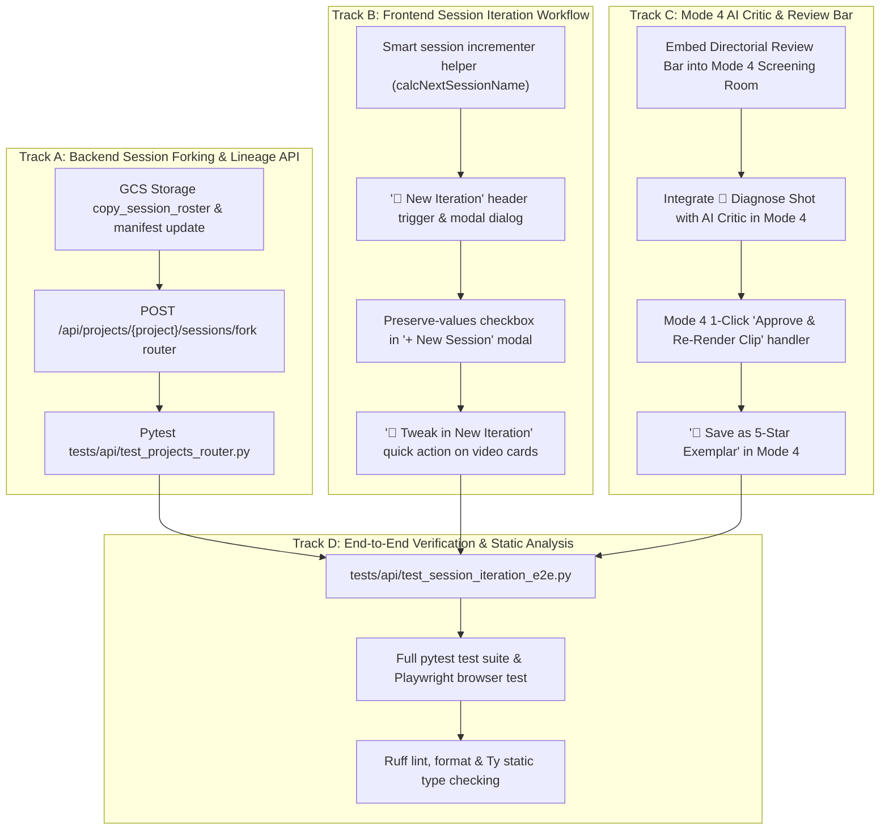

# Session Iteration Engine & Mode 4 AI Critic Integration Implementation Plan

> **For Claude:** REQUIRED SUB-SKILL: Use superpowers:executing-plans to implement this plan task-by-task.

**Goal:** Enable directors to seamlessly start a new session iteration retaining all prompt values, character roles, reference sheets, and production models for fresh Turn-0 video generations (instead of editing previously generated videos), and embed the Directorial Review Bar and AI Critic directly into Mode 4 (Director's Co-Pilot).

**Architecture:** 
1. **Backend Session Forking & Lineage API**: Add `POST /api/projects/{project_name}/sessions/fork` and `copy_session_roster` in GCS storage, tracking `parent_session_name` and `iteration_number` in session manifests.
2. **Session Iteration State Engine**: Provide a 1-click "🔄 Start New Iteration" flow that automatically increments session version tags (e.g. `price_war_v1` $\to$ `price_war_v2`), preserves all prompt and character configurations, but cleanly resets video artifacts and sets `parent_turn_id = null` for fresh Turn-0 generation.
3. **Mode 4 Screening Room AI Critic**: Colocate the Star Rating bar, defect category chips, GCS feedback logging, and `🎯 Diagnose Shot with AI Critic` card directly below the Mode 4 video player with 1-click prompt patch re-rendering.

**Tech Stack:** Python 3.12, FastAPI, Google Cloud Storage (GCS), Gemini Omni Flash 1.1 (`gemini-omni-1.1-flash`), Gemini 3.8 Flash (`gemini-3.8-flash`), Google ADK, React/Babel (in `index.html`), Tailwind CSS, Pytest, Ruff, Ty.

---

## User Review Required

> [!IMPORTANT]
> **Key Design Decision: Turn-0 Fresh Generation vs. Multi-Turn Edit**
> - In OmniMash, providing a `parent_turn_id` causes the Gemini Omni Flash client to execute a **conversational video diff** (`is_conversational_edit=True` / `task="edit"`), modifying the existing video latents.
> - When a director clicks **"🔄 Start New Iteration"**, OmniMash explicitly resets `parent_turn_id = null`, `currentVideo = ""`, and `mode4VideoUrl = ""`. When the director tweaks their prompt and clicks render, OmniMash compiles a brand new Turn-0 prompt and renders a **100% fresh video from scratch** in the new session's GCS bucket directory, completely isolated from previous video latents.

> [!NOTE]
> **Automatic Session Version Incrementing**
> - The UI will automatically suggest the next iteration identifier:
>   - `price_war_v1` $\rightarrow$ `price_war_v2`
>   - `parody_session_1` $\rightarrow$ `parody_session_2`
>   - `cyberpunk_duel` $\rightarrow$ `cyberpunk_duel_v2`
> - Directors can override the suggested name at any time.

---

## Work Breakdown & Parallelizable Tracks



---

## Detailed Bite-Sized Implementation Tasks

### Track A: Backend Session Forking & Lineage API

#### Task 1: Add `fork_session` and `copy_session_roster` to GCS Storage Manager
**Files:**
- Modify: `src/omnimash/storage/gcs.py`
- Test: `tests/storage/test_gcs_session_fork.py`

**Step 1: Write the failing test**
```python
# tests/storage/test_gcs_session_fork.py
def test_fork_session_creates_new_session_and_copies_roster():
    from omnimash.storage.gcs import GcsStorageManager

    storage = GcsStorageManager(mock_mode=True)
    storage.create_session("orig_session", project_id="prj_test")
    storage.save_project_character(
        "prj_test",
        {"role_id": "Role A", "name": "Harry", "reference_url": "https://img.jpg"},
    )

    res = storage.fork_session(
        source_session="orig_session",
        new_session="orig_session_v2",
        project_id="prj_test",
        copy_roster=True,
    )

    assert res["success"] is True
    assert res["session_name"] == "orig_session_v2"
    assert res["parent_session_name"] == "orig_session"
    assert "orig_session_v2" in storage.list_sessions("prj_test")
```

**Step 2: Run test to verify it fails**
- Command: `uv run pytest tests/storage/test_gcs_session_fork.py -v`
- Expected: `AttributeError: 'GcsStorageManager' object has no attribute 'fork_session'`

**Step 3: Implement minimal code**
- In `src/omnimash/storage/gcs.py`, implement `fork_session(source_session, new_session, project_id, copy_roster)`:
  - Validates `new_session` using `validate_safe_identifier`.
  - Creates the new session folder structure (`intermediate/`, `finalized/`, `prompts/`).
  - Writes a session manifest with `parent_session: source_session`, `created_at`, `iteration_number`.
  - If `copy_roster`, preserves character references and presets from source session manifest into the new session manifest.

**Step 4: Run test to verify it passes**
- Command: `uv run pytest tests/storage/test_gcs_session_fork.py -v`
- Expected: `1 passed`

**Step 5: Commit**
- Command: `git add tests/storage/test_gcs_session_fork.py src/omnimash/storage/gcs.py && git commit -m "feat(storage): implement session forking and lineage tracking in GcsStorageManager"`

---

#### Task 2: Expose `POST /api/projects/{project_name}/sessions/fork` Endpoint
**Files:**
- Modify: `src/omnimash/api/routers/projects.py`
- Test: `tests/api/test_projects_router.py`

**Step 1: Write the failing test**
```python
# In tests/api/test_projects_router.py
def test_fork_project_session_endpoint():
    from fastapi.testclient import TestClient
    from omnimash.api.app import app

    client = TestClient(app)
    # Create base session
    client.post(
        "/api/projects/prj_alpha/sessions/create", json={"session_name": "shot_v1"}
    )

    # Fork session
    res = client.post(
        "/api/projects/prj_alpha/sessions/fork",
        json={"source_session_name": "shot_v1", "new_session_name": "shot_v2"},
    )
    assert res.status_code == 200
    data = res.json()
    assert data["success"] is True
    assert data["session_name"] == "shot_v2"
    assert data["parent_session_name"] == "shot_v1"
```

**Step 2: Run test to verify it fails**
- Command: `uv run pytest tests/api/test_projects_router.py -k test_fork_project_session_endpoint -v`
- Expected: `404 Not Found` (endpoint does not exist)

**Step 3: Implement minimal code**
- In `src/omnimash/api/routers/projects.py`:
  - Define `ForkSessionRequest(BaseModel)` with `source_session_name: str`, `new_session_name: str`, `copy_roster: bool = True`.
  - Define `ForkSessionResponse(BaseModel)`.
  - Add `@router.post("/api/projects/{project_name}/sessions/fork", response_model=ForkSessionResponse)`.
  - Call `agent.storage.fork_session(...)`.

**Step 4: Run test to verify it passes**
- Command: `uv run pytest tests/api/test_projects_router.py -k test_fork_project_session_endpoint -v`
- Expected: `1 passed`

**Step 5: Commit**
- Command: `git add tests/api/test_projects_router.py src/omnimash/api/routers/projects.py && git commit -m "feat(api): add session forking endpoint for iterative workflows"`

---

### Track B: Frontend Session Iteration Workflow

#### Task 3: Add Session Version Incrementer & "Start New Iteration" Modal
**Files:**
- Modify: `src/omnimash/api/templates/index.html`
- Test: `tests/api/test_app.py`

**Step 1: Write the failing test**
```python
# In tests/api/test_app.py
def test_ui_html_session_iteration_controls():
    from omnimash.api.app import UI_HTML

    assert "btn-new-iteration" in UI_HTML
    assert "Start New Iteration" in UI_HTML
    assert "handleStartNewIteration" in UI_HTML
    assert "modal-title-iteration" in UI_HTML
    assert "/api/projects/" in UI_HTML and "/sessions/fork" in UI_HTML
```

**Step 2: Run test to verify it fails**
- Command: `uv run pytest tests/api/test_app.py -k test_ui_html_session_iteration_controls -v`
- Expected: `AssertionError: assert "btn-new-iteration" in UI_HTML`

**Step 3: Implement minimal code in `index.html`**
- Implement `calcNextIterationName(currSession: string): string`:
  - Match pattern `/(.*?)(?:_v|[-_])(\d+)$/i`. If matched, increments number (e.g. `price_war_v1` $\rightarrow$ `price_war_v2`).
  - If no number present, appends `_v2` (e.g. `price_war` $\rightarrow$ `price_war_v2`).
- Add state: `[showIterationModal, setShowIterationModal]`, `[iterationSessionInput, setIterationSessionInput]`, `[retainValuesForIteration, setRetainValuesForIteration]`.
- Add `handleStartNewIteration`:
  - Computes suggested next iteration name.
  - Opens iteration modal.
- Add `handleConfirmStartIteration`:
  - Calls `POST /api/projects/{project}/sessions/fork` with `source_session_name: sessionName`, `new_session_name: cleaned`.
  - Sets `sessionName = cleaned`.
  - Appends `cleaned` to `availableSessions`.
  - **Crucial**: Sets `parentTurnId = null`, `currentVideo = ""`, `mode4VideoUrl = ""`, `evaluationScorecard = null`, `history = []`, `deltaPrompt = ""`.
  - **Preserves**: `concept`, `characters`, `aestheticTags`, `environmentTag`, `cameraLightingTag`, `audioBeat`, `vocalDelivery`, `scenes`, `screenplayScript`, `stageShots`, `intentText`, `intentInputs`, `questionAnswers`, `compiledIntentPlan`.
  - Displays toast: `🔄 Started iteration '<new_session>'! Tweak your prompt and render a fresh video from scratch.`
- Add header button next to session dropdown:
  - `<button id="btn-new-iteration" onClick={handleStartNewIteration} ...>🔄 New Iteration</button>`

**Step 4: Run test to verify it passes**
- Command: `uv run pytest tests/api/test_app.py -k test_ui_html_session_iteration_controls -v`
- Expected: `1 passed`

**Step 5: Commit**
- Command: `git add tests/api/test_app.py src/omnimash/api/templates/index.html && git commit -m "feat(ui): add session iteration engine and modal to start fresh generations with current values"`

---

#### Task 4: Add "Retain Values" Option to "+ New Session" Modal & Quick Fork on Video Cards
**Files:**
- Modify: `src/omnimash/api/templates/index.html`
- Test: `tests/api/test_app.py`

**Step 1: Write the failing test**
```python
# In tests/api/test_app.py
def test_ui_html_quick_fork_buttons_on_video_cards():
    from omnimash.api.app import UI_HTML

    assert "btn-quick-fork-mode4" in UI_HTML
    assert "btn-quick-fork-act3" in UI_HTML
    assert "Tweak in New Iteration" in UI_HTML
```

**Step 2: Run test to verify it fails**
- Command: `uv run pytest tests/api/test_app.py -k test_ui_html_quick_fork_buttons_on_video_cards -v`
- Expected: `AssertionError: assert "btn-quick-fork-mode4" in UI_HTML`

**Step 3: Implement minimal code in `index.html`**
- In the "+ New Session" modal:
  - Add checkbox: `[retainSettingsInNewSession, setRetainSettingsInNewSession]` ("Keep current characters & prompt settings").
  - In `handleConfirmCreateSession`: if `retainSettingsInNewSession` is true, only reset video/turn state, do NOT call full `handleResetStudio()`.
- In Act 3 Screening Room header and Mode 4 Screening Room header:
  - Add button **`🔄 Tweak in New Iteration`**:
    - Calls `handleStartNewIteration()` directly from the video card.

**Step 4: Run test to verify it passes**
- Command: `uv run pytest tests/api/test_app.py -k test_ui_html_quick_fork_buttons_on_video_cards -v`
- Expected: `1 passed`

**Step 5: Commit**
- Command: `git add tests/api/test_app.py src/omnimash/api/templates/index.html && git commit -m "feat(ui): add quick iteration fork buttons on video screening cards"`

---

### Track C: Mode 4 AI Critic & Directorial Review Bar

#### Task 5: Embed Directorial Review Bar into Mode 4 Screening Room
**Files:**
- Modify: `src/omnimash/api/templates/index.html`
- Test: `tests/api/test_app.py`

**Step 1: Write the failing test**
```python
# In tests/api/test_app.py
def test_ui_html_mode4_directorial_review_bar_and_critic():
    from omnimash.api.app import UI_HTML

    assert "mode4-directorial-review-bar" in UI_HTML
    assert "mode4-btn-diagnose-shot" in UI_HTML
    assert "mode4-btn-submit-review" in UI_HTML
```

**Step 2: Run test to verify it fails**
- Command: `uv run pytest tests/api/test_app.py -k test_ui_html_mode4_directorial_review_bar_and_critic -v`
- Expected: `AssertionError: assert "mode4-directorial-review-bar" in UI_HTML`

**Step 3: Implement minimal code in `index.html`**
- Directly under the video player in Mode 4 (`{mode4VideoUrl && ...}`):
  - Render the **Mode 4 Directorial Review Bar**:
    - Star ratings (1-5 stars) connected to `directorRating`.
    - Defect category chips connected to `selectedDefects` & `toggleDefectSelection`.
    - Directorial critique text input connected to `critiqueText`.
    - `<button id="mode4-btn-submit-review" onClick={handleSubmitDirectorialReview}>⭐ Submit Review</button>`
    - `{directorRating === 5 && <button id="mode4-btn-save-exemplar" onClick={handleSave5StarExemplar}>🌟 Save as 5-Star Exemplar</button>}`
    - `<button id="mode4-btn-diagnose-shot" onClick={handleDiagnoseShotWithCritic}>🎯 Diagnose Shot with AI Critic</button>`
  - Ensure `handleSubmitDirectorialReview` uses `mode4VideoUrl || currentVideo` and `compiledIntentPlan?.raw_compiled_prompt || rawCompiledPrompt`.

**Step 4: Run test to verify it passes**
- Command: `uv run pytest tests/api/test_app.py -k test_ui_html_mode4_directorial_review_bar_and_critic -v`
- Expected: `1 passed`

**Step 5: Commit**
- Command: `git add tests/api/test_app.py src/omnimash/api/templates/index.html && git commit -m "feat(ui): embed directorial review bar and AI critic into Mode 4 screening room"`

---

#### Task 6: Embed AI Critic Diagnosis Card & In-Mode Re-Render into Mode 4
**Files:**
- Modify: `src/omnimash/api/templates/index.html`
- Test: `tests/api/test_app.py`

**Step 1: Write the failing test**
```python
# In tests/api/test_app.py
def test_ui_html_mode4_critic_diagnosis_card_and_patch():
    from omnimash.api.app import UI_HTML

    assert "mode4-ai-diagnosis-card" in UI_HTML
    assert "mode4-btn-approve-rerender" in UI_HTML
    assert "handleApproveMode4PromptPatch" in UI_HTML
```

**Step 2: Run test to verify it fails**
- Command: `uv run pytest tests/api/test_app.py -k test_ui_html_mode4_critic_diagnosis_card_and_patch -v`
- Expected: `AssertionError: assert "mode4-ai-diagnosis-card" in UI_HTML`

**Step 3: Implement minimal code in `index.html`**
- Directly under the Review Bar in Mode 4, when `evaluationScorecard` is truthy:
  - Render the **🎯 AI Directorial Diagnosis & Prompt Patch Card**:
    - Overall rating badge + 4-dimension score breakdown pills (Video-Text Adherence, Character Likeness, Audio-Visual Harmony, Tag & Index Integrity).
    - Verbal reflection.
    - Repaired prompt diff inspection.
    - Implement `handleApproveMode4PromptPatch`:
      - Updates `compiledIntentPlan.raw_compiled_prompt = evaluationScorecard.suggested_prompt_patch`.
      - Dispatches `handleRenderIntentDirect()` with the patched prompt.
      - Displays toast: `⚡ Re-rendering Mode 4 shot with AI Critic prompt patch...`
    - Action button: `<button id="mode4-btn-approve-rerender" onClick={handleApproveMode4PromptPatch}>⚡ Approve & Re-Render in Mode 4</button>`.

**Step 4: Run test to verify it passes**
- Command: `uv run pytest tests/api/test_app.py -k test_ui_html_mode4_critic_diagnosis_card_and_patch -v`
- Expected: `1 passed`

**Step 5: Commit**
- Command: `git add tests/api/test_app.py src/omnimash/api/templates/index.html && git commit -m "feat(ui): add AI critic diagnosis card and in-mode prompt patch re-render to Mode 4"`

---

### Track D: End-to-End Verification & Quality Gates

#### Task 7: Closed-Loop Session Iteration & Turn-0 Verification Test
**Files:**
- Create: `tests/api/test_session_iteration_e2e.py`

**Step 1: Write the test**
```python
# tests/api/test_session_iteration_e2e.py
def test_session_fork_and_turn0_regeneration_lifecycle():
    """Verify that forking a session preserves character setup, creates a clean session in GCS, and executes a fresh Turn-0 generation with parent_turn_id=None."""
    from fastapi.testclient import TestClient
    from omnimash.api.app import app

    client = TestClient(app)

    # 1. Initial generation in session 1
    gen1 = client.post(
        "/api/generate",
        json={
            "session_name": "orbit_duel_v1",
            "concept": "Astronaut chess match on Mars",
            "characters": [{"role_id": "Role A", "name": "Vance"}],
            "scenes": [{"scene_number": 1, "action": "Moves pawn on Mars"}],
        },
    )
    assert gen1.status_code == 200
    assert gen1.json()["turn_id"] == "turn_0"

    # 2. Fork session to v2
    fork_res = client.post(
        "/api/projects/prj_default/sessions/fork",
        json={
            "source_session_name": "orbit_duel_v1",
            "new_session_name": "orbit_duel_v2",
        },
    )
    assert fork_res.status_code == 200
    assert fork_res.json()["session_name"] == "orbit_duel_v2"

    # 3. Generate in v2 with tweaked prompt and parent_turn_id=None (Turn-0 from scratch)
    gen2 = client.post(
        "/api/generate",
        json={
            "session_name": "orbit_duel_v2",
            "concept": "Astronaut chess match on Mars with neon board",
            "characters": [{"role_id": "Role A", "name": "Vance"}],
            "scenes": [
                {
                    "scene_number": 1,
                    "action": "Moves neon pawn in zero gravity dust",
                }
            ],
            "parent_turn_id": None,
        },
    )
    assert gen2.status_code == 200
    res2 = gen2.json()
    assert res2["turn_id"] == "turn_0"  # Brand new Turn-0 from scratch
    assert "orbit_duel_v2" in res2["video_url"]
```

**Step 2: Run test to verify it passes**
- Command: `uv run pytest tests/api/test_session_iteration_e2e.py -v`
- Expected: `1 passed`

**Step 3: Commit**
- Command: `git add tests/api/test_session_iteration_e2e.py && git commit -m "test(api): verify session iteration lifecycle and fresh Turn-0 generation from scratch"`

---

#### Task 8: Full Suite, Playwright Browser Verification & Static Analysis
**Files:**
- All touched files

**Step 1: Run full unit & API test suite**
- Command: `uv run pytest -m "not browser" -n auto`
- Expected: 800+ passed

**Step 2: Run browser rendering test**
- Command: `uv run pytest tests/api/test_app.py -k "test_ui_html_syntax_and_tag_balance or test_ui_html_renders_in_browser_without_syntax_error" -o "addopts=" -v`
- Expected: 2 passed, 100% JSX tag balance verified

**Step 3: Run static type checker and linter**
- Command: `uv run ruff check .`
- Command: `uv run ruff format --check src tests`
- Command: `uv run ty check`
- Expected: 0 errors across all checks

---

## Verification Plan

### Automated Tests
```bash
# 1. Target tests for session forking
uv run pytest tests/storage/test_gcs_session_fork.py -v
uv run pytest tests/api/test_projects_router.py -v

# 2. UI HTML tag balance and DOM tests
uv run pytest tests/api/test_app.py -k "iteration or review_bar or critic or syntax" -v

# 3. End-to-end iteration lifecycle
uv run pytest tests/api/test_session_iteration_e2e.py -v

# 4. Full test suite (all ~800 tests)
uv run pytest -m "not browser" -n auto

# 5. Playwright headless browser render
uv run pytest tests/api/test_app.py -k test_ui_html_renders_in_browser_without_syntax_error -o "addopts=" -v

# 6. Static analysis
uv run ruff check .
uv run ty check
```

### Manual Verification Instructions
1. Open local studio at `http://localhost:8000` or Cloud Run URL.
2. Select or type a concept in **Mode 4 (Director's Co-Pilot)** (e.g. *"Astronaut chess battle"*).
3. Click **"Synthesize Production Plan"** $\rightarrow$ Click **"Direct Video Render"**.
4. Once rendered:
   - Verify the **⭐ Directorial Review Bar** appears directly beneath the Mode 4 video player.
   - Click a star rating (e.g. 3 stars) and click **"🎯 Diagnose Shot with AI Critic"**.
   - Verify the **🎯 AI Directorial Diagnosis Card** renders inline with 4 dimension scores and verbal reflection.
   - Click **"Approve & Re-Render in Mode 4"** to verify the prompt is patched and re-rendered directly.
5. In the header or on the video card:
   - Click **"🔄 New Iteration"**.
   - Confirm the modal pre-fills `price_war_v2` and has "Retain current characters & prompt settings" checked.
   - Click **"Create & Start Iteration"**.
   - Verify your concept, characters, and prompt values are 100% preserved, while the video canvas and turn thread are freshly reset (`parent_turn_id = null`).
   - Tweak a word in the prompt and click render. Verify a fresh **Turn-0** video is generated and saved under `.../sessions/price_war_v2/...`!
